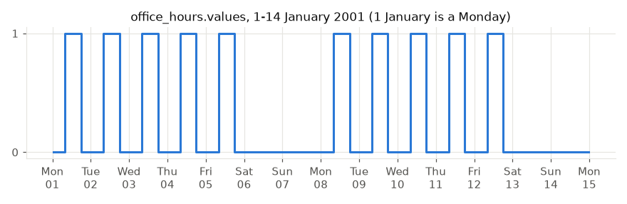
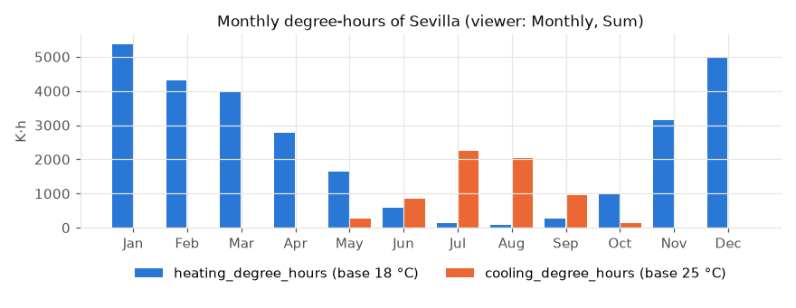
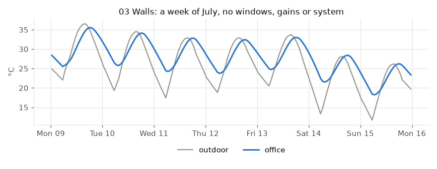
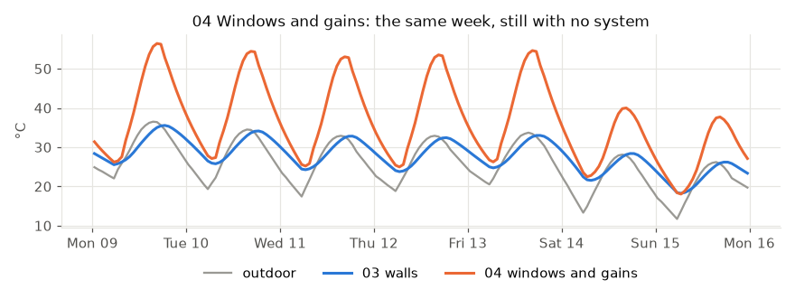
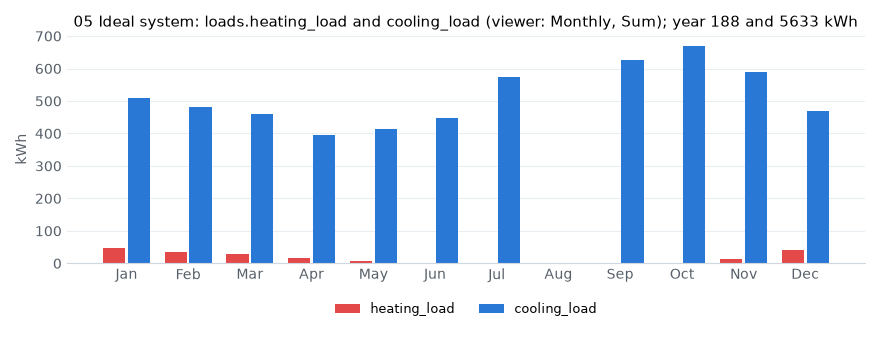
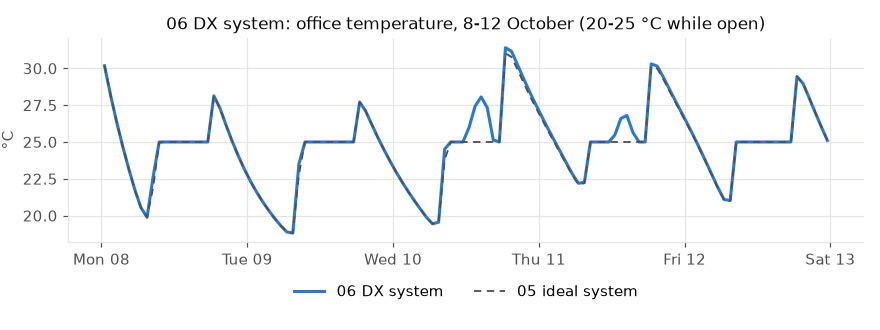
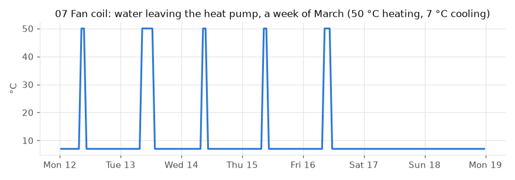
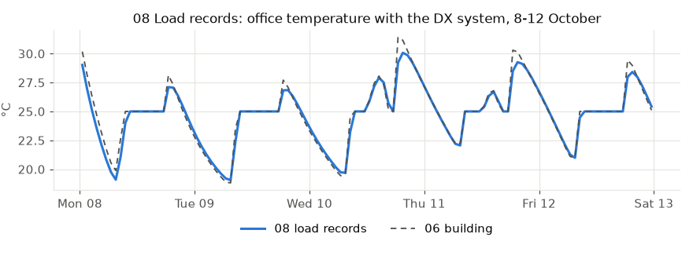

## Examples

A gallery of projects that build on each other: each one of the first seven is the previous one plus one new idea, from a schedule with no building at all to an office conditioned by a fan coil and a heat pump. The eighth goes back to the sixth and replaces the building by a record of its loads. They all use the weather of Sevilla (Spain) and, from the third on, the same building (the eighth, its loads): the 8 × 6 × 2.7 m box of the ASHRAE Standard 140 test cases, with lightweight walls and roof and a floor that loses almost no heat.

They come with opensimula. To get them, together with the weather and load files they read, run in a terminal:

<pre>
opensimula examples
cd opensimula_examples
opensimula gui 01_schedules.json
</pre>

`opensimula examples` copies them to the folder `opensimula_examples` (or to the folder given after it) and never overwrites a file already there, so edited examples are safe. `opensimula gui` opens one in the [OpenSimula app](user_guide.md#opensimula-app), which needs the `gui` extra (`pip install "opensimula[gui]"`): look at its components in the editor, press **Simulate** and pick its variables in the results viewer. Every component has a `description` that says what it is for. They can also be read in a notebook, from the same folder:

<pre><code class="python">
import opensimula as osm

sim = osm.Simulation()
pro = sim.new_project("example")
pro.read_json("05_ideal_system.json")
pro.simulate()
pro.results("office.temperature", "office.system_sensible_heat")
</code></pre>

| Example | What it adds | Components |
|---|---|---|
| [01 Schedules](#01-schedules) | Day, week and year schedules | 5 |
| [02 Weather](#02-weather) | A weather file and a calculator | 7 |
| [03 Walls](#03-walls) | Materials, constructions, a building and a space | 25 |
| [04 Windows and gains](#04-windows-and-gains) | Windows, and people, lights and equipment | 29 |
| [05 Ideal system](#05-ideal-system) | An ideal system: the heating and cooling loads | 31 |
| [06 DX system](#06-dx-system) | A real air-to-air heat pump | 32 |
| [07 Fan coil](#07-fan-coil) | A fan coil, a water loop and an air-to-water heat pump | 37 |
| [08 Load records](#08-load-records) | The system of 06 against a record of the loads, without the building | 12 |

### 01 Schedules

**New:** `Day_schedule`, `Week_schedule`, `Year_schedule`.

There is no building and no weather: a project is just a list of components that refer to each other by name. `working_day` is 1 from 8:00 to 18:00 and 0 the rest of the day, `closed_day` is always 0; `working_week` uses the first from Monday to Friday and the second at the weekend, and `office_hours` uses the working week all year except August. Simulating the project gives `office_hours` a value for every hour of the year, its variable `values`, which the next examples use to switch people, lights and systems on and off.

*Try:* change the hours of `working_day`, or make Saturday morning a working day with a third day schedule.

### 02 Weather

**New:** `File_met`, `Calculator`, the project parameter `simulation_file_met`.

`sevilla` reads the hourly weather of Sevilla from `sevilla.met`: temperature, humidity, solar radiation, wind and sky temperature, all of them variables of the component. `degree_hours` is a calculator: it takes variables of other components (`T = sevilla.temperature`) and computes new ones with mathematical expressions, here the heating and cooling degree-hours. The file name is relative, so it is read from the folder the app or the notebook is started from.

In the results viewer, pick both variables of `degree_hours` and set **Frequency** to Monthly and **Aggregation** to Sum: the bars are the degree-hours of each month.

*Try:* add an output with the outdoor temperature in °F, or degree-hours with another base temperature.

### 03 Walls

**New:** `Material`, `Construction`, `Building`, `Space_type`, `Space`, `Building_surface`.

A closed box with no windows, no internal gains and no system. Each construction lists its materials and thicknesses from outside to inside; the six surfaces are placed with their reference point, size, azimuth and altitude, and refer to the construction they are made of and to the space they enclose. The space type `empty` has no gains and 0.5 air changes per hour of infiltration. The **Show 3D** and **Show graph** buttons of the editor show the box and how its components refer to each other.

The temperature of the office (`office.temperature`) follows the outdoor one, a few degrees above it because of the sun on the walls and roof, with its swing reduced and delayed a couple of hours by the walls.

*Try:* make the insulation (`fiberglass_quilt`) thicker or thinner, or the walls heavier, and look at the swing and the delay.

### 04 Windows and gains

**New:** `Glazing`, `Opening_type`, `Opening`, and a `Space_type` driven by a schedule.

Two windows of 3 × 2 m on the south wall, 12 m² of glass for 48 m² of floor, and the office use: one person per 10 m², 10 W/m² of lights and 8 W/m² of computers. The space type `office_use` reads the schedule of the first example (`f = office_hours.values`) and multiplies its densities by it (`"0.1 * f"`), so the gains are only there while the office is open. With no system, the office overheats far above the outdoor temperature: this is why buildings need cooling, and why the size and orientation of windows matter.

*Try:* make the windows smaller, or move one of them to the north wall.

### 05 Ideal system

**New:** `HVAC_perfect_system`, and a second `Calculator`.

An ideal system works while the office is open (`system_on_off` = `"f"`): it supplies exactly the heat needed to keep the office between 20 and 25 °C, and brings in the outdoor air of five people. As the system ventilates while the office is open, the office use now has infiltration only while it is closed, `"0.5 * (1 - f)"`. What it supplies is the load of the space: `office.system_sensible_heat` (positive heating, negative cooling) and `office.system_latent_heat`. The calculator `loads` splits the sensible one into `heating_load` and `cooling_load`, both positive and in kW: with hourly steps, their sum over a month (**Frequency** Monthly, **Aggregation** Sum) is the energy of that month in kWh, the bars below. The same split, for one variable at a time, is the aggregation "Sum of positives" or "Sum of negatives" of `office.system_sensible_heat`.

The large south glazing, the lightweight construction and the internal gains make this office need cooling all year: in winter the low sun enters the south windows. It is an extreme building on purpose, the same as in the ASHRAE 140 tests.

*Try:* compare the loads with smaller windows, or with the system working all day (`system_on_off` = `"1"`).

### 06 DX system

**New:** `DX_unit`, `HVAC_DX_system`.

The ideal system is replaced by a real piece of equipment: an air-to-air heat pump with a rated capacity and power, and curves that correct them with the indoor and outdoor conditions (the `*_expression` parameters of `heat_pump`). The system `dx_system` uses it to serve the office while it is open, at 20-25 °C and with 15 % of outdoor air. Its variables give what it supplies (`Q_sensible`, `Q_latent`), what it consumes (`power`) and its efficiency (`EER`, `COP`); `loads` still gives the loads of the office, to compare them with those of the ideal system. The ideal system has no limit; the heat pump has. In September and October, when the low sun enters the south windows and the cooling load is highest, it falls short for a few hours and the office rises above 25 °C (up to 28 °C on 10 October): a real system is not ideal. Part of its capacity does not even cool the air: its coil is below the dew point and condenses water, so about 1 kW of its 6.9 kW goes into dehumidifying (`Q_latent`), while the ideal system, with no humidity limit, spends all its power on the temperature (`Q_sensible`). At part load the heat pump cycles on and off, which lowers its efficiency a little: `EER_expression` and `COP_expression` are `"0.85 + 0.15 * F_load"`, 7.5 % less at half load. `EER` and `COP` are 0 in the hours the unit does not cool or heat, so their monthly **Mean** counts those hours too: **Mean without zeros** gives the mean while it runs, about 2.3-3.0 for the EER. The COP is lower, around 1.4, because in winter the unit works at about a fifth of its capacity and its indoor fan, which runs all the time the office is open to bring in the outdoor air, takes a large share of the power.

*Try:* give the heat pump more or less capacity and look at the hours above 25 °C and the energy it uses.

### 07 Fan coil

**New:** `Fan`, `Water_coil`, `HVAC_SZW_system`, `Pump`, `Chiller_heat_pump`, `HVAC_water_generator`, `HVAC_water_system`.

The air system is now a fan coil: a fan and a water coil in the office, working while it is open at 20-25 °C and with 15 % of outdoor air, fed with hot or chilled water by a water loop. The loop `water_system` has one generator, `generator`: a reversible air-to-water heat pump with its pump. With `system_control` "LOAD_CONTROL" it heats the water to 50 °C or cools it to 7 °C depending on what the coil asks for. In spring, when the mornings are cold and the afternoons sunny, it changes mode within the same day. The heat pump has a nominal EER of 3.0 and COP of 3.2, and the same part-load degradation as the DX unit. Its efficiency is `generator.efficiency` (also `water_system.generator_efficiency`), its EER or COP, 0 while it is off: as for the DX unit, **Mean without zeros** gives its monthly mean while it runs, about 2.5-3.1.

*Try:* set `system_control` to "SCHEDULE_CONTROL", with a year schedule of heating and cooling seasons in `system_mode`, as a two-pipe installation works: on sunny winter days the office overheats, because the loop can only heat.

### 08 Load records

**New:** `Load_space`, `File_data`.

The DX system of example 06 again, but the office is no longer made of walls, windows and gains: it is a `Load_space`, defined by a record of its hourly loads. This is how an HVAC installation is simulated when the loads come from another program or from measurements, or to try many systems quickly: without the walls and windows, the year simulates in half the time here, and in much less in a large building. `load_record` reads `office_loads.csv`, the loads of the box of the examples calculated with the ideal system of example 05 holding 24 °C and 50 % all year, with no outdoor air and 0.5 air changes per hour; they are the `reference_temperature`, `reference_humidity` and `load_infiltration` of `office`. As in examples 05-07, the infiltration of the office is only there while it is closed, `"0.5 * (1 - f)"`: the `Load_space` takes the record's infiltration out of the loads and adds the one simulated, at the temperature and humidity the office actually has.

When the system does not supply the load, at night, at weekends, or when the DX unit falls short, the office departs from 24 °C following a model of two nodes, its air and the thermal mass of the building. Its mass is given by a construction class, `MEDIUM` by default; the box of the examples is the very light one of the ASHRAE 140 tests, lighter than any real building, so here it is `CUSTOM`, 20 kJ/(m²·K) of mass on 1 m² per m² of floor, with an envelope conductance of 1.8 W/(m²·K) of floor (a small box exposed on every side). With them the office behaves almost as the building of example 06: 5722 kWh of cooling load in the year against 5612, 2631 kWh used by the heat pump against 2569, and 20 hours above 25.5 °C while open against 18. The heating load is 300 kWh against 188: small, and where the model of two nodes is furthest from the building, cold nights and weekends with the sun of winter.

*Try:* change `construction` to `MEDIUM` or `HEAVY` and look at how the temperature swings while the office is closed; or make your own record: in example 05, set the ideal system to 24 °C and 50 % all day, simulate, pick `office.system_sensible_heat` and `office.system_latent_heat` in the results viewer and download them with **CSV**. Rename their columns to `Q_sensible [W]` and `Q_latent [W]` (a variable name cannot have the dot of `office.`) and give the file to `load_record`.
