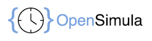
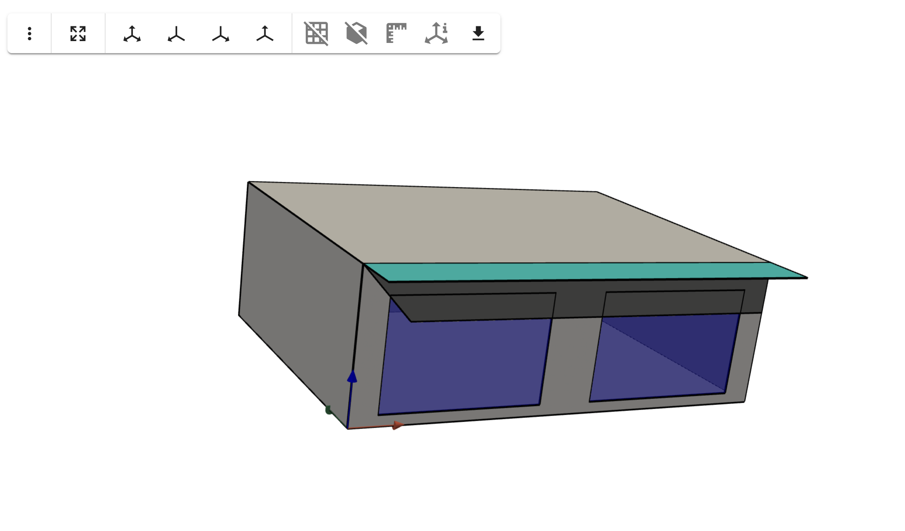
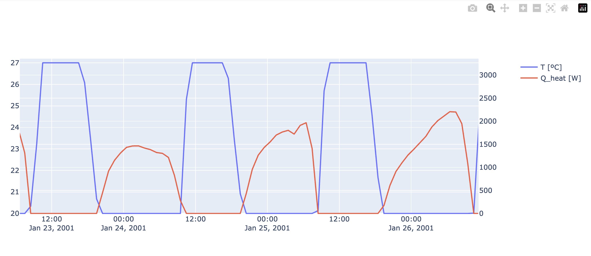
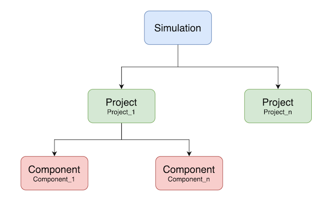
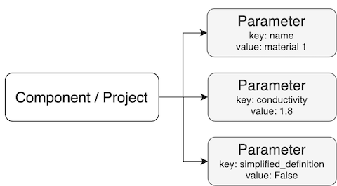
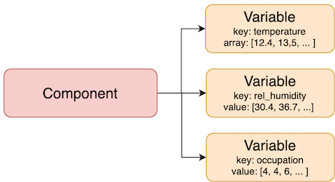

 

This site contains the documentation for the
___opensimula___ project. Github site 

`opensimula` is a component-based time simulation environment in Python. 

The main objective is the thermal and energy simulation of different systems and installations, mainly in buildings, although it can be used to simulate any component that presents a temporal variation.

### Structure

The general object structure provided by opensimula is composed of three main elements:

- Simulation: The global environment for simulation.
- Project: A set of components that define a problem that can be temporarily simulated.
- Component: These are the base elements on which the simulation is performed. The types of components currently available can be consulted in section [Component list](component_list.md).

### Parameters

**Parameters** are used to define the characteristics that make up the projects and components. 

Parameters can be of different types depending on the type of information they contain (strings, boolean, integer, float, options, ...). A list of all parameter types and their possibilities can be found in the [User guide](user_guide.md#parameters). :

### Variables

**Variables** are elements included in the components to store the temporal 
information generated during the simulation.

## Documentation

1. [Getting started](getting_started.md)
2. [User guide](user_guide.md)
3. [Component list](component_list.md)
3. [Developer guide](developer_guide.md)

## Release notes

__Current Version 0.11.0__ (November 26, 2026): domestic hot water and solar thermal on the water plants (demands, storage tanks, solar collectors, generators in series, DHW priority), variable water flow, energy and comfort indicators, verification of the Spanish CTE DB-HE (HE0 and HE4), and help in the app for every parameter and variable. One variable of the water plants has a new name (`Q_coils` is `Q_loads`).

The changes of every version, and how to upgrade from earlier ones, are in the [Release notes](release_notes.md).
