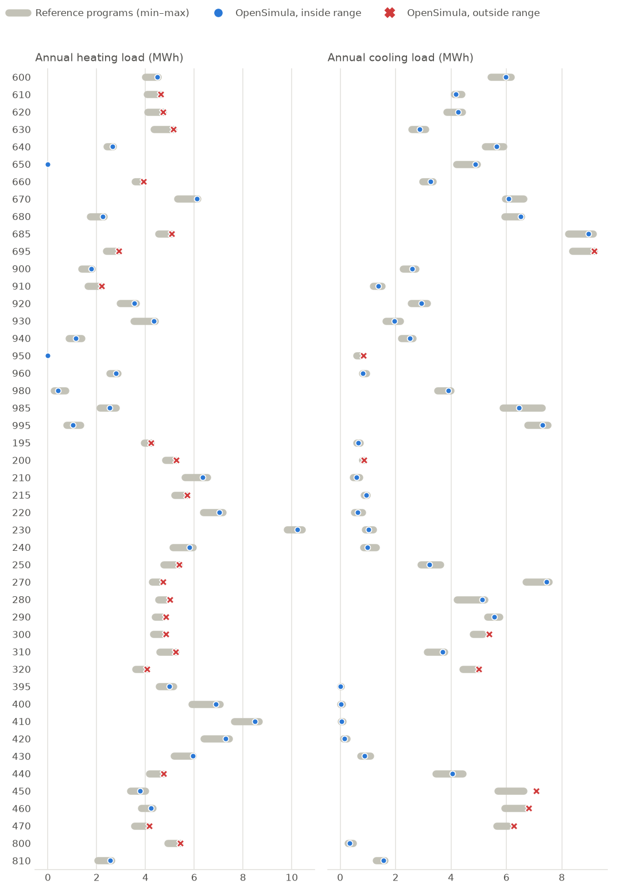
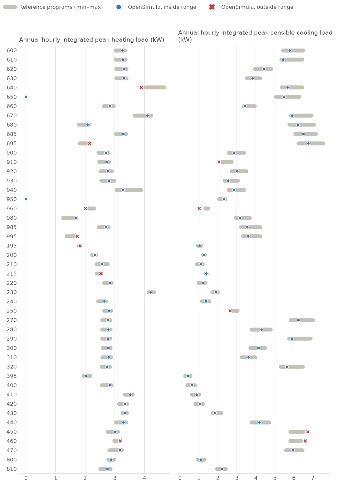
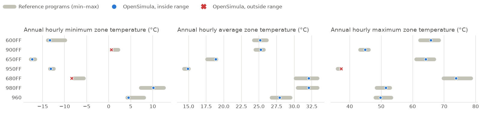

# Validation: ASHRAE Standard 140

OpenSimula is tested with the method of test of ANSI/ASHRAE Standard 140-2023, *Standard Method of Test for the Evaluation of Building Energy Analysis Computer Programs*. For each output the Standard asks for, the OpenSimula result is compared with the range (minimum and maximum) of the example results of the reference programs published with the Standard.

The range shows how much well-established programs differ from each other; it is not the Standard's formal acceptance criteria. A result outside the range is a prompt to look into that case, not necessarily an error.

*Generated by `ASHRAE_140/validation/validate.py` with OpenSimula 0.8.7 on 2026-10-22. The test case definitions are in the `ASHRAE_140` folder of the repository.*

## Building thermal envelope and fabric load tests (Section 7)

Reference programs: BSIMAC, CSE, DeST, EnergyPlus, ESP-r, TRNSYS (example results from `Std140_TF_Results.xlsx`).

| Output | Cases | Inside range | Outside range |
|---|--:|--:|--:|
| Annual heating load (MWh) | 46 | 26 | 20 |
| Annual cooling load (MWh) | 46 | 38 | 8 |
| Annual hourly integrated peak heating load (kW) | 46 | 39 | 7 |
| Annual hourly integrated peak sensible cooling load (kW) | 46 | 41 | 5 |
| Annual hourly average zone temperature (°C) | 7 | 7 | 0 |
| Annual hourly minimum zone temperature (°C) | 7 | 5 | 2 |
| Annual hourly maximum zone temperature (°C) | 7 | 6 | 1 |
| **Total** | **205** | **162** | **43** |

### Annual loads

### Peak loads

### Free-float zone temperatures

### Detailed results

#### Annual heating load (MWh)

| Case | OpenSimula | Min | Max | Programs | Result |
|---|--:|--:|--:|--:|---|
| 600 | 4.490 | 3.993 | 4.504 | 6 | ✓ inside |
| 610 | 4.621 | 4.066 | 4.592 | 6 | ✗ +0.6 % above max |
| 620 | 4.723 | 4.094 | 4.719 | 6 | ✗ +0.1 % above max |
| 630 | 5.143 | 4.356 | 5.139 | 6 | ✗ +0.1 % above max |
| 640 | 2.644 | 2.403 | 2.682 | 6 | ✓ inside |
| 650 | 0.000 | 0.000 | 0.000 | 6 | ✓ inside |
| 660 | 3.932 | 3.574 | 3.821 | 6 | ✗ +2.9 % above max |
| 670 | 6.113 | 5.300 | 6.140 | 6 | ✓ inside |
| 680 | 2.245 | 1.732 | 2.286 | 6 | ✓ inside |
| 685 | 5.077 | 4.532 | 5.042 | 6 | ✗ +0.7 % above max |
| 695 | 2.899 | 2.385 | 2.892 | 6 | ✗ +0.2 % above max |
| 900 | 1.779 | 1.379 | 1.814 | 6 | ✓ inside |
| 910 | 2.195 | 1.648 | 2.163 | 6 | ✗ +1.5 % above max |
| 920 | 3.542 | 2.956 | 3.607 | 6 | ✓ inside |
| 930 | 4.352 | 3.524 | 4.384 | 6 | ✓ inside |
| 940 | 1.132 | 0.863 | 1.389 | 6 | ✓ inside |
| 950 | 0.000 | 0.000 | 0.000 | 6 | ✓ inside |
| 960 | 2.786 | 2.522 | 2.860 | 5 | ✓ inside |
| 980 | 0.425 | 0.246 | 0.720 | 6 | ✓ inside |
| 985 | 2.543 | 2.120 | 2.801 | 6 | ✓ inside |
| 995 | 1.027 | 0.755 | 1.330 | 6 | ✓ inside |
| 195 | 4.234 | 3.951 | 4.217 | 6 | ✗ +0.4 % above max |
| 200 | 5.251 | 4.813 | 5.226 | 6 | ✗ +0.5 % above max |
| 210 | 6.354 | 5.627 | 6.531 | 6 | ✓ inside |
| 215 | 5.717 | 5.181 | 5.697 | 6 | ✗ +0.4 % above max |
| 220 | 7.017 | 6.377 | 7.178 | 6 | ✓ inside |
| 230 | 10.218 | 9.812 | 10.417 | 6 | ✓ inside |
| 240 | 5.811 | 5.116 | 5.944 | 6 | ✓ inside |
| 250 | 5.380 | 4.733 | 5.373 | 6 | ✗ +0.1 % above max |
| 270 | 4.715 | 4.273 | 4.631 | 5 | ✗ +1.8 % above max |
| 280 | 5.008 | 4.525 | 4.870 | 5 | ✗ +2.8 % above max |
| 290 | 4.850 | 4.381 | 4.745 | 5 | ✗ +2.2 % above max |
| 300 | 4.840 | 4.318 | 4.726 | 5 | ✗ +2.4 % above max |
| 310 | 5.249 | 4.580 | 5.240 | 5 | ✗ +0.2 % above max |
| 320 | 4.061 | 3.599 | 4.031 | 5 | ✗ +0.7 % above max |
| 395 | 4.975 | 4.565 | 5.145 | 6 | ✓ inside |
| 400 | 6.883 | 5.906 | 7.047 | 6 | ✓ inside |
| 410 | 8.478 | 7.630 | 8.661 | 6 | ✓ inside |
| 420 | 7.279 | 6.399 | 7.433 | 6 | ✓ inside |
| 430 | 5.949 | 5.171 | 5.954 | 6 | ✓ inside |
| 440 | 4.742 | 4.156 | 4.721 | 5 | ✗ +0.4 % above max |
| 450 | 3.769 | 3.375 | 3.990 | 6 | ✓ inside |
| 460 | 4.236 | 3.828 | 4.290 | 6 | ✓ inside |
| 470 | 4.144 | 3.540 | 4.094 | 6 | ✗ +1.2 % above max |
| 800 | 5.427 | 4.906 | 5.403 | 6 | ✗ +0.4 % above max |
| 810 | 2.564 | 2.038 | 2.610 | 5 | ✓ inside |

#### Annual cooling load (MWh)

| Case | OpenSimula | Min | Max | Programs | Result |
|---|--:|--:|--:|--:|---|
| 600 | 5.968 | 5.432 | 6.162 | 6 | ✓ inside |
| 610 | 4.181 | 4.117 | 4.382 | 6 | ✓ inside |
| 620 | 4.258 | 3.841 | 4.404 | 6 | ✓ inside |
| 630 | 2.861 | 2.573 | 3.074 | 6 | ✓ inside |
| 640 | 5.654 | 5.237 | 5.893 | 6 | ✓ inside |
| 650 | 4.882 | 4.186 | 4.945 | 6 | ✓ inside |
| 660 | 3.256 | 2.966 | 3.340 | 6 | ✓ inside |
| 670 | 6.084 | 5.954 | 6.623 | 6 | ✓ inside |
| 680 | 6.517 | 5.932 | 6.529 | 6 | ✓ inside |
| 685 | 8.959 | 8.238 | 9.130 | 6 | ✓ inside |
| 695 | 9.175 | 8.386 | 9.172 | 6 | ✗ +0.0 % above max |
| 900 | 2.599 | 2.267 | 2.714 | 6 | ✓ inside |
| 910 | 1.385 | 1.191 | 1.490 | 6 | ✓ inside |
| 920 | 2.930 | 2.549 | 3.128 | 6 | ✓ inside |
| 930 | 1.950 | 1.654 | 2.161 | 6 | ✓ inside |
| 940 | 2.523 | 2.203 | 2.613 | 6 | ✓ inside |
| 950 | 0.834 | 0.586 | 0.707 | 6 | ✗ +18.0 % above max |
| 960 | 0.823 | 0.789 | 0.950 | 5 | ✓ inside |
| 980 | 3.906 | 3.501 | 3.995 | 6 | ✓ inside |
| 985 | 6.444 | 5.880 | 7.273 | 6 | ✓ inside |
| 995 | 7.303 | 6.771 | 7.482 | 6 | ✓ inside |
| 195 | 0.657 | 0.592 | 0.712 | 6 | ✓ inside |
| 200 | 0.860 | 0.788 | 0.839 | 6 | ✗ +2.4 % above max |
| 210 | 0.580 | 0.459 | 0.688 | 6 | ✓ inside |
| 215 | 0.939 | 0.850 | 0.952 | 6 | ✓ inside |
| 220 | 0.635 | 0.498 | 0.803 | 6 | ✓ inside |
| 230 | 1.022 | 0.897 | 1.184 | 6 | ✓ inside |
| 240 | 0.983 | 0.834 | 1.287 | 6 | ✓ inside |
| 250 | 3.219 | 2.904 | 3.612 | 6 | ✓ inside |
| 270 | 7.457 | 6.698 | 7.522 | 5 | ✓ inside |
| 280 | 5.129 | 4.215 | 5.206 | 5 | ✓ inside |
| 290 | 5.570 | 5.310 | 5.743 | 5 | ✓ inside |
| 300 | 5.373 | 4.805 | 5.152 | 5 | ✗ +4.3 % above max |
| 310 | 3.704 | 3.128 | 3.752 | 5 | ✓ inside |
| 320 | 4.997 | 4.420 | 4.986 | 5 | ✗ +0.2 % above max |
| 395 | 0.010 | 0.004 | 0.021 | 6 | ✓ inside |
| 400 | 0.030 | 0.013 | 0.063 | 6 | ✓ inside |
| 410 | 0.060 | 0.035 | 0.096 | 6 | ✓ inside |
| 420 | 0.151 | 0.109 | 0.228 | 6 | ✓ inside |
| 430 | 0.870 | 0.739 | 1.084 | 6 | ✓ inside |
| 440 | 4.049 | 3.458 | 4.414 | 5 | ✓ inside |
| 450 | 7.073 | 5.689 | 6.613 | 6 | ✗ +7.0 % above max |
| 460 | 6.807 | 5.929 | 6.729 | 6 | ✗ +1.2 % above max |
| 470 | 6.272 | 5.644 | 6.056 | 6 | ✗ +3.6 % above max |
| 800 | 0.341 | 0.282 | 0.473 | 6 | ✓ inside |
| 810 | 1.569 | 1.295 | 1.606 | 5 | ✓ inside |

#### Annual hourly integrated peak heating load (kW)

| Case | OpenSimula | Date | Min | Max | Programs | Result |
|---|--:|---|--:|--:|--:|---|
| 600 | 3.253 | Dec 31 24 | 3.020 | 3.359 | 6 | ✓ inside |
| 610 | 3.258 | Dec 31 24 | 3.021 | 3.360 | 6 | ✓ inside |
| 620 | 3.294 | Dec 31 24 | 3.038 | 3.385 | 6 | ✓ inside |
| 630 | 3.299 | Dec 31 24 | 3.039 | 3.388 | 6 | ✓ inside |
| 640 | 3.878 | Feb 8 9 | 4.039 | 4.658 | 6 | ✗ -4.0 % below min |
| 650 | 0.000 | Jan 25 12 | 0.000 | 0.000 | 6 | ✓ inside |
| 660 | 2.824 | Dec 31 24 | 2.620 | 2.955 | 6 | ✓ inside |
| 670 | 4.089 | Dec 31 24 | 3.655 | 4.221 | 6 | ✓ inside |
| 680 | 2.068 | Dec 31 24 | 1.778 | 2.126 | 6 | ✓ inside |
| 685 | 3.276 | Dec 31 24 | 3.032 | 3.374 | 6 | ✓ inside |
| 695 | 2.141 | Dec 31 24 | 1.795 | 2.138 | 6 | ✗ +0.2 % above max |
| 900 | 2.688 | Feb 9 6 | 2.443 | 2.778 | 6 | ✓ inside |
| 910 | 2.717 | Feb 9 6 | 2.469 | 2.799 | 6 | ✓ inside |
| 920 | 2.756 | Feb 9 6 | 2.512 | 2.895 | 6 | ✓ inside |
| 930 | 2.792 | Feb 9 6 | 2.537 | 2.968 | 6 | ✓ inside |
| 940 | 3.273 | Dec 31 9 | 3.052 | 3.882 | 6 | ✓ inside |
| 950 | 0.000 | Jan 5 14 | 0.000 | 0.000 | 6 | ✓ inside |
| 960 | 2.000 | Feb 9 6 | 2.085 | 2.300 | 5 | ✗ -4.1 % below min |
| 980 | 1.669 | Feb 9 6 | 1.254 | 1.693 | 6 | ✓ inside |
| 985 | 2.694 | Feb 9 6 | 2.452 | 2.785 | 6 | ✓ inside |
| 995 | 1.718 | Feb 9 6 | 1.370 | 1.711 | 6 | ✗ +0.4 % above max |
| 195 | 1.820 | Dec 31 24 | 1.791 | 1.802 | 6 | ✗ +1.0 % above max |
| 200 | 2.320 | Dec 31 24 | 2.226 | 2.353 | 6 | ✓ inside |
| 210 | 2.557 | Dec 31 24 | 2.374 | 2.750 | 6 | ✓ inside |
| 215 | 2.522 | Dec 31 24 | 2.390 | 2.521 | 6 | ✗ +0.0 % above max |
| 220 | 2.814 | Dec 31 24 | 2.631 | 2.879 | 6 | ✓ inside |
| 230 | 4.201 | Dec 31 24 | 4.133 | 4.316 | 6 | ✓ inside |
| 240 | 2.637 | Dec 31 24 | 2.431 | 2.693 | 6 | ✓ inside |
| 250 | 2.805 | Dec 31 24 | 2.631 | 2.874 | 6 | ✓ inside |
| 270 | 2.760 | Dec 31 24 | 2.560 | 2.843 | 5 | ✓ inside |
| 280 | 2.775 | Dec 31 24 | 2.568 | 2.849 | 5 | ✓ inside |
| 290 | 2.762 | Dec 31 24 | 2.561 | 2.843 | 5 | ✓ inside |
| 300 | 2.780 | Dec 31 24 | 2.589 | 2.854 | 5 | ✓ inside |
| 310 | 2.786 | Dec 31 24 | 2.580 | 2.856 | 5 | ✓ inside |
| 320 | 2.730 | Dec 31 24 | 2.546 | 2.834 | 5 | ✓ inside |
| 395 | 2.008 | Dec 31 24 | 1.948 | 2.161 | 6 | ✓ inside |
| 400 | 2.814 | Dec 31 24 | 2.559 | 2.879 | 6 | ✓ inside |
| 410 | 3.508 | Dec 31 24 | 3.338 | 3.597 | 6 | ✓ inside |
| 420 | 3.331 | Dec 31 24 | 3.138 | 3.411 | 6 | ✓ inside |
| 430 | 3.325 | Dec 31 24 | 3.254 | 3.409 | 6 | ✓ inside |
| 440 | 3.277 | Dec 31 24 | 3.027 | 3.374 | 5 | ✓ inside |
| 450 | 3.011 | Dec 31 24 | 2.753 | 3.100 | 6 | ✓ inside |
| 460 | 3.179 | Dec 31 24 | 2.971 | 3.160 | 6 | ✗ +0.6 % above max |
| 470 | 3.170 | Dec 31 24 | 2.807 | 3.231 | 6 | ✓ inside |
| 800 | 2.872 | Feb 9 6 | 2.778 | 2.967 | 6 | ✓ inside |
| 810 | 2.744 | Feb 9 6 | 2.500 | 2.845 | 5 | ✓ inside |

#### Annual hourly integrated peak sensible cooling load (kW)

| Case | OpenSimula | Date | Min | Max | Programs | Result |
|---|--:|---|--:|--:|--:|---|
| 600 | 5.774 | Jan 22 14 | 5.422 | 6.481 | 6 | ✓ inside |
| 610 | 5.436 | Dec 1 14 | 5.331 | 6.432 | 6 | ✓ inside |
| 620 | 4.416 | Jun 26 17 | 3.955 | 4.797 | 6 | ✓ inside |
| 630 | 3.817 | Jun 26 18 | 3.526 | 4.212 | 6 | ✓ inside |
| 640 | 5.666 | Jan 22 14 | 5.365 | 6.429 | 6 | ✓ inside |
| 650 | 5.474 | Oct 18 14 | 5.045 | 6.290 | 6 | ✓ inside |
| 660 | 3.414 | Oct 18 14 | 3.343 | 3.933 | 6 | ✓ inside |
| 670 | 5.906 | Oct 18 14 | 5.839 | 6.925 | 6 | ✓ inside |
| 680 | 6.194 | Jan 22 14 | 5.761 | 7.051 | 6 | ✓ inside |
| 685 | 6.494 | Jan 22 14 | 6.071 | 7.159 | 6 | ✓ inside |
| 695 | 6.765 | Jan 22 14 | 6.232 | 7.541 | 6 | ✓ inside |
| 900 | 2.842 | Oct 1 14 | 2.556 | 3.376 | 6 | ✓ inside |
| 910 | 2.046 | Oct 1 15 | 2.081 | 2.722 | 6 | ✗ -1.7 % below min |
| 920 | 3.008 | Jun 26 17 | 2.710 | 3.481 | 6 | ✓ inside |
| 930 | 2.532 | Jun 26 18 | 2.335 | 3.052 | 6 | ✓ inside |
| 940 | 2.841 | Oct 1 14 | 2.556 | 3.376 | 6 | ✓ inside |
| 950 | 2.305 | Sep 11 15 | 2.054 | 2.388 | 6 | ✓ inside |
| 960 | 1.001 | Jun 26 17 | 1.338 | 1.480 | 5 | ✗ -25.2 % below min |
| 980 | 3.143 | Oct 18 15 | 2.930 | 3.668 | 6 | ✓ inside |
| 985 | 3.543 | Oct 1 14 | 3.208 | 4.225 | 6 | ✓ inside |
| 995 | 3.589 | Oct 18 15 | 3.315 | 4.224 | 6 | ✓ inside |
| 195 | 1.020 | Jun 26 17 | 0.944 | 1.118 | 6 | ✓ inside |
| 200 | 1.270 | Jun 26 16 | 1.198 | 1.307 | 6 | ✓ inside |
| 210 | 1.079 | Jun 26 16 | 0.877 | 1.193 | 6 | ✓ inside |
| 215 | 1.381 | Jun 26 16 | 1.352 | 1.400 | 6 | ✓ inside |
| 220 | 1.182 | Jun 26 17 | 0.968 | 1.336 | 6 | ✓ inside |
| 230 | 1.886 | Jun 26 16 | 1.694 | 1.994 | 6 | ✓ inside |
| 240 | 1.360 | Jun 26 17 | 1.150 | 1.534 | 6 | ✓ inside |
| 250 | 2.637 | Sep 3 14 | 2.688 | 3.034 | 6 | ✗ -1.9 % below min |
| 270 | 6.230 | Jan 22 14 | 5.832 | 7.011 | 5 | ✓ inside |
| 280 | 4.287 | Jan 22 14 | 3.768 | 4.765 | 5 | ✓ inside |
| 290 | 5.893 | Jan 22 14 | 5.739 | 6.872 | 5 | ✓ inside |
| 300 | 4.126 | Jun 26 17 | 3.695 | 4.475 | 5 | ✓ inside |
| 310 | 3.608 | Jun 26 18 | 3.252 | 3.970 | 5 | ✓ inside |
| 320 | 5.634 | Jan 22 14 | 5.304 | 6.473 | 5 | ✓ inside |
| 395 | 0.400 | Jun 26 18 | 0.265 | 0.547 | 6 | ✓ inside |
| 400 | 0.620 | Jun 26 17 | 0.372 | 0.798 | 6 | ✓ inside |
| 410 | 0.865 | Jun 26 17 | 0.604 | 1.011 | 6 | ✓ inside |
| 420 | 1.062 | Jun 26 17 | 0.814 | 1.208 | 6 | ✓ inside |
| 430 | 1.846 | Jun 26 15 | 1.704 | 2.167 | 6 | ✓ inside |
| 440 | 4.179 | Oct 18 14 | 3.766 | 4.686 | 5 | ✓ inside |
| 450 | 6.725 | Jan 22 14 | 5.812 | 6.501 | 6 | ✗ +3.4 % above max |
| 460 | 6.602 | Jan 22 14 | 5.804 | 6.374 | 6 | ✗ +3.6 % above max |
| 470 | 5.958 | Jan 22 14 | 5.570 | 6.444 | 6 | ✓ inside |
| 800 | 1.083 | Jun 14 15 | 0.936 | 1.286 | 6 | ✓ inside |
| 810 | 2.225 | Sep 11 14 | 1.940 | 2.410 | 5 | ✓ inside |

#### Annual hourly average zone temperature (°C)

| Case | OpenSimula | Min | Max | Programs | Result |
|---|--:|--:|--:|--:|---|
| 600FF | 25.174 | 24.258 | 26.100 | 6 | ✓ inside |
| 900FF | 25.237 | 24.462 | 25.692 | 6 | ✓ inside |
| 650FF | 18.875 | 17.600 | 18.930 | 6 | ✓ inside |
| 950FF | 14.887 | 14.350 | 15.000 | 6 | ✓ inside |
| 680FF | 32.045 | 30.187 | 33.300 | 6 | ✓ inside |
| 980FF | 32.047 | 30.492 | 33.300 | 6 | ✓ inside |
| 960 | 27.928 | 26.798 | 29.450 | 5 | ✓ inside |

#### Annual hourly minimum zone temperature (°C)

| Case | OpenSimula | Date | Min | Max | Programs | Result |
|---|--:|---|--:|--:|--:|---|
| 600FF | -13.376 | Feb 9 7 | -13.844 | -9.900 | 6 | ✓ inside |
| 900FF | 0.597 | Feb 9 7 | 0.600 | 2.165 | 6 | ✗ -0.00 °C below min |
| 650FF | -17.369 | Dec 31 24 | -17.762 | -16.700 | 6 | ✓ inside |
| 950FF | -13.170 | Dec 31 24 | -13.360 | -12.500 | 6 | ✓ inside |
| 680FF | -8.388 | Feb 9 7 | -8.074 | -5.700 | 6 | ✗ -0.31 °C below min |
| 980FF | 10.138 | Nov 4 7 | 7.300 | 12.536 | 6 | ✓ inside |
| 960 | 4.453 | Feb 9 7 | 4.238 | 8.017 | 5 | ✓ inside |

#### Annual hourly maximum zone temperature (°C)

| Case | OpenSimula | Date | Min | Max | Programs | Result |
|---|--:|---|--:|--:|--:|---|
| 600FF | 65.732 | Oct 1 15 | 62.369 | 68.361 | 6 | ✓ inside |
| 900FF | 44.871 | Sep 11 15 | 43.252 | 46.000 | 6 | ✓ inside |
| 650FF | 64.120 | Oct 1 15 | 61.133 | 66.846 | 6 | ✓ inside |
| 950FF | 37.304 | Sep 11 15 | 36.127 | 37.100 | 6 | ✗ +0.20 °C above max |
| 680FF | 73.795 | Oct 18 16 | 69.774 | 78.514 | 6 | ✓ inside |
| 980FF | 51.513 | Sep 12 15 | 48.541 | 52.810 | 6 | ✓ inside |
| 960 | 49.766 | Oct 12 15 | 48.097 | 53.180 | 5 | ✓ inside |
