# Validation: ASHRAE Standard 140

OpenSimula is tested with the method of test of ANSI/ASHRAE Standard 140-2023, *Standard Method of Test for the Evaluation of Building Energy Analysis Computer Programs*. For each output the Standard asks for, the OpenSimula result is compared with the range (minimum and maximum) of the example results of the reference programs published with the Standard.

The range shows how much well-established programs differ from each other; it is not the Standard's formal acceptance criteria. A result outside the range is a prompt to look into that case, not necessarily an error. A value counts as inside when it is within the range widened by 0.1 % of its bound, to allow for the rounding of the reference spreadsheets.

*Generated by `ASHRAE_140/validation/validate.py` with OpenSimula 0.8.9 on 2026-10-29. The test case definitions are in the `ASHRAE_140` folder of the repository.*

## Building thermal envelope and fabric load tests (Section 7)

Reference programs: BSIMAC, CSE, DeST, EnergyPlus, ESP-r, TRNSYS (example results from `Std140_TF_Results.xlsx`). **184 of 219 values inside the reference range; 1171 of 1397 profile points (hourly, monthly…).**

### Annual loads

| Output | Values | Inside range | Outside range |
|---|--:|--:|--:|
| Annual heating load (MWh) | 46 | 32 | 14 |
| Annual cooling load (MWh) | 46 | 39 | 7 |

#### Annual heating load (MWh)

| Case | OpenSimula | Min | Max | Programs | Result |
|---|--:|--:|--:|--:|---|
| 600 | 4.470 | 3.993 | 4.504 | 6 | ✓ inside |
| 610 | 4.604 | 4.066 | 4.592 | 6 | ✗ +0.2 % above max |
| 620 | 4.703 | 4.094 | 4.719 | 6 | ✓ inside |
| 630 | 5.123 | 4.356 | 5.139 | 6 | ✓ inside |
| 640 | 2.620 | 2.403 | 2.682 | 6 | ✓ inside |
| 650 | 0.000 | 0.000 | 0.000 | 6 | ✓ inside |
| 660 | 3.919 | 3.574 | 3.821 | 6 | ✗ +2.6 % above max |
| 670 | 6.088 | 5.300 | 6.140 | 6 | ✓ inside |
| 680 | 2.229 | 1.732 | 2.286 | 6 | ✓ inside |
| 685 | 5.056 | 4.532 | 5.042 | 6 | ✗ +0.3 % above max |
| 695 | 2.883 | 2.385 | 2.892 | 6 | ✓ inside |
| 900 | 1.763 | 1.379 | 1.814 | 6 | ✓ inside |
| 910 | 2.192 | 1.648 | 2.163 | 6 | ✗ +1.3 % above max |
| 920 | 3.526 | 2.956 | 3.607 | 6 | ✓ inside |
| 930 | 4.343 | 3.524 | 4.384 | 6 | ✓ inside |
| 940 | 1.120 | 0.863 | 1.389 | 6 | ✓ inside |
| 950 | 0.000 | 0.000 | 0.000 | 6 | ✓ inside |
| 960 | 2.772 | 2.522 | 2.860 | 5 | ✓ inside |
| 980 | 0.423 | 0.246 | 0.720 | 6 | ✓ inside |
| 985 | 2.530 | 2.120 | 2.801 | 6 | ✓ inside |
| 995 | 1.018 | 0.755 | 1.330 | 6 | ✓ inside |
| 195 | 4.236 | 3.951 | 4.217 | 6 | ✗ +0.4 % above max |
| 200 | 5.252 | 4.813 | 5.226 | 6 | ✗ +0.5 % above max |
| 210 | 6.354 | 5.627 | 6.531 | 6 | ✓ inside |
| 215 | 5.717 | 5.181 | 5.697 | 6 | ✗ +0.4 % above max |
| 220 | 7.018 | 6.377 | 7.178 | 6 | ✓ inside |
| 230 | 10.218 | 9.812 | 10.417 | 6 | ✓ inside |
| 240 | 5.811 | 5.116 | 5.944 | 6 | ✓ inside |
| 250 | 5.372 | 4.733 | 5.373 | 6 | ✓ inside |
| 270 | 4.695 | 4.273 | 4.631 | 5 | ✗ +1.4 % above max |
| 280 | 4.991 | 4.525 | 4.870 | 5 | ✗ +2.5 % above max |
| 290 | 4.832 | 4.381 | 4.745 | 5 | ✗ +1.8 % above max |
| 300 | 4.814 | 4.318 | 4.726 | 5 | ✗ +1.9 % above max |
| 310 | 5.225 | 4.580 | 5.240 | 5 | ✓ inside |
| 320 | 4.042 | 3.599 | 4.031 | 5 | ✗ +0.3 % above max |
| 395 | 4.977 | 4.565 | 5.145 | 6 | ✓ inside |
| 400 | 6.884 | 5.906 | 7.047 | 6 | ✓ inside |
| 410 | 8.479 | 7.630 | 8.661 | 6 | ✓ inside |
| 420 | 7.279 | 6.399 | 7.433 | 6 | ✓ inside |
| 430 | 5.946 | 5.171 | 5.954 | 6 | ✓ inside |
| 440 | 4.725 | 4.156 | 4.721 | 5 | ✓ inside |
| 450 | 3.748 | 3.375 | 3.990 | 6 | ✓ inside |
| 460 | 4.214 | 3.828 | 4.290 | 6 | ✓ inside |
| 470 | 4.126 | 3.540 | 4.094 | 6 | ✗ +0.8 % above max |
| 800 | 5.425 | 4.906 | 5.403 | 6 | ✗ +0.4 % above max |
| 810 | 2.544 | 2.038 | 2.610 | 5 | ✓ inside |

#### Annual cooling load (MWh)

| Case | OpenSimula | Min | Max | Programs | Result |
|---|--:|--:|--:|--:|---|
| 600 | 5.942 | 5.432 | 6.162 | 6 | ✓ inside |
| 610 | 4.135 | 4.117 | 4.382 | 6 | ✓ inside |
| 620 | 4.111 | 3.841 | 4.404 | 6 | ✓ inside |
| 630 | 2.745 | 2.573 | 3.074 | 6 | ✓ inside |
| 640 | 5.625 | 5.237 | 5.893 | 6 | ✓ inside |
| 650 | 4.773 | 4.186 | 4.945 | 6 | ✓ inside |
| 660 | 3.230 | 2.966 | 3.340 | 6 | ✓ inside |
| 670 | 6.059 | 5.954 | 6.623 | 6 | ✓ inside |
| 680 | 6.511 | 5.932 | 6.529 | 6 | ✓ inside |
| 685 | 8.929 | 8.238 | 9.130 | 6 | ✓ inside |
| 695 | 9.168 | 8.386 | 9.172 | 6 | ✓ inside |
| 900 | 2.573 | 2.267 | 2.714 | 6 | ✓ inside |
| 910 | 1.360 | 1.191 | 1.490 | 6 | ✓ inside |
| 920 | 2.805 | 2.549 | 3.128 | 6 | ✓ inside |
| 930 | 1.857 | 1.654 | 2.161 | 6 | ✓ inside |
| 940 | 2.496 | 2.203 | 2.613 | 6 | ✓ inside |
| 950 | 0.771 | 0.586 | 0.707 | 6 | ✗ +9.1 % above max |
| 960 | 0.800 | 0.789 | 0.950 | 5 | ✓ inside |
| 980 | 3.907 | 3.501 | 3.995 | 6 | ✓ inside |
| 985 | 6.421 | 5.880 | 7.273 | 6 | ✓ inside |
| 995 | 7.303 | 6.771 | 7.482 | 6 | ✓ inside |
| 195 | 0.653 | 0.592 | 0.712 | 6 | ✓ inside |
| 200 | 0.855 | 0.788 | 0.839 | 6 | ✗ +1.9 % above max |
| 210 | 0.577 | 0.459 | 0.688 | 6 | ✓ inside |
| 215 | 0.935 | 0.850 | 0.952 | 6 | ✓ inside |
| 220 | 0.632 | 0.498 | 0.803 | 6 | ✓ inside |
| 230 | 1.019 | 0.897 | 1.184 | 6 | ✓ inside |
| 240 | 0.979 | 0.834 | 1.287 | 6 | ✓ inside |
| 250 | 3.180 | 2.904 | 3.612 | 6 | ✓ inside |
| 270 | 7.451 | 6.698 | 7.522 | 5 | ✓ inside |
| 280 | 5.120 | 4.215 | 5.206 | 5 | ✓ inside |
| 290 | 5.540 | 5.310 | 5.743 | 5 | ✓ inside |
| 300 | 5.235 | 4.805 | 5.152 | 5 | ✗ +1.6 % above max |
| 310 | 3.590 | 3.128 | 3.752 | 5 | ✓ inside |
| 320 | 4.996 | 4.420 | 4.986 | 5 | ✗ +0.2 % above max |
| 395 | 0.010 | 0.004 | 0.021 | 6 | ✓ inside |
| 400 | 0.030 | 0.013 | 0.063 | 6 | ✓ inside |
| 410 | 0.059 | 0.035 | 0.096 | 6 | ✓ inside |
| 420 | 0.150 | 0.109 | 0.228 | 6 | ✓ inside |
| 430 | 0.853 | 0.739 | 1.084 | 6 | ✓ inside |
| 440 | 4.023 | 3.458 | 4.414 | 5 | ✓ inside |
| 450 | 7.055 | 5.689 | 6.613 | 6 | ✗ +6.7 % above max |
| 460 | 6.784 | 5.929 | 6.729 | 6 | ✗ +0.8 % above max |
| 470 | 6.252 | 5.644 | 6.056 | 6 | ✗ +3.2 % above max |
| 800 | 0.332 | 0.282 | 0.473 | 6 | ✓ inside |
| 810 | 1.541 | 1.295 | 1.606 | 5 | ✓ inside |

### Peak loads

| Output | Values | Inside range | Outside range |
|---|--:|--:|--:|
| Annual hourly integrated peak heating load (kW) | 46 | 41 | 5 |
| Annual hourly integrated peak sensible cooling load (kW) | 46 | 41 | 5 |

#### Annual hourly integrated peak heating load (kW)

| Case | OpenSimula | Date | Min | Max | Programs | Result |
|---|--:|---|--:|--:|--:|---|
| 600 | 3.249 | Dec 31 24 | 3.020 | 3.359 | 6 | ✓ inside |
| 610 | 3.254 | Dec 31 24 | 3.021 | 3.360 | 6 | ✓ inside |
| 620 | 3.291 | Dec 31 24 | 3.038 | 3.385 | 6 | ✓ inside |
| 630 | 3.297 | Dec 31 24 | 3.039 | 3.388 | 6 | ✓ inside |
| 640 | 3.892 | Feb 8 9 | 4.039 | 4.658 | 6 | ✗ -3.6 % below min |
| 650 | 0.000 | Jan 1 1 | 0.000 | 0.000 | 6 | ✓ inside |
| 660 | 2.822 | Dec 31 24 | 2.620 | 2.955 | 6 | ✓ inside |
| 670 | 4.085 | Dec 31 24 | 3.655 | 4.221 | 6 | ✓ inside |
| 680 | 2.066 | Feb 9 6 | 1.778 | 2.126 | 6 | ✓ inside |
| 685 | 3.273 | Dec 31 24 | 3.032 | 3.374 | 6 | ✓ inside |
| 695 | 2.137 | Dec 31 24 | 1.795 | 2.138 | 6 | ✓ inside |
| 900 | 2.691 | Feb 9 6 | 2.443 | 2.778 | 6 | ✓ inside |
| 910 | 2.721 | Feb 9 6 | 2.469 | 2.799 | 6 | ✓ inside |
| 920 | 2.765 | Feb 9 6 | 2.512 | 2.895 | 6 | ✓ inside |
| 930 | 2.799 | Feb 9 6 | 2.537 | 2.968 | 6 | ✓ inside |
| 940 | 3.249 | Dec 31 9 | 3.052 | 3.882 | 6 | ✓ inside |
| 950 | 0.000 | Jan 1 1 | 0.000 | 0.000 | 6 | ✓ inside |
| 960 | 2.003 | Feb 9 6 | 2.085 | 2.300 | 5 | ✗ -3.9 % below min |
| 980 | 1.671 | Feb 9 6 | 1.254 | 1.693 | 6 | ✓ inside |
| 985 | 2.696 | Feb 9 6 | 2.452 | 2.785 | 6 | ✓ inside |
| 995 | 1.720 | Feb 9 6 | 1.370 | 1.711 | 6 | ✗ +0.5 % above max |
| 195 | 1.820 | Dec 31 24 | 1.791 | 1.802 | 6 | ✗ +1.0 % above max |
| 200 | 2.320 | Dec 31 24 | 2.226 | 2.353 | 6 | ✓ inside |
| 210 | 2.557 | Dec 31 24 | 2.374 | 2.750 | 6 | ✓ inside |
| 215 | 2.521 | Dec 31 24 | 2.390 | 2.521 | 6 | ✓ inside |
| 220 | 2.814 | Dec 31 24 | 2.631 | 2.879 | 6 | ✓ inside |
| 230 | 4.201 | Dec 31 24 | 4.133 | 4.316 | 6 | ✓ inside |
| 240 | 2.637 | Dec 31 24 | 2.431 | 2.693 | 6 | ✓ inside |
| 250 | 2.804 | Dec 31 24 | 2.631 | 2.874 | 6 | ✓ inside |
| 270 | 2.757 | Dec 31 24 | 2.560 | 2.843 | 5 | ✓ inside |
| 280 | 2.773 | Dec 31 24 | 2.568 | 2.849 | 5 | ✓ inside |
| 290 | 2.759 | Dec 31 24 | 2.561 | 2.843 | 5 | ✓ inside |
| 300 | 2.778 | Dec 31 24 | 2.589 | 2.854 | 5 | ✓ inside |
| 310 | 2.784 | Dec 31 24 | 2.580 | 2.856 | 5 | ✓ inside |
| 320 | 2.725 | Dec 31 24 | 2.546 | 2.834 | 5 | ✓ inside |
| 395 | 2.008 | Dec 31 24 | 1.948 | 2.161 | 6 | ✓ inside |
| 400 | 2.814 | Dec 31 24 | 2.559 | 2.879 | 6 | ✓ inside |
| 410 | 3.508 | Dec 31 24 | 3.338 | 3.597 | 6 | ✓ inside |
| 420 | 3.330 | Dec 31 24 | 3.138 | 3.411 | 6 | ✓ inside |
| 430 | 3.324 | Dec 31 24 | 3.254 | 3.409 | 6 | ✓ inside |
| 440 | 3.275 | Dec 31 24 | 3.027 | 3.374 | 5 | ✓ inside |
| 450 | 3.007 | Dec 31 24 | 2.753 | 3.100 | 6 | ✓ inside |
| 460 | 3.175 | Dec 31 24 | 2.971 | 3.160 | 6 | ✗ +0.5 % above max |
| 470 | 3.166 | Dec 31 24 | 2.807 | 3.231 | 6 | ✓ inside |
| 800 | 2.874 | Feb 9 6 | 2.778 | 2.967 | 6 | ✓ inside |
| 810 | 2.746 | Feb 9 6 | 2.500 | 2.845 | 5 | ✓ inside |

#### Annual hourly integrated peak sensible cooling load (kW)

| Case | OpenSimula | Date | Min | Max | Programs | Result |
|---|--:|---|--:|--:|--:|---|
| 600 | 5.813 | Jan 22 14 | 5.422 | 6.481 | 6 | ✓ inside |
| 610 | 5.396 | Dec 1 14 | 5.331 | 6.432 | 6 | ✓ inside |
| 620 | 4.400 | Jun 26 17 | 3.955 | 4.797 | 6 | ✓ inside |
| 630 | 3.793 | Jun 26 18 | 3.526 | 4.212 | 6 | ✓ inside |
| 640 | 5.704 | Jan 22 14 | 5.365 | 6.429 | 6 | ✓ inside |
| 650 | 5.479 | Oct 18 14 | 5.045 | 6.290 | 6 | ✓ inside |
| 660 | 3.416 | Oct 18 14 | 3.343 | 3.933 | 6 | ✓ inside |
| 670 | 5.908 | Oct 18 14 | 5.839 | 6.925 | 6 | ✓ inside |
| 680 | 6.242 | Jan 22 14 | 5.761 | 7.051 | 6 | ✓ inside |
| 685 | 6.523 | Jan 22 14 | 6.071 | 7.159 | 6 | ✓ inside |
| 695 | 6.800 | Jan 22 14 | 6.232 | 7.541 | 6 | ✓ inside |
| 900 | 2.838 | Oct 1 14 | 2.556 | 3.376 | 6 | ✓ inside |
| 910 | 2.028 | Oct 1 15 | 2.081 | 2.722 | 6 | ✗ -2.5 % below min |
| 920 | 2.985 | Jun 26 18 | 2.710 | 3.481 | 6 | ✓ inside |
| 930 | 2.507 | Jun 26 18 | 2.335 | 3.052 | 6 | ✓ inside |
| 940 | 2.837 | Oct 1 14 | 2.556 | 3.376 | 6 | ✓ inside |
| 950 | 2.312 | Sep 11 15 | 2.054 | 2.388 | 6 | ✓ inside |
| 960 | 0.995 | Jun 26 17 | 1.338 | 1.480 | 5 | ✗ -25.7 % below min |
| 980 | 3.146 | Oct 18 15 | 2.930 | 3.668 | 6 | ✓ inside |
| 985 | 3.540 | Oct 1 14 | 3.208 | 4.225 | 6 | ✓ inside |
| 995 | 3.645 | Jan 22 15 | 3.315 | 4.224 | 6 | ✓ inside |
| 195 | 1.020 | Jun 26 17 | 0.944 | 1.118 | 6 | ✓ inside |
| 200 | 1.274 | Jun 26 16 | 1.198 | 1.307 | 6 | ✓ inside |
| 210 | 1.082 | Jun 26 16 | 0.877 | 1.193 | 6 | ✓ inside |
| 215 | 1.384 | Jun 26 16 | 1.352 | 1.400 | 6 | ✓ inside |
| 220 | 1.184 | Jun 26 16 | 0.968 | 1.336 | 6 | ✓ inside |
| 230 | 1.888 | Jun 26 16 | 1.694 | 1.994 | 6 | ✓ inside |
| 240 | 1.361 | Jun 26 16 | 1.150 | 1.534 | 6 | ✓ inside |
| 250 | 2.616 | Sep 3 14 | 2.688 | 3.034 | 6 | ✗ -2.7 % below min |
| 270 | 6.258 | Jan 22 14 | 5.832 | 7.011 | 5 | ✓ inside |
| 280 | 4.304 | Jan 22 14 | 3.768 | 4.765 | 5 | ✓ inside |
| 290 | 5.855 | Jan 22 14 | 5.739 | 6.872 | 5 | ✓ inside |
| 300 | 4.107 | Jun 26 17 | 3.695 | 4.475 | 5 | ✓ inside |
| 310 | 3.583 | Jun 26 18 | 3.252 | 3.970 | 5 | ✓ inside |
| 320 | 5.671 | Jan 22 14 | 5.304 | 6.473 | 5 | ✓ inside |
| 395 | 0.399 | Jun 26 18 | 0.265 | 0.547 | 6 | ✓ inside |
| 400 | 0.620 | Jun 26 17 | 0.372 | 0.798 | 6 | ✓ inside |
| 410 | 0.866 | Jun 26 17 | 0.604 | 1.011 | 6 | ✓ inside |
| 420 | 1.063 | Jun 26 17 | 0.814 | 1.208 | 6 | ✓ inside |
| 430 | 1.827 | Jun 26 15 | 1.704 | 2.167 | 6 | ✓ inside |
| 440 | 4.181 | Oct 18 14 | 3.766 | 4.686 | 5 | ✓ inside |
| 450 | 6.760 | Jan 22 14 | 5.812 | 6.501 | 6 | ✗ +4.0 % above max |
| 460 | 6.638 | Jan 22 14 | 5.804 | 6.374 | 6 | ✗ +4.1 % above max |
| 470 | 5.994 | Jan 22 14 | 5.570 | 6.444 | 6 | ✓ inside |
| 800 | 1.063 | Aug 5 15 | 0.936 | 1.286 | 6 | ✓ inside |
| 810 | 2.221 | Sep 11 14 | 1.940 | 2.410 | 5 | ✓ inside |

### Free-float zone temperatures

| Output | Values | Inside range | Outside range |
|---|--:|--:|--:|
| Annual hourly minimum zone temperature (°C) | 7 | 5 | 2 |
| Annual hourly average zone temperature (°C) | 7 | 7 | 0 |
| Annual hourly maximum zone temperature (°C) | 7 | 6 | 1 |

#### Annual hourly minimum zone temperature (°C)

| Case | OpenSimula | Date | Min | Max | Programs | Result |
|---|--:|---|--:|--:|--:|---|
| 600FF | -13.388 | Feb 9 7 | -13.844 | -9.900 | 6 | ✓ inside |
| 900FF | 0.552 | Feb 9 7 | 0.600 | 2.165 | 6 | ✗ -0.05 °C below min |
| 650FF | -17.346 | Dec 31 24 | -17.762 | -16.700 | 6 | ✓ inside |
| 950FF | -13.126 | Dec 31 24 | -13.360 | -12.500 | 6 | ✓ inside |
| 680FF | -8.408 | Feb 9 7 | -8.074 | -5.700 | 6 | ✗ -0.33 °C below min |
| 980FF | 10.058 | Nov 4 7 | 7.300 | 12.536 | 6 | ✓ inside |
| 960 | 4.428 | Feb 9 7 | 4.238 | 8.017 | 5 | ✓ inside |

#### Annual hourly average zone temperature (°C)

| Case | OpenSimula | Min | Max | Programs | Result |
|---|--:|--:|--:|--:|---|
| 600FF | 25.161 | 24.258 | 26.100 | 6 | ✓ inside |
| 900FF | 25.224 | 24.462 | 25.692 | 6 | ✓ inside |
| 650FF | 18.876 | 17.600 | 18.930 | 6 | ✓ inside |
| 950FF | 14.886 | 14.350 | 15.000 | 6 | ✓ inside |
| 680FF | 32.061 | 30.187 | 33.300 | 6 | ✓ inside |
| 980FF | 32.060 | 30.492 | 33.300 | 6 | ✓ inside |
| 960 | 27.941 | 26.798 | 29.450 | 5 | ✓ inside |

#### Annual hourly maximum zone temperature (°C)

| Case | OpenSimula | Date | Min | Max | Programs | Result |
|---|--:|---|--:|--:|--:|---|
| 600FF | 65.672 | Oct 1 15 | 62.369 | 68.361 | 6 | ✓ inside |
| 900FF | 44.816 | Sep 12 15 | 43.252 | 46.000 | 6 | ✓ inside |
| 650FF | 64.059 | Oct 1 15 | 61.133 | 66.846 | 6 | ✓ inside |
| 950FF | 37.272 | Sep 11 16 | 36.127 | 37.100 | 6 | ✗ +0.17 °C above max |
| 680FF | 74.860 | Jan 22 16 | 69.774 | 78.514 | 6 | ✓ inside |
| 980FF | 51.504 | Oct 21 15 | 48.541 | 52.810 | 6 | ✓ inside |
| 960 | 49.857 | Oct 21 15 | 48.097 | 53.180 | 5 | ✓ inside |

### Solar radiation

| Output | Values | Inside range | Outside range |
|---|--:|--:|--:|
| Annual incident solar radiation (kWh/m²) | 5 | 5 | 0 |
| Annual transmitted solar radiation, unshaded (kWh/m²) | 4 | 4 | 0 |
| Annual transmitted solar radiation, shaded (kWh/m²) | 2 | 2 | 0 |

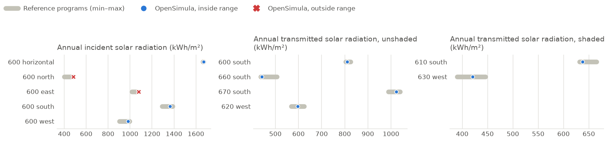

#### Annual incident solar radiation (kWh/m²)

| Case | OpenSimula | Min | Max | Programs | Result |
|---|--:|--:|--:|--:|---|
| 600 horizontal | 1669.365 | 1662.528 | 1670.000 | 6 | ✓ inside |
| 600 north | 430.047 | 399.047 | 477.310 | 6 | ✓ inside |
| 600 east | 1060.225 | 1016.676 | 1067.940 | 6 | ✓ inside |
| 600 south | 1366.517 | 1290.593 | 1387.000 | 6 | ✓ inside |
| 600 west | 962.361 | 903.066 | 997.000 | 6 | ✓ inside |

#### Annual transmitted solar radiation, unshaded (kWh/m²)

| Case | OpenSimula | Min | Max | Programs | Result |
|---|--:|--:|--:|--:|---|
| 600 south | 811.887 | 804.021 | 825.519 | 6 | ✓ inside |
| 660 south | 442.711 | 435.995 | 506.461 | 6 | ✓ inside |
| 670 south | 1024.267 | 987.818 | 1039.230 | 6 | ✓ inside |
| 620 west | 584.932 | 569.394 | 623.797 | 5 | ✓ inside |

#### Annual transmitted solar radiation, shaded (kWh/m²)

| Case | OpenSimula | Min | Max | Programs | Result |
|---|--:|--:|--:|--:|---|
| 610 south | 639.437 | 631.330 | 665.261 | 6 | ✓ inside |
| 630 west | 413.272 | 389.670 | 445.549 | 5 | ✓ inside |

### Sky temperature

| Output | Values | Inside range | Outside range |
|---|--:|--:|--:|
| Annual hourly minimum sky temperature (°C) | 1 | 1 | 0 |
| Annual hourly average sky temperature (°C) | 1 | 0 | 1 |
| Annual hourly maximum sky temperature (°C) | 1 | 1 | 0 |

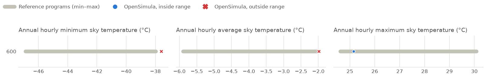

#### Annual hourly minimum sky temperature (°C)

| Case | OpenSimula | Date | Min | Max | Programs | Result |
|---|--:|---|--:|--:|--:|---|
| 600 | -37.958 | Dec 31 24 | -46.900 | -37.980 | 5 | ✓ inside |

#### Annual hourly average sky temperature (°C)

| Case | OpenSimula | Min | Max | Programs | Result |
|---|--:|--:|--:|--:|---|
| 600 | -1.985 | -5.900 | -2.022 | 5 | ✗ +0.04 °C above max |

#### Annual hourly maximum sky temperature (°C)

| Case | OpenSimula | Date | Min | Max | Programs | Result |
|---|--:|---|--:|--:|--:|---|
| 600 | 26.050 | Aug 4 15 | 24.620 | 30.081 | 5 | ✓ inside |

### Monthly loads, cases 600 and 900

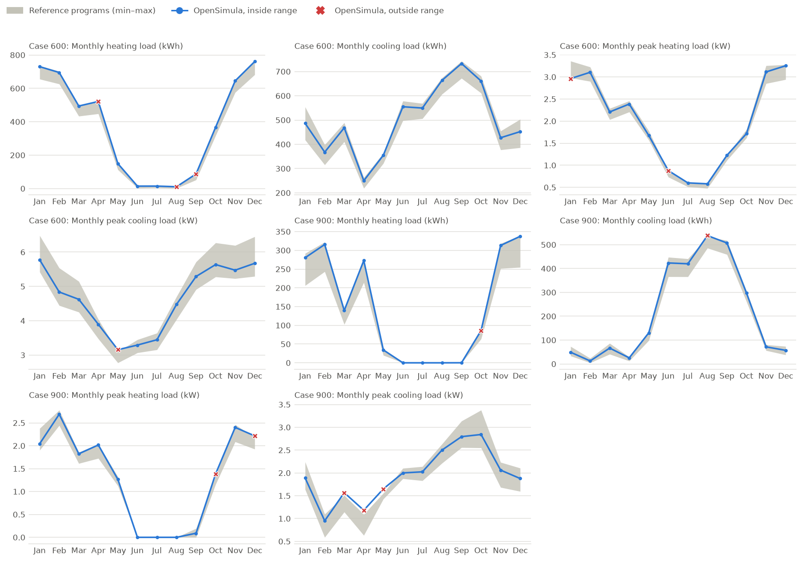

| Case | Output | Values | Inside range | Largest distance outside range |
|---|---|--:|--:|--:|
| 600 | Monthly heating load (kWh) | 12 | 6 | 9.43 kWh |
| 600 | Monthly cooling load (kWh) | 12 | 12 | – |
| 600 | Monthly peak heating load (kW) | 12 | 10 | 0.0272 kW |
| 600 | Monthly peak cooling load (kW) | 12 | 11 | 0.042 kW |
| 900 | Monthly heating load (kWh) | 12 | 10 | 3.94 kWh |
| 900 | Monthly cooling load (kWh) | 12 | 12 | – |
| 900 | Monthly peak heating load (kW) | 12 | 11 | 0.0604 kW |
| 900 | Monthly peak cooling load (kW) | 12 | 9 | 0.0855 kW |

### Hourly incident solar radiation and sky temperature, case 600

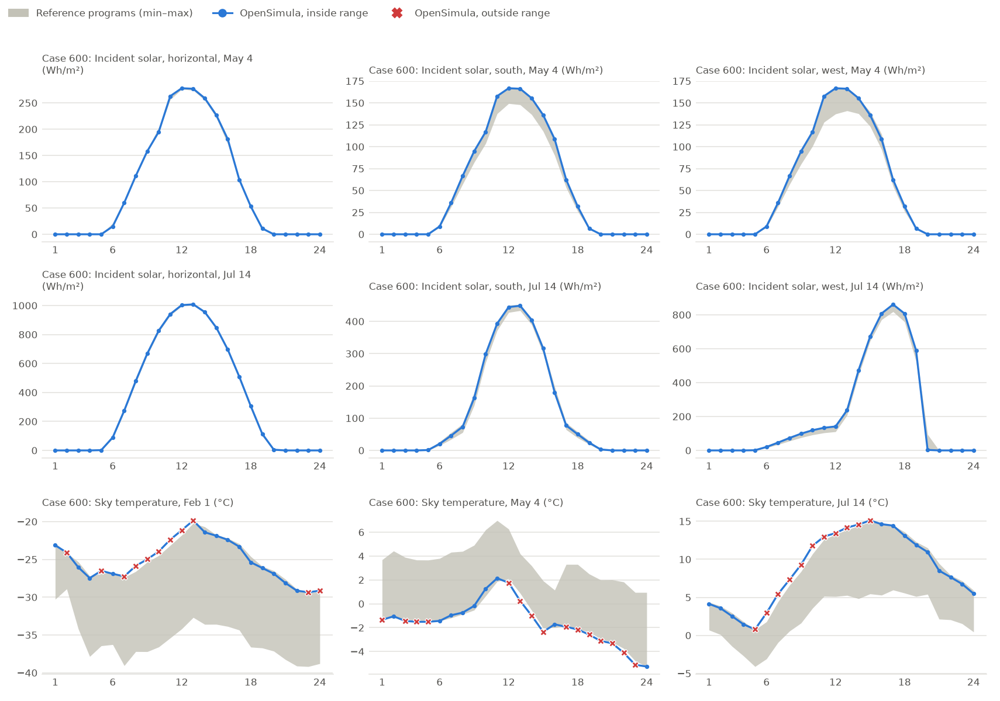

| Case | Output | Values | Inside range | Largest distance outside range |
|---|---|--:|--:|--:|
| 600 | Incident solar, horizontal, May 4 (Wh/m²) | 24 | 24 | – |
| 600 | Incident solar, south, May 4 (Wh/m²) | 24 | 23 | 0.15 Wh/m² |
| 600 | Incident solar, west, May 4 (Wh/m²) | 24 | 23 | 1.29 Wh/m² |
| 600 | Incident solar, horizontal, Jul 14 (Wh/m²) | 24 | 24 | – |
| 600 | Incident solar, south, Jul 14 (Wh/m²) | 24 | 24 | – |
| 600 | Incident solar, west, Jul 14 (Wh/m²) | 24 | 22 | 2.47 Wh/m² |
| 600 | Sky temperature, Feb 1 (°C) | 24 | 15 | 0.895 °C |
| 600 | Sky temperature, May 4 (°C) | 24 | 9 | 0.733 °C |
| 600 | Sky temperature, Jul 14 (°C) | 24 | 13 | 1.29 °C |

### Hourly transmitted solar radiation

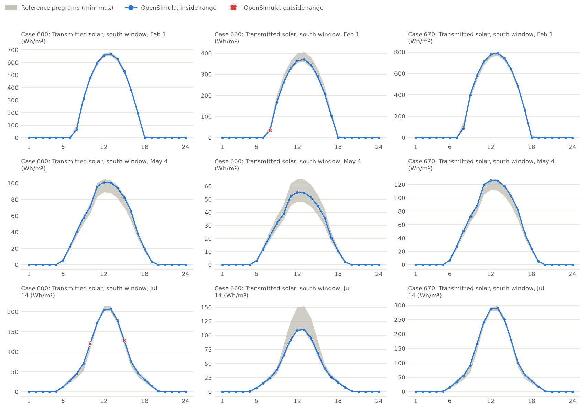

| Case | Output | Values | Inside range | Largest distance outside range |
|---|---|--:|--:|--:|
| 600 | Transmitted solar, south window, Feb 1 (Wh/m²) | 24 | 24 | – |
| 660 | Transmitted solar, south window, Feb 1 (Wh/m²) | 24 | 24 | – |
| 670 | Transmitted solar, south window, Feb 1 (Wh/m²) | 24 | 23 | 3.62 Wh/m² |
| 600 | Transmitted solar, south window, May 4 (Wh/m²) | 24 | 20 | 0.487 Wh/m² |
| 660 | Transmitted solar, south window, May 4 (Wh/m²) | 24 | 21 | 0.278 Wh/m² |
| 670 | Transmitted solar, south window, May 4 (Wh/m²) | 24 | 19 | 0.66 Wh/m² |
| 600 | Transmitted solar, south window, Jul 14 (Wh/m²) | 24 | 22 | 1.25 Wh/m² |
| 660 | Transmitted solar, south window, Jul 14 (Wh/m²) | 24 | 24 | – |
| 670 | Transmitted solar, south window, Jul 14 (Wh/m²) | 24 | 24 | – |

### Hourly zone loads

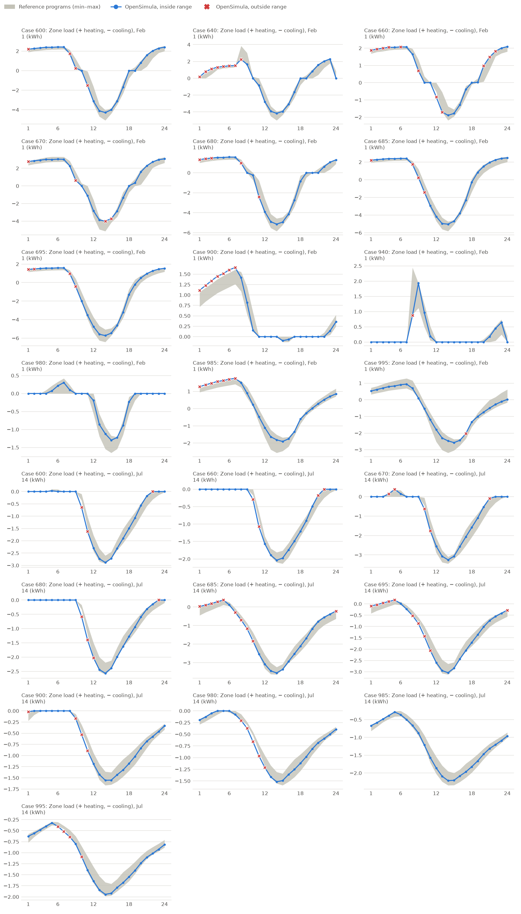

| Case | Output | Values | Inside range | Largest distance outside range |
|---|---|--:|--:|--:|
| 600 | Zone load (+ heating, − cooling), Feb 1 (kWh) | 24 | 20 | 0.148 kWh |
| 640 | Zone load (+ heating, − cooling), Feb 1 (kWh) | 24 | 16 | 0.253 kWh |
| 660 | Zone load (+ heating, − cooling), Feb 1 (kWh) | 24 | 13 | 0.292 kWh |
| 670 | Zone load (+ heating, − cooling), Feb 1 (kWh) | 24 | 20 | 0.159 kWh |
| 680 | Zone load (+ heating, − cooling), Feb 1 (kWh) | 24 | 19 | 0.137 kWh |
| 685 | Zone load (+ heating, − cooling), Feb 1 (kWh) | 24 | 20 | 0.0496 kWh |
| 695 | Zone load (+ heating, − cooling), Feb 1 (kWh) | 24 | 20 | 0.14 kWh |
| 900 | Zone load (+ heating, − cooling), Feb 1 (kWh) | 24 | 17 | 0.0733 kWh |
| 940 | Zone load (+ heating, − cooling), Feb 1 (kWh) | 24 | 23 | 0.0267 kWh |
| 980 | Zone load (+ heating, − cooling), Feb 1 (kWh) | 24 | 24 | – |
| 985 | Zone load (+ heating, − cooling), Feb 1 (kWh) | 24 | 17 | 0.0806 kWh |
| 995 | Zone load (+ heating, − cooling), Feb 1 (kWh) | 24 | 23 | 0.0537 kWh |
| 600 | Zone load (+ heating, − cooling), Jul 14 (kWh) | 24 | 21 | 0.278 kWh |
| 660 | Zone load (+ heating, − cooling), Jul 14 (kWh) | 24 | 20 | 0.183 kWh |
| 670 | Zone load (+ heating, − cooling), Jul 14 (kWh) | 24 | 19 | 0.183 kWh |
| 680 | Zone load (+ heating, − cooling), Jul 14 (kWh) | 24 | 20 | 0.248 kWh |
| 685 | Zone load (+ heating, − cooling), Jul 14 (kWh) | 24 | 14 | 0.123 kWh |
| 695 | Zone load (+ heating, − cooling), Jul 14 (kWh) | 24 | 14 | 0.141 kWh |
| 900 | Zone load (+ heating, − cooling), Jul 14 (kWh) | 24 | 20 | 0.118 kWh |
| 980 | Zone load (+ heating, − cooling), Jul 14 (kWh) | 24 | 19 | 0.129 kWh |
| 985 | Zone load (+ heating, − cooling), Jul 14 (kWh) | 24 | 24 | – |
| 995 | Zone load (+ heating, − cooling), Jul 14 (kWh) | 24 | 20 | 0.055 kWh |

### Hourly zone temperatures

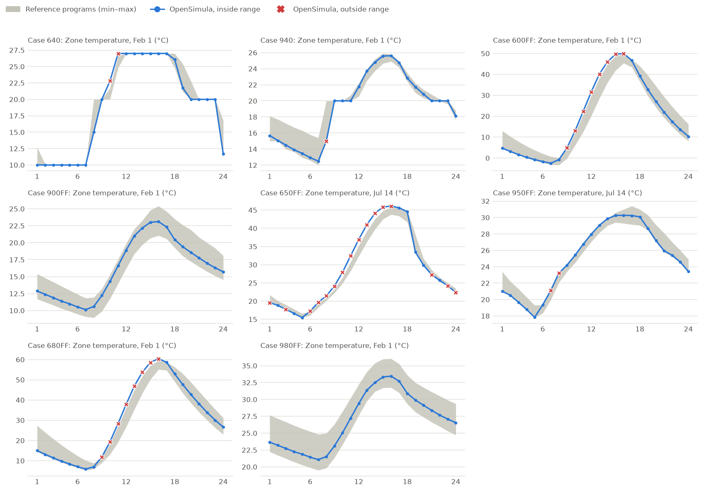

| Case | Output | Values | Inside range | Largest distance outside range |
|---|---|--:|--:|--:|
| 640 | Zone temperature, Feb 1 (°C) | 24 | 22 | 0.792 °C |
| 940 | Zone temperature, Feb 1 (°C) | 24 | 19 | 0.29 °C |
| 600FF | Zone temperature, Feb 1 (°C) | 24 | 11 | 1.08 °C |
| 900FF | Zone temperature, Feb 1 (°C) | 24 | 24 | – |
| 650FF | Zone temperature, Jul 14 (°C) | 24 | 5 | 1.87 °C |
| 950FF | Zone temperature, Jul 14 (°C) | 24 | 22 | 0.0687 °C |
| 680FF | Zone temperature, Feb 1 (°C) | 24 | 14 | 1.3 °C |
| 980FF | Zone temperature, Feb 1 (°C) | 24 | 24 | – |

### Zone temperature bins, case 900FF

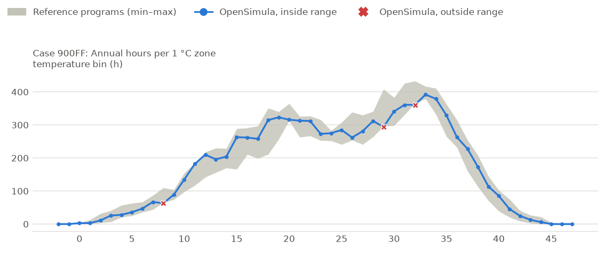

| Case | Output | Values | Inside range | Largest distance outside range |
|---|---|--:|--:|--:|
| 900FF | Annual hours per 1 °C zone temperature bin (h) | 149 | 148 | 6 h |

## Fuel-fired furnace tests (HE100–HE230)

Reference programs: ESP-r/HOT3000, EnergyPlus, DOE-2.1E (example results from `Std140_HE_Results.xlsx`). **32 of 37 values inside the reference range.**

### Furnace load and fuel input

| Output | Values | Inside range | Outside range |
|---|--:|--:|--:|
| Total furnace load (GJ) | 11 | 11 | 0 |
| Total furnace input (fuel) (GJ) | 11 | 9 | 2 |

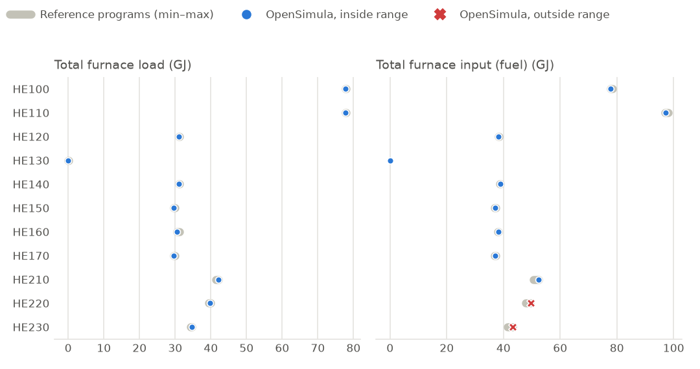

#### Total furnace load (GJ)

| Case | OpenSimula | Min | Max | Programs | Result |
|---|--:|--:|--:|--:|---|
| HE100 | 77.742 | 77.750 | 77.940 | 3 | ✓ inside |
| HE110 | 77.742 | 77.750 | 77.940 | 3 | ✓ inside |
| HE120 | 31.097 | 31.100 | 31.250 | 3 | ✓ inside |
| HE130 | 0.000 | 0.000 | 0.155 | 3 | ✓ inside |
| HE140 | 31.097 | 31.100 | 31.260 | 3 | ✓ inside |
| HE150 | 29.639 | 29.565 | 29.880 | 3 | ✓ inside |
| HE160 | 30.487 | 30.460 | 31.260 | 3 | ✓ inside |
| HE170 | 29.639 | 29.565 | 29.880 | 3 | ✓ inside |
| HE210 | 42.038 | 41.360 | 42.057 | 3 | ✓ inside |
| HE220 | 39.814 | 39.410 | 39.870 | 3 | ✓ inside |
| HE230 | 34.595 | 34.320 | 34.590 | 3 | ✓ inside |

#### Total furnace input (fuel) (GJ)

| Case | OpenSimula | Min | Max | Programs | Result |
|---|--:|--:|--:|--:|---|
| HE100 | 77.739 | 77.713 | 78.417 | 3 | ✓ inside |
| HE110 | 97.174 | 96.920 | 98.020 | 3 | ✓ inside |
| HE120 | 38.271 | 38.266 | 38.556 | 3 | ✓ inside |
| HE130 | 0.000 | 0.000 | 0.142 | 3 | ✓ inside |
| HE140 | 38.899 | 38.764 | 39.004 | 3 | ✓ inside |
| HE150 | 37.001 | 36.820 | 37.231 | 3 | ✓ inside |
| HE160 | 38.125 | 37.962 | 38.118 | 3 | ✓ inside |
| HE170 | 37.001 | 36.820 | 37.231 | 3 | ✓ inside |
| HE210 | 52.402 | 50.528 | 52.371 | 3 | ✓ inside |
| HE220 | 49.548 | 47.869 | 49.466 | 3 | ✗ +0.2 % above max |
| HE230 | 43.320 | 41.368 | 43.219 | 3 | ✗ +0.2 % above max |

### Fan energy

| Output | Values | Inside range | Outside range |
|---|--:|--:|--:|
| Fan energy (circulating and draft fans) (kWh) | 6 | 4 | 2 |

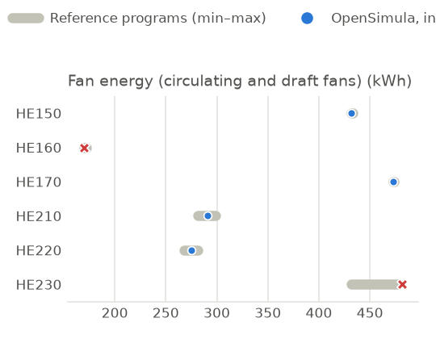

#### Fan energy (circulating and draft fans) (kWh)

| Case | OpenSimula | Min | Max | Programs | Result |
|---|--:|--:|--:|--:|---|
| HE150 | 432.000 | 432.000 | 433.300 | 3 | ✓ inside |
| HE160 | 169.444 | 170.200 | 172.385 | 3 | ✗ -0.4 % below min |
| HE170 | 473.112 | 473.100 | 473.400 | 3 | ✓ inside |
| HE210 | 291.123 | 281.600 | 298.918 | 3 | ✓ inside |
| HE220 | 275.265 | 268.300 | 281.157 | 3 | ✓ inside |
| HE230 | 481.336 | 431.400 | 478.408 | 3 | ✗ +0.6 % above max |

### Zone temperatures

| Output | Values | Inside range | Outside range |
|---|--:|--:|--:|
| Minimum zone temperature (°C) | 3 | 2 | 1 |
| Mean zone temperature (°C) | 3 | 3 | 0 |
| Maximum zone temperature (°C) | 3 | 3 | 0 |

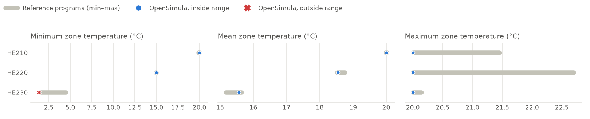

#### Minimum zone temperature (°C)

| Case | OpenSimula | Min | Max | Programs | Result |
|---|--:|--:|--:|--:|---|
| HE210 | 20.000 | 19.890 | 20.000 | 3 | ✓ inside |
| HE220 | 15.000 | 14.940 | 15.000 | 3 | ✓ inside |
| HE230 | 1.308 | 1.450 | 4.480 | 3 | ✗ -0.14 °C below min |

#### Mean zone temperature (°C)

| Case | OpenSimula | Min | Max | Programs | Result |
|---|--:|--:|--:|--:|---|
| HE210 | 20.000 | 19.980 | 20.010 | 3 | ✓ inside |
| HE220 | 18.542 | 18.530 | 18.750 | 3 | ✓ inside |
| HE230 | 15.563 | 15.170 | 15.640 | 3 | ✓ inside |

#### Maximum zone temperature (°C)

| Case | OpenSimula | Min | Max | Programs | Result |
|---|--:|--:|--:|--:|---|
| HE210 | 20.000 | 20.000 | 21.450 | 3 | ✓ inside |
| HE220 | 20.000 | 20.000 | 22.700 | 3 | ✓ inside |
| HE230 | 20.000 | 20.000 | 20.140 | 3 | ✓ inside |

## Space cooling equipment, steady-state tests (CE100–CE200)

Reference programs: Analytical TUD, Analytical HTAL1, Analytical HTAL2, CA-SIS, CLIM2000, DOE-2.1E CIEMAT, DOE-2.1E NREL, EnergyPlus, TRNSYS-ideal, TRNSYS-real (example results from `Std140_CE_a_Results.xlsx`). **227 of 266 values inside the reference range.**

### Energy consumption (February)

| Output | Values | Inside range | Outside range |
|---|--:|--:|--:|
| Total cooling energy consumption, February (kWh) | 14 | 10 | 4 |
| Compressor consumption, February (kWh) | 14 | 13 | 1 |
| Supply fan consumption, February (kWh) | 14 | 10 | 4 |
| Condenser fan consumption, February (kWh) | 14 | 12 | 2 |

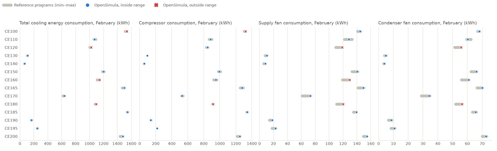

#### Total cooling energy consumption, February (kWh)

| Case | OpenSimula | Min | Max | Programs | Result |
|---|--:|--:|--:|--:|---|
| CE100 | 1538.359 | 1511.937 | 1531.000 | 10 | ✗ +0.5 % above max |
| CE110 | 1075.003 | 1061.196 | 1089.000 | 10 | ✓ inside |
| CE120 | 1021.598 | 1001.664 | 1012.677 | 10 | ✗ +0.9 % above max |
| CE130 | 109.986 | 105.419 | 110.582 | 10 | ✓ inside |
| CE140 | 68.264 | 65.008 | 69.000 | 10 | ✓ inside |
| CE150 | 1200.720 | 1183.000 | 1208.000 | 10 | ✓ inside |
| CE160 | 1142.338 | 1107.000 | 1140.440 | 10 | ✗ +0.2 % above max |
| CE165 | 1496.992 | 1470.000 | 1502.000 | 10 | ✓ inside |
| CE170 | 634.979 | 620.000 | 641.117 | 10 | ✓ inside |
| CE180 | 1089.838 | 1077.109 | 1083.000 | 10 | ✗ +0.6 % above max |
| CE185 | 1548.305 | 1538.397 | 1547.000 | 10 | ✓ inside |
| CE190 | 165.115 | 160.000 | 165.173 | 10 | ✓ inside |
| CE195 | 250.169 | 244.919 | 252.161 | 10 | ✓ inside |
| CE200 | 1477.637 | 1440.000 | 1479.993 | 10 | ✓ inside |

#### Compressor consumption, February (kWh)

| Case | OpenSimula | Min | Max | Programs | Result |
|---|--:|--:|--:|--:|---|
| CE100 | 1324.980 | 1302.726 | 1319.000 | 9 | ✗ +0.5 % above max |
| CE110 | 885.955 | 865.866 | 899.000 | 9 | ✓ inside |
| CE120 | 847.012 | 831.929 | 850.068 | 9 | ✓ inside |
| CE130 | 94.730 | 93.000 | 95.287 | 9 | ✓ inside |
| CE140 | 56.259 | 54.799 | 57.000 | 9 | ✓ inside |
| CE150 | 994.176 | 982.000 | 1007.094 | 9 | ✓ inside |
| CE160 | 951.913 | 926.000 | 962.675 | 9 | ✓ inside |
| CE165 | 1277.611 | 1256.000 | 1291.242 | 9 | ✓ inside |
| CE170 | 528.166 | 523.000 | 538.959 | 9 | ✓ inside |
| CE180 | 914.102 | 906.440 | 914.262 | 9 | ✓ inside |
| CE185 | 1343.051 | 1334.391 | 1344.000 | 9 | ✓ inside |
| CE190 | 138.443 | 137.511 | 139.423 | 9 | ✓ inside |
| CE195 | 216.933 | 216.483 | 218.867 | 9 | ✓ inside |
| CE200 | 1250.501 | 1218.000 | 1252.857 | 9 | ✓ inside |

#### Supply fan consumption, February (kWh)

| Case | OpenSimula | Min | Max | Programs | Result |
|---|--:|--:|--:|--:|---|
| CE100 | 145.198 | 141.000 | 145.185 | 10 | ✓ inside |
| CE110 | 128.642 | 122.000 | 132.917 | 10 | ✓ inside |
| CE120 | 118.801 | 109.581 | 117.000 | 10 | ✗ +1.5 % above max |
| CE130 | 10.381 | 8.000 | 10.408 | 10 | ✓ inside |
| CE140 | 8.169 | 6.000 | 8.214 | 10 | ✓ inside |
| CE150 | 140.547 | 132.917 | 141.220 | 10 | ✓ inside |
| CE160 | 129.579 | 119.052 | 129.310 | 10 | ✗ +0.2 % above max |
| CE165 | 149.283 | 141.678 | 150.000 | 10 | ✓ inside |
| CE170 | 72.684 | 61.322 | 73.592 | 10 | ✓ inside |
| CE180 | 119.583 | 110.813 | 119.000 | 10 | ✗ +0.5 % above max |
| CE185 | 139.670 | 135.056 | 139.400 | 10 | ✗ +0.2 % above max |
| CE190 | 18.150 | 14.000 | 18.170 | 10 | ✓ inside |
| CE195 | 22.616 | 17.728 | 23.000 | 10 | ✓ inside |
| CE200 | 154.560 | 149.151 | 154.600 | 10 | ✓ inside |

#### Condenser fan consumption, February (kWh)

| Case | OpenSimula | Min | Max | Programs | Result |
|---|--:|--:|--:|--:|---|
| CE100 | 68.180 | 66.849 | 68.174 | 9 | ✓ inside |
| CE110 | 60.406 | 59.475 | 62.413 | 9 | ✓ inside |
| CE120 | 55.785 | 51.455 | 55.000 | 9 | ✗ +1.4 % above max |
| CE130 | 4.875 | 3.905 | 5.000 | 9 | ✓ inside |
| CE140 | 3.836 | 3.262 | 4.000 | 9 | ✓ inside |
| CE150 | 65.996 | 62.413 | 66.312 | 9 | ✓ inside |
| CE160 | 60.846 | 55.903 | 61.000 | 9 | ✓ inside |
| CE165 | 70.098 | 66.527 | 70.133 | 9 | ✓ inside |
| CE170 | 34.130 | 28.795 | 34.556 | 9 | ✓ inside |
| CE180 | 56.152 | 52.034 | 56.000 | 9 | ✗ +0.3 % above max |
| CE185 | 65.584 | 63.418 | 66.000 | 9 | ✓ inside |
| CE190 | 8.523 | 6.645 | 9.000 | 9 | ✓ inside |
| CE195 | 10.620 | 8.324 | 11.000 | 9 | ✓ inside |
| CE200 | 72.576 | 70.036 | 73.000 | 9 | ✓ inside |

### Evaporator coil and zone loads (February)

| Output | Values | Inside range | Outside range |
|---|--:|--:|--:|
| Evaporator coil total load, February (kWh) | 14 | 13 | 1 |
| Evaporator coil sensible load, February (kWh) | 14 | 11 | 3 |
| Evaporator coil latent load, February (kWh) | 14 | 14 | 0 |
| Zone total load, February (kWh) | 14 | 14 | 0 |
| Zone sensible load, February (kWh) | 14 | 14 | 0 |
| Zone latent load, February (kWh) | 14 | 14 | 0 |

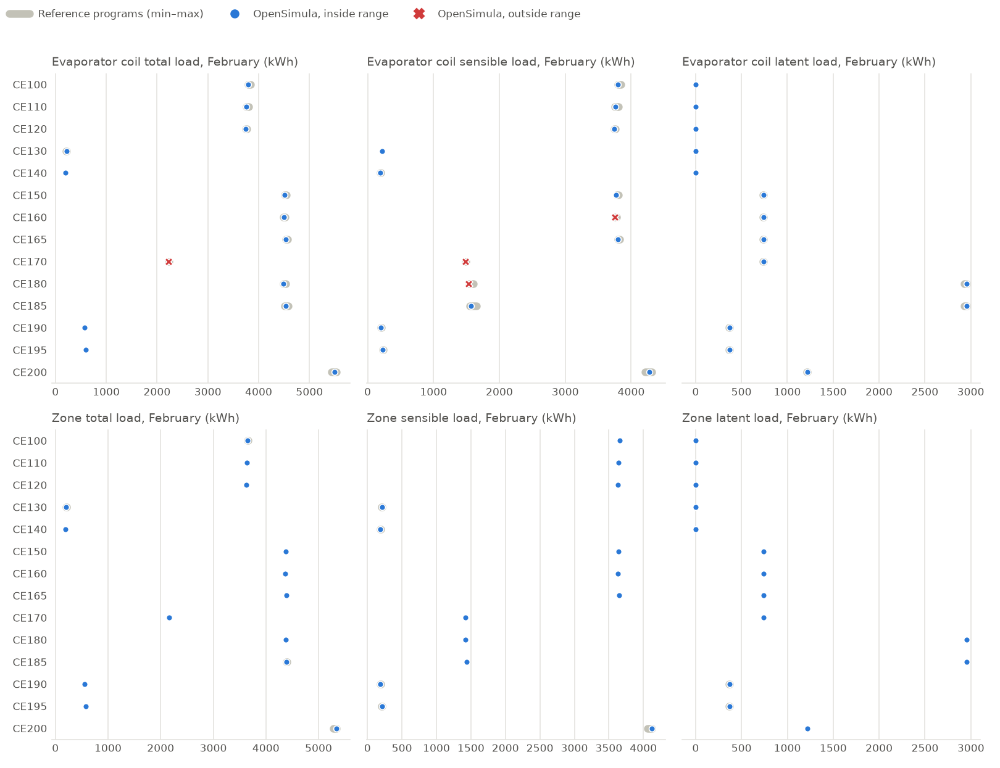

#### Evaporator coil total load, February (kWh)

| Case | OpenSimula | Min | Max | Programs | Result |
|---|--:|--:|--:|--:|---|
| CE100 | 3798.274 | 3793.962 | 3841.470 | 10 | ✓ inside |
| CE110 | 3759.050 | 3755.569 | 3803.580 | 10 | ✓ inside |
| CE120 | 3742.505 | 3739.156 | 3763.480 | 10 | ✓ inside |
| CE130 | 216.410 | 215.123 | 219.769 | 10 | ✓ inside |
| CE140 | 195.527 | 194.607 | 198.564 | 10 | ✓ inside |
| CE150 | 4512.662 | 4508.723 | 4542.780 | 10 | ✓ inside |
| CE160 | 4494.244 | 4491.049 | 4516.378 | 10 | ✓ inside |
| CE165 | 4535.161 | 4528.659 | 4567.458 | 10 | ✓ inside |
| CE170 | 2220.785 | 2224.868 | 2236.518 | 10 | ✗ -0.2 % below min |
| CE180 | 4487.867 | 4481.208 | 4534.584 | 10 | ✓ inside |
| CE185 | 4530.761 | 4507.000 | 4582.649 | 10 | ✓ inside |
| CE190 | 573.016 | 572.607 | 578.546 | 10 | ✓ inside |
| CE195 | 596.025 | 595.240 | 602.000 | 10 | ✓ inside |
| CE200 | 5497.245 | 5436.000 | 5534.200 | 10 | ✓ inside |

#### Evaporator coil sensible load, February (kWh)

| Case | OpenSimula | Min | Max | Programs | Result |
|---|--:|--:|--:|--:|---|
| CE100 | 3798.274 | 3793.962 | 3841.470 | 10 | ✓ inside |
| CE110 | 3759.050 | 3755.569 | 3803.580 | 10 | ✓ inside |
| CE120 | 3742.505 | 3739.156 | 3763.480 | 10 | ✓ inside |
| CE130 | 216.410 | 215.123 | 219.769 | 10 | ✓ inside |
| CE140 | 195.527 | 194.607 | 198.564 | 10 | ✓ inside |
| CE150 | 3773.466 | 3775.822 | 3803.580 | 10 | ✓ inside |
| CE160 | 3755.079 | 3759.037 | 3777.178 | 10 | ✗ -0.1 % below min |
| CE165 | 3795.951 | 3795.493 | 3828.258 | 10 | ✓ inside |
| CE170 | 1481.714 | 1486.857 | 1497.655 | 10 | ✗ -0.3 % below min |
| CE180 | 1530.998 | 1537.000 | 1606.682 | 10 | ✗ -0.4 % below min |
| CE185 | 1573.861 | 1548.000 | 1652.696 | 10 | ✓ inside |
| CE190 | 203.532 | 203.007 | 212.192 | 10 | ✓ inside |
| CE195 | 226.324 | 225.640 | 235.053 | 10 | ✓ inside |
| CE200 | 4276.116 | 4215.000 | 4313.176 | 10 | ✓ inside |

#### Evaporator coil latent load, February (kWh)

| Case | OpenSimula | Min | Max | Programs | Result |
|---|--:|--:|--:|--:|---|
| CE100 | 0.000 | 0.000 | 0.005 | 10 | ✓ inside |
| CE110 | 0.000 | 0.000 | 0.004 | 10 | ✓ inside |
| CE120 | 0.000 | 0.000 | 0.004 | 10 | ✓ inside |
| CE130 | 0.000 | 0.000 | 0.001 | 10 | ✓ inside |
| CE140 | 0.000 | -0.000 | 0.001 | 10 | ✓ inside |
| CE150 | 739.196 | 732.696 | 741.501 | 10 | ✓ inside |
| CE160 | 739.165 | 732.012 | 740.000 | 10 | ✓ inside |
| CE165 | 739.209 | 733.167 | 740.328 | 10 | ✓ inside |
| CE170 | 739.071 | 733.647 | 740.000 | 10 | ✓ inside |
| CE180 | 2956.869 | 2927.902 | 2958.000 | 10 | ✓ inside |
| CE185 | 2956.900 | 2929.953 | 2959.000 | 10 | ✓ inside |
| CE190 | 369.484 | 366.354 | 370.000 | 10 | ✓ inside |
| CE195 | 369.701 | 366.647 | 370.000 | 10 | ✓ inside |
| CE200 | 1221.129 | 1210.221 | 1222.000 | 10 | ✓ inside |

#### Zone total load, February (kWh)

| Case | OpenSimula | Min | Max | Programs | Result |
|---|--:|--:|--:|--:|---|
| CE100 | 3655.642 | 3654.127 | 3656.306 | 10 | ✓ inside |
| CE110 | 3636.511 | 3635.534 | 3637.113 | 10 | ✓ inside |
| CE120 | 3631.343 | 3630.472 | 3632.000 | 10 | ✓ inside |
| CE130 | 208.282 | 206.748 | 209.371 | 10 | ✓ inside |
| CE140 | 189.151 | 188.183 | 190.358 | 10 | ✓ inside |
| CE150 | 4375.800 | 4374.747 | 4376.313 | 10 | ✓ inside |
| CE160 | 4370.601 | 4369.652 | 4371.189 | 10 | ✓ inside |
| CE165 | 4387.376 | 4385.925 | 4388.000 | 10 | ✓ inside |
| CE170 | 2157.983 | 2157.139 | 2159.000 | 10 | ✓ inside |
| CE180 | 4375.815 | 4374.739 | 4376.313 | 10 | ✓ inside |
| CE185 | 4394.977 | 4393.311 | 4396.000 | 10 | ✓ inside |
| CE190 | 558.636 | 557.000 | 559.456 | 10 | ✓ inside |
| CE195 | 577.983 | 576.000 | 579.000 | 10 | ✓ inside |
| CE200 | 5342.685 | 5283.000 | 5343.255 | 10 | ✓ inside |

#### Zone sensible load, February (kWh)

| Case | OpenSimula | Min | Max | Programs | Result |
|---|--:|--:|--:|--:|---|
| CE100 | 3655.642 | 3654.127 | 3656.306 | 10 | ✓ inside |
| CE110 | 3636.511 | 3635.534 | 3637.113 | 10 | ✓ inside |
| CE120 | 3631.343 | 3630.472 | 3632.000 | 10 | ✓ inside |
| CE130 | 208.282 | 206.748 | 209.371 | 10 | ✓ inside |
| CE140 | 189.151 | 188.183 | 190.358 | 10 | ✓ inside |
| CE150 | 3636.604 | 3635.550 | 3637.113 | 10 | ✓ inside |
| CE160 | 3631.436 | 3630.452 | 3632.000 | 10 | ✓ inside |
| CE165 | 3648.167 | 3646.728 | 3649.000 | 10 | ✓ inside |
| CE170 | 1418.912 | 1417.939 | 1420.000 | 10 | ✓ inside |
| CE180 | 1418.946 | 1417.952 | 1420.000 | 10 | ✓ inside |
| CE185 | 1438.077 | 1436.524 | 1439.000 | 10 | ✓ inside |
| CE190 | 189.152 | 188.182 | 190.000 | 10 | ✓ inside |
| CE195 | 208.282 | 206.748 | 209.000 | 10 | ✓ inside |
| CE200 | 4121.556 | 4062.000 | 4122.231 | 10 | ✓ inside |

#### Zone latent load, February (kWh)

| Case | OpenSimula | Min | Max | Programs | Result |
|---|--:|--:|--:|--:|---|
| CE100 | 0.000 | 0.000 | 0.000 | 10 | ✓ inside |
| CE110 | 0.000 | 0.000 | 0.000 | 10 | ✓ inside |
| CE120 | 0.000 | 0.000 | 0.000 | 10 | ✓ inside |
| CE130 | 0.000 | 0.000 | 0.000 | 10 | ✓ inside |
| CE140 | 0.000 | 0.000 | 0.000 | 10 | ✓ inside |
| CE150 | 739.196 | 739.000 | 739.449 | 10 | ✓ inside |
| CE160 | 739.165 | 739.000 | 739.449 | 10 | ✓ inside |
| CE165 | 739.209 | 739.000 | 739.449 | 10 | ✓ inside |
| CE170 | 739.071 | 739.000 | 739.449 | 10 | ✓ inside |
| CE180 | 2956.869 | 2956.787 | 2957.503 | 10 | ✓ inside |
| CE185 | 2956.900 | 2956.787 | 2957.503 | 10 | ✓ inside |
| CE190 | 369.484 | 367.000 | 370.000 | 10 | ✓ inside |
| CE195 | 369.701 | 367.000 | 370.000 | 10 | ✓ inside |
| CE200 | 1221.129 | 1220.982 | 1221.278 | 10 | ✓ inside |

### COP, indoor dry bulb and humidity ratio (February)

| Output | Values | Inside range | Outside range |
|---|--:|--:|--:|
| Mean COP, February (-) | 14 | 10 | 4 |
| Maximum COP, February (-) | 14 | 9 | 5 |
| Minimum COP, February (-) | 14 | 12 | 2 |
| Mean indoor dry bulb, February (°C) | 14 | 14 | 0 |
| Maximum indoor dry bulb, February (°C) | 14 | 14 | 0 |
| Minimum indoor dry bulb, February (°C) | 14 | 14 | 0 |
| Mean zone humidity ratio, February (kg/kg) | 14 | 9 | 5 |
| Maximum zone humidity ratio, February (kg/kg) | 14 | 9 | 5 |
| Minimum zone humidity ratio, February (kg/kg) | 14 | 11 | 3 |

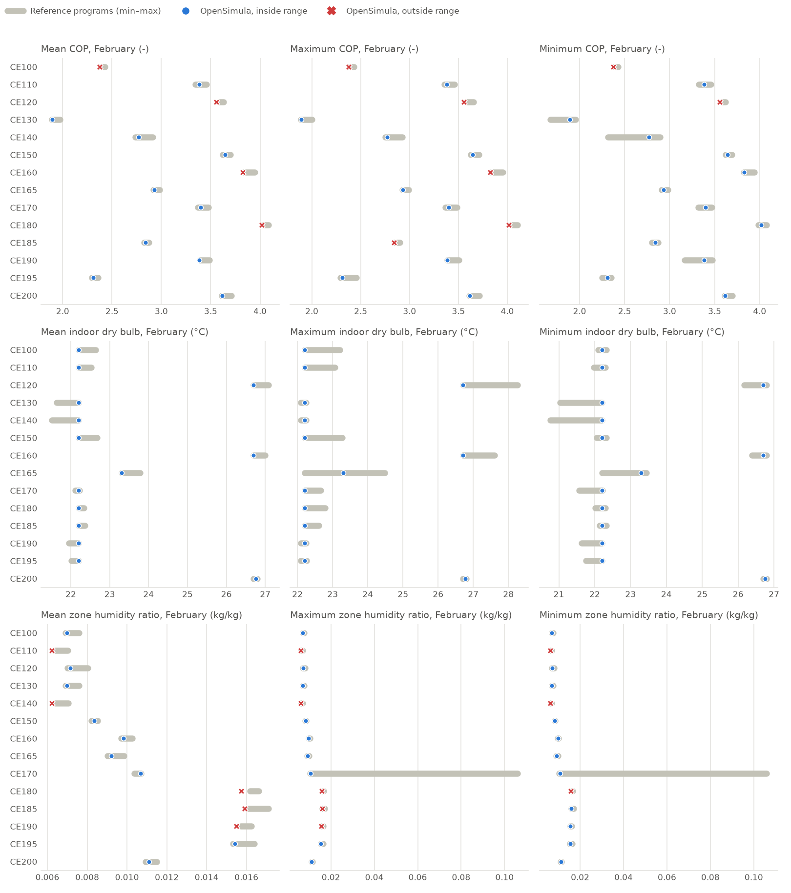

#### Mean COP, February (-)

| Case | OpenSimula | Min | Max | Programs | Result |
|---|--:|--:|--:|--:|---|
| CE100 | 2.376 | 2.389 | 2.430 | 10 | ✗ -0.5 % below min |
| CE110 | 3.383 | 3.342 | 3.459 | 10 | ✓ inside |
| CE120 | 3.555 | 3.587 | 3.631 | 10 | ✗ -0.9 % below min |
| CE130 | 1.894 | 1.890 | 1.975 | 10 | ✓ inside |
| CE140 | 2.771 | 2.734 | 2.915 | 10 | ✓ inside |
| CE150 | 3.644 | 3.620 | 3.700 | 10 | ✓ inside |
| CE160 | 3.826 | 3.833 | 3.950 | 10 | ✗ -0.2 % below min |
| CE165 | 2.931 | 2.920 | 2.985 | 10 | ✓ inside |
| CE170 | 3.399 | 3.367 | 3.477 | 10 | ✓ inside |
| CE180 | 4.015 | 4.026 | 4.084 | 10 | ✗ -0.3 % below min |
| CE185 | 2.839 | 2.823 | 2.874 | 10 | ✓ inside |
| CE190 | 3.383 | 3.386 | 3.486 | 10 | ✓ inside |
| CE195 | 2.310 | 2.294 | 2.360 | 10 | ✓ inside |
| CE200 | 3.616 | 3.610 | 3.708 | 10 | ✓ inside |

#### Maximum COP, February (-)

| Case | OpenSimula | Min | Max | Programs | Result |
|---|--:|--:|--:|--:|---|
| CE100 | 2.377 | 2.389 | 2.432 | 9 | ✗ -0.5 % below min |
| CE110 | 3.383 | 3.357 | 3.463 | 9 | ✓ inside |
| CE120 | 3.555 | 3.587 | 3.654 | 9 | ✗ -0.9 % below min |
| CE130 | 1.894 | 1.890 | 2.003 | 9 | ✓ inside |
| CE140 | 2.771 | 2.750 | 2.928 | 9 | ✓ inside |
| CE150 | 3.645 | 3.627 | 3.709 | 9 | ✓ inside |
| CE160 | 3.826 | 3.833 | 3.957 | 9 | ✗ -0.2 % below min |
| CE165 | 2.931 | 2.926 | 2.989 | 9 | ✓ inside |
| CE170 | 3.399 | 3.367 | 3.485 | 9 | ✓ inside |
| CE180 | 4.015 | 4.042 | 4.105 | 9 | ✗ -0.7 % below min |
| CE185 | 2.839 | 2.844 | 2.903 | 9 | ✗ -0.2 % below min |
| CE190 | 3.384 | 3.386 | 3.508 | 9 | ✓ inside |
| CE195 | 2.311 | 2.294 | 2.457 | 9 | ✓ inside |
| CE200 | 3.616 | 3.610 | 3.717 | 9 | ✓ inside |

#### Minimum COP, February (-)

| Case | OpenSimula | Min | Max | Programs | Result |
|---|--:|--:|--:|--:|---|
| CE100 | 2.376 | 2.389 | 2.429 | 9 | ✗ -0.5 % below min |
| CE110 | 3.383 | 3.322 | 3.457 | 9 | ✓ inside |
| CE120 | 3.554 | 3.583 | 3.621 | 9 | ✗ -0.8 % below min |
| CE130 | 1.894 | 1.674 | 1.956 | 9 | ✓ inside |
| CE140 | 2.771 | 2.313 | 2.896 | 9 | ✓ inside |
| CE150 | 3.644 | 3.620 | 3.691 | 9 | ✓ inside |
| CE160 | 3.826 | 3.821 | 3.944 | 9 | ✓ inside |
| CE165 | 2.931 | 2.910 | 2.981 | 9 | ✓ inside |
| CE170 | 3.398 | 3.317 | 3.471 | 9 | ✓ inside |
| CE180 | 4.015 | 3.987 | 4.080 | 9 | ✓ inside |
| CE185 | 2.838 | 2.805 | 2.871 | 9 | ✓ inside |
| CE190 | 3.382 | 3.165 | 3.475 | 9 | ✓ inside |
| CE195 | 2.310 | 2.250 | 2.350 | 9 | ✓ inside |
| CE200 | 3.615 | 3.610 | 3.698 | 9 | ✓ inside |

#### Mean indoor dry bulb, February (°C)

| Case | OpenSimula | Min | Max | Programs | Result |
|---|--:|--:|--:|--:|---|
| CE100 | 22.200 | 22.200 | 22.635 | 10 | ✓ inside |
| CE110 | 22.200 | 22.200 | 22.524 | 10 | ✓ inside |
| CE120 | 26.700 | 26.700 | 27.078 | 10 | ✓ inside |
| CE130 | 22.200 | 21.638 | 22.200 | 10 | ✓ inside |
| CE140 | 22.200 | 21.510 | 22.200 | 10 | ✓ inside |
| CE150 | 22.200 | 22.200 | 22.677 | 10 | ✓ inside |
| CE160 | 26.700 | 26.700 | 26.995 | 10 | ✓ inside |
| CE165 | 23.300 | 23.300 | 23.780 | 10 | ✓ inside |
| CE170 | 22.200 | 22.117 | 22.222 | 10 | ✓ inside |
| CE180 | 22.200 | 22.200 | 22.334 | 10 | ✓ inside |
| CE185 | 22.200 | 22.200 | 22.368 | 10 | ✓ inside |
| CE190 | 22.200 | 21.947 | 22.200 | 10 | ✓ inside |
| CE195 | 22.200 | 22.011 | 22.200 | 10 | ✓ inside |
| CE200 | 26.758 | 26.700 | 26.800 | 10 | ✓ inside |

#### Maximum indoor dry bulb, February (°C)

| Case | OpenSimula | Min | Max | Programs | Result |
|---|--:|--:|--:|--:|---|
| CE100 | 22.200 | 22.200 | 23.210 | 9 | ✓ inside |
| CE110 | 22.200 | 22.200 | 23.060 | 9 | ✓ inside |
| CE120 | 26.700 | 26.700 | 28.260 | 9 | ✓ inside |
| CE130 | 22.200 | 22.100 | 22.250 | 9 | ✓ inside |
| CE140 | 22.200 | 22.100 | 22.250 | 9 | ✓ inside |
| CE150 | 22.200 | 22.200 | 23.280 | 9 | ✓ inside |
| CE160 | 26.700 | 26.700 | 27.610 | 9 | ✓ inside |
| CE165 | 23.300 | 22.200 | 24.480 | 9 | ✓ inside |
| CE170 | 22.200 | 22.200 | 22.670 | 9 | ✓ inside |
| CE180 | 22.200 | 22.200 | 22.790 | 9 | ✓ inside |
| CE185 | 22.200 | 22.200 | 22.610 | 9 | ✓ inside |
| CE190 | 22.200 | 22.100 | 22.250 | 9 | ✓ inside |
| CE195 | 22.200 | 22.100 | 22.260 | 9 | ✓ inside |
| CE200 | 26.772 | 26.700 | 26.800 | 9 | ✓ inside |

#### Minimum indoor dry bulb, February (°C)

| Case | OpenSimula | Min | Max | Programs | Result |
|---|--:|--:|--:|--:|---|
| CE100 | 22.200 | 22.090 | 22.333 | 9 | ✓ inside |
| CE110 | 22.200 | 21.980 | 22.300 | 9 | ✓ inside |
| CE120 | 26.700 | 26.170 | 26.800 | 9 | ✓ inside |
| CE130 | 22.200 | 21.030 | 22.200 | 9 | ✓ inside |
| CE140 | 22.200 | 20.760 | 22.200 | 9 | ✓ inside |
| CE150 | 22.200 | 22.060 | 22.333 | 9 | ✓ inside |
| CE160 | 26.700 | 26.390 | 26.800 | 9 | ✓ inside |
| CE165 | 23.300 | 22.200 | 23.444 | 9 | ✓ inside |
| CE170 | 22.200 | 21.570 | 22.222 | 9 | ✓ inside |
| CE180 | 22.200 | 22.010 | 22.300 | 9 | ✓ inside |
| CE185 | 22.200 | 22.130 | 22.333 | 9 | ✓ inside |
| CE190 | 22.200 | 21.630 | 22.200 | 9 | ✓ inside |
| CE195 | 22.200 | 21.760 | 22.200 | 9 | ✓ inside |
| CE200 | 26.749 | 26.699 | 26.800 | 9 | ✓ inside |

#### Mean zone humidity ratio, February (kg/kg)

| Case | OpenSimula | Min | Max | Programs | Result |
|---|--:|--:|--:|--:|---|
| CE100 | 0.007 | 0.007 | 0.008 | 10 | ✓ inside |
| CE110 | 0.006 | 0.006 | 0.007 | 10 | ✗ -2.8 % below min |
| CE120 | 0.007 | 0.007 | 0.008 | 10 | ✓ inside |
| CE130 | 0.007 | 0.007 | 0.008 | 10 | ✓ inside |
| CE140 | 0.006 | 0.006 | 0.007 | 10 | ✗ -2.7 % below min |
| CE150 | 0.008 | 0.008 | 0.009 | 10 | ✓ inside |
| CE160 | 0.010 | 0.010 | 0.010 | 10 | ✓ inside |
| CE165 | 0.009 | 0.009 | 0.010 | 10 | ✓ inside |
| CE170 | 0.011 | 0.010 | 0.011 | 10 | ✓ inside |
| CE180 | 0.016 | 0.016 | 0.017 | 10 | ✗ -2.8 % below min |
| CE185 | 0.016 | 0.016 | 0.017 | 10 | ✗ -0.9 % below min |
| CE190 | 0.016 | 0.016 | 0.016 | 10 | ✗ -1.3 % below min |
| CE195 | 0.015 | 0.015 | 0.016 | 10 | ✓ inside |
| CE200 | 0.011 | 0.011 | 0.011 | 10 | ✓ inside |

#### Maximum zone humidity ratio, February (kg/kg)

| Case | OpenSimula | Min | Max | Programs | Result |
|---|--:|--:|--:|--:|---|
| CE100 | 0.007 | 0.007 | 0.008 | 9 | ✓ inside |
| CE110 | 0.006 | 0.006 | 0.007 | 9 | ✗ -2.8 % below min |
| CE120 | 0.007 | 0.007 | 0.008 | 9 | ✓ inside |
| CE130 | 0.007 | 0.007 | 0.008 | 9 | ✓ inside |
| CE140 | 0.006 | 0.006 | 0.007 | 9 | ✗ -2.7 % below min |
| CE150 | 0.008 | 0.008 | 0.009 | 9 | ✓ inside |
| CE160 | 0.010 | 0.010 | 0.010 | 9 | ✓ inside |
| CE165 | 0.009 | 0.009 | 0.010 | 9 | ✓ inside |
| CE170 | 0.011 | 0.010 | 0.106 | 9 | ✓ inside |
| CE180 | 0.016 | 0.016 | 0.017 | 9 | ✗ -2.8 % below min |
| CE185 | 0.016 | 0.016 | 0.017 | 9 | ✗ -0.9 % below min |
| CE190 | 0.016 | 0.016 | 0.016 | 9 | ✗ -1.8 % below min |
| CE195 | 0.015 | 0.015 | 0.017 | 9 | ✓ inside |
| CE200 | 0.011 | 0.011 | 0.011 | 9 | ✓ inside |

#### Minimum zone humidity ratio, February (kg/kg)

| Case | OpenSimula | Min | Max | Programs | Result |
|---|--:|--:|--:|--:|---|
| CE100 | 0.007 | 0.007 | 0.008 | 9 | ✓ inside |
| CE110 | 0.006 | 0.006 | 0.007 | 9 | ✗ -2.8 % below min |
| CE120 | 0.007 | 0.007 | 0.008 | 9 | ✓ inside |
| CE130 | 0.007 | 0.007 | 0.008 | 9 | ✓ inside |
| CE140 | 0.006 | 0.006 | 0.007 | 9 | ✗ -2.7 % below min |
| CE150 | 0.008 | 0.008 | 0.009 | 9 | ✓ inside |
| CE160 | 0.010 | 0.010 | 0.010 | 9 | ✓ inside |
| CE165 | 0.009 | 0.009 | 0.010 | 9 | ✓ inside |
| CE170 | 0.011 | 0.010 | 0.106 | 9 | ✓ inside |
| CE180 | 0.016 | 0.016 | 0.017 | 9 | ✗ -2.0 % below min |
| CE185 | 0.016 | 0.016 | 0.017 | 9 | ✓ inside |
| CE190 | 0.015 | 0.015 | 0.016 | 9 | ✓ inside |
| CE195 | 0.015 | 0.015 | 0.016 | 9 | ✓ inside |
| CE200 | 0.011 | 0.011 | 0.011 | 9 | ✓ inside |

## Space cooling equipment, dynamic tests (CE300–CE545)

Reference programs: TRNSYS-TUD, DOE-2.2, DOE-2.1E, EnergyPlus, CODYRUN, HOT3000 (example results from `Std140_CE-b_Results.xlsx`). **423 of 519 values inside the reference range; 232 of 264 profile points (hourly, monthly…).**

### Annual energy consumption

| Output | Values | Inside range | Outside range |
|---|--:|--:|--:|
| Annual total cooling energy consumption (kWh) | 21 | 18 | 3 |
| Annual compressor consumption (kWh) | 21 | 20 | 1 |
| Annual condenser fan consumption (kWh) | 21 | 17 | 4 |
| Annual indoor fan consumption (kWh) | 21 | 17 | 4 |

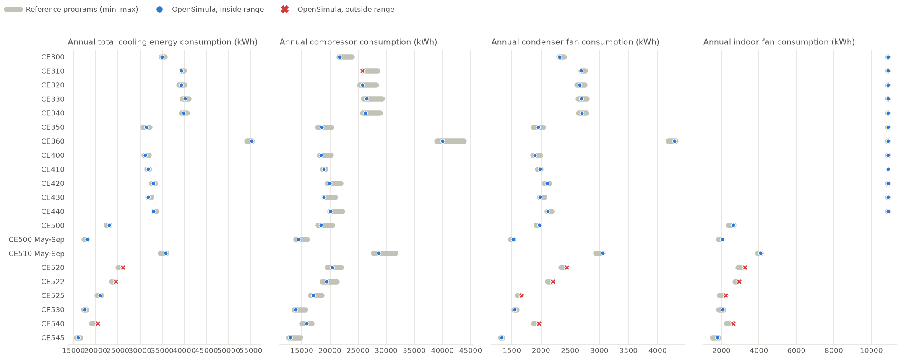

#### Annual total cooling energy consumption (kWh)

| Case | OpenSimula | Min | Max | Programs | Result |
|---|--:|--:|--:|--:|---|
| CE300 | 34924.257 | 34745.638 | 35633.777 | 6 | ✓ inside |
| CE310 | 39324.165 | 39290.364 | 39973.380 | 6 | ✓ inside |
| CE320 | 39328.084 | 38745.000 | 40059.657 | 6 | ✓ inside |
| CE330 | 40120.228 | 39438.000 | 40963.300 | 6 | ✓ inside |
| CE340 | 39856.653 | 39265.000 | 40619.295 | 6 | ✓ inside |
| CE350 | 31403.772 | 30547.000 | 32236.979 | 6 | ✓ inside |
| CE360 | 55167.283 | 54016.000 | 55298.792 | 6 | ✓ inside |
| CE400 | 31192.970 | 30846.000 | 32045.154 | 5 | ✓ inside |
| CE410 | 31776.233 | 31503.000 | 32078.432 | 4 | ✓ inside |
| CE420 | 32955.941 | 32530.000 | 33387.008 | 5 | ✓ inside |
| CE430 | 31795.580 | 31772.397 | 32538.031 | 5 | ✓ inside |
| CE440 | 33085.612 | 32973.000 | 33691.321 | 5 | ✓ inside |
| CE500 | 23025.851 | 22322.953 | 23138.000 | 6 | ✓ inside |
| CE500 May-Sep | 17987.947 | 17390.851 | 18051.000 | 6 | ✓ inside |
| CE510 May-Sep | 35837.671 | 34608.775 | 35971.000 | 6 | ✓ inside |
| CE520 | 26115.900 | 24986.582 | 25781.000 | 6 | ✗ +1.3 % above max |
| CE522 | 24545.442 | 23544.161 | 24360.000 | 6 | ✗ +0.8 % above max |
| CE525 | 20979.877 | 20241.713 | 21323.000 | 6 | ✓ inside |
| CE530 | 17524.038 | 17281.271 | 17875.000 | 6 | ✓ inside |
| CE540 | 20445.005 | 19061.113 | 20164.000 | 6 | ✗ +1.4 % above max |
| CE545 | 16057.336 | 15687.080 | 16635.726 | 6 | ✓ inside |

#### Annual compressor consumption (kWh)

| Case | OpenSimula | Min | Max | Programs | Result |
|---|--:|--:|--:|--:|---|
| CE300 | 21723.950 | 21569.000 | 23883.546 | 6 | ✓ inside |
| CE310 | 25757.603 | 25813.000 | 28428.272 | 6 | ✗ -0.2 % below min |
| CE320 | 25781.905 | 25250.000 | 28217.008 | 6 | ✓ inside |
| CE330 | 26545.058 | 25925.000 | 29281.282 | 6 | ✓ inside |
| CE340 | 26280.910 | 25745.000 | 28920.927 | 6 | ✓ inside |
| CE350 | 18575.791 | 17801.000 | 20283.022 | 6 | ✓ inside |
| CE360 | 39996.860 | 38955.000 | 43842.619 | 6 | ✓ inside |
| CE400 | 18419.435 | 18106.000 | 20150.589 | 5 | ✓ inside |
| CE410 | 18919.675 | 18685.000 | 19204.494 | 4 | ✓ inside |
| CE420 | 19975.879 | 19596.000 | 21873.413 | 5 | ✓ inside |
| CE430 | 18936.380 | 18951.000 | 20910.305 | 5 | ✓ inside |
| CE440 | 20090.185 | 19989.000 | 22169.553 | 5 | ✓ inside |
| CE500 | 18422.109 | 17854.296 | 20406.282 | 6 | ✓ inside |
| CE500 May-Sep | 14434.009 | 13942.148 | 15967.148 | 6 | ✓ inside |
| CE510 May-Sep | 28697.032 | 27747.879 | 31669.181 | 6 | ✓ inside |
| CE520 | 20421.175 | 19521.277 | 21998.508 | 6 | ✓ inside |
| CE522 | 19407.784 | 18620.311 | 21235.168 | 6 | ✓ inside |
| CE525 | 17088.112 | 16506.802 | 18521.664 | 6 | ✓ inside |
| CE530 | 13900.217 | 13656.995 | 15651.726 | 6 | ✓ inside |
| CE540 | 15851.711 | 15020.743 | 16751.867 | 6 | ✓ inside |
| CE545 | 12958.679 | 12621.869 | 14764.824 | 6 | ✓ inside |

#### Annual condenser fan consumption (kWh)

| Case | OpenSimula | Min | Max | Programs | Result |
|---|--:|--:|--:|--:|---|
| CE300 | 2320.387 | 2301.000 | 2400.323 | 5 | ✓ inside |
| CE310 | 2686.642 | 2686.000 | 2753.834 | 5 | ✓ inside |
| CE320 | 2666.259 | 2615.000 | 2746.600 | 5 | ✓ inside |
| CE330 | 2695.249 | 2633.000 | 2783.648 | 5 | ✓ inside |
| CE340 | 2695.823 | 2640.000 | 2776.438 | 5 | ✓ inside |
| CE350 | 1948.061 | 1865.000 | 2040.219 | 5 | ✓ inside |
| CE360 | 4290.502 | 4181.000 | 4313.032 | 5 | ✓ inside |
| CE400 | 1893.616 | 1860.000 | 1986.285 | 4 | ✓ inside |
| CE410 | 1976.638 | 1936.000 | 1994.017 | 4 | ✓ inside |
| CE420 | 2100.142 | 2054.000 | 2148.502 | 4 | ✓ inside |
| CE430 | 1979.280 | 1970.000 | 2059.490 | 4 | ✓ inside |
| CE440 | 2115.507 | 2104.000 | 2182.268 | 4 | ✓ inside |
| CE500 | 1971.216 | 1911.869 | 1976.000 | 5 | ✓ inside |
| CE500 May-Sep | 1521.714 | 1475.528 | 1527.000 | 5 | ✓ inside |
| CE510 May-Sep | 3057.456 | 2937.677 | 3061.000 | 5 | ✓ inside |
| CE520 | 2438.349 | 2340.117 | 2396.000 | 5 | ✗ +1.8 % above max |
| CE522 | 2199.826 | 2108.278 | 2182.000 | 5 | ✗ +0.8 % above max |
| CE525 | 1666.364 | 1599.203 | 1663.000 | 5 | ✗ +0.2 % above max |
| CE530 | 1551.636 | 1535.684 | 1585.000 | 5 | ✓ inside |
| CE540 | 1966.742 | 1872.336 | 1940.000 | 5 | ✗ +1.4 % above max |
| CE545 | 1326.773 | 1301.791 | 1337.000 | 5 | ✓ inside |

#### Annual indoor fan consumption (kWh)

| Case | OpenSimula | Min | Max | Programs | Result |
|---|--:|--:|--:|--:|---|
| CE300 | 10879.920 | 10862.092 | 10880.000 | 6 | ✓ inside |
| CE310 | 10879.920 | 10862.092 | 10880.000 | 6 | ✓ inside |
| CE320 | 10879.920 | 10862.092 | 10880.000 | 6 | ✓ inside |
| CE330 | 10879.920 | 10862.092 | 10880.000 | 6 | ✓ inside |
| CE340 | 10879.920 | 10862.092 | 10880.000 | 6 | ✓ inside |
| CE350 | 10879.920 | 10862.092 | 10880.000 | 6 | ✓ inside |
| CE360 | 10879.920 | 10862.092 | 10880.000 | 6 | ✓ inside |
| CE400 | 10879.920 | 10862.092 | 10880.000 | 5 | ✓ inside |
| CE410 | 10879.920 | 10879.920 | 10880.000 | 4 | ✓ inside |
| CE420 | 10879.920 | 10862.092 | 10880.000 | 5 | ✓ inside |
| CE430 | 10879.920 | 10862.092 | 10880.000 | 5 | ✓ inside |
| CE440 | 10879.920 | 10862.092 | 10880.000 | 5 | ✓ inside |
| CE500 | 2632.527 | 2369.000 | 2639.000 | 6 | ✓ inside |
| CE500 May-Sep | 2032.224 | 1837.000 | 2035.000 | 6 | ✓ inside |
| CE510 May-Sep | 4083.183 | 3923.220 | 4099.000 | 6 | ✓ inside |
| CE520 | 3256.376 | 2871.000 | 3200.000 | 6 | ✗ +1.8 % above max |
| CE522 | 2937.832 | 2704.000 | 2904.000 | 6 | ✗ +1.2 % above max |
| CE525 | 2225.402 | 1885.000 | 2221.000 | 6 | ✗ +0.2 % above max |
| CE530 | 2072.185 | 1833.000 | 2117.000 | 6 | ✓ inside |
| CE540 | 2626.552 | 2258.000 | 2573.000 | 6 | ✗ +2.1 % above max |
| CE545 | 1771.884 | 1501.000 | 1870.902 | 6 | ✓ inside |

### Annual evaporator coil loads and COP2

| Output | Values | Inside range | Outside range |
|---|--:|--:|--:|
| Annual evaporator coil total load (kWh) | 21 | 20 | 1 |
| Annual evaporator coil sensible load (kWh) | 21 | 21 | 0 |
| Annual evaporator coil latent load (kWh) | 21 | 20 | 1 |
| Annual cOP2 (-) | 21 | 17 | 4 |

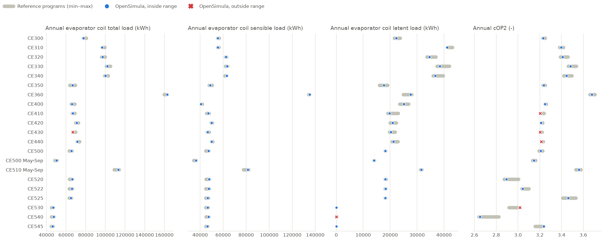

#### Annual evaporator coil total load (kWh)

| Case | OpenSimula | Min | Max | Programs | Result |
|---|--:|--:|--:|--:|---|
| CE300 | 77695.809 | 77283.436 | 80426.867 | 6 | ✓ inside |
| CE310 | 96579.305 | 96447.590 | 99342.132 | 6 | ✓ inside |
| CE320 | 96980.304 | 96083.560 | 99791.678 | 6 | ✓ inside |
| CE330 | 101777.568 | 100729.970 | 105012.871 | 6 | ✓ inside |
| CE340 | 99785.855 | 99027.645 | 102727.979 | 6 | ✓ inside |
| CE350 | 66419.371 | 63634.648 | 69387.998 | 6 | ✓ inside |
| CE360 | 162810.535 | 159807.206 | 162974.063 | 6 | ✓ inside |
| CE400 | 65958.314 | 64917.547 | 68792.822 | 5 | ✓ inside |
| CE410 | 66928.280 | 66175.000 | 68672.854 | 4 | ✓ inside |
| CE420 | 70847.282 | 69610.957 | 72609.307 | 5 | ✓ inside |
| CE430 | 66973.942 | 67141.352 | 69756.312 | 5 | ✗ -0.2 % below min |
| CE440 | 71368.638 | 71181.094 | 73711.363 | 5 | ✓ inside |
| CE500 | 65391.284 | 63105.366 | 65995.861 | 6 | ✓ inside |
| CE500 May-Sep | 50207.250 | 48439.570 | 50692.817 | 6 | ✓ inside |
| CE510 May-Sep | 112933.911 | 108974.310 | 114017.952 | 6 | ✓ inside |
| CE520 | 66127.584 | 63212.102 | 66571.217 | 6 | ✓ inside |
| CE522 | 65746.734 | 63157.030 | 66373.081 | 6 | ✓ inside |
| CE525 | 64897.312 | 63001.558 | 65399.110 | 6 | ✓ inside |
| CE530 | 46622.101 | 44875.414 | 47002.000 | 6 | ✓ inside |
| CE540 | 47255.052 | 44979.842 | 47462.000 | 6 | ✓ inside |
| CE545 | 46247.057 | 44775.110 | 46668.000 | 6 | ✓ inside |

#### Annual evaporator coil sensible load (kWh)

| Case | OpenSimula | Min | Max | Programs | Result |
|---|--:|--:|--:|--:|---|
| CE300 | 55439.790 | 55191.000 | 56661.748 | 6 | ✓ inside |
| CE310 | 55441.826 | 55083.000 | 56312.717 | 6 | ✓ inside |
| CE320 | 62391.595 | 62008.804 | 62859.205 | 6 | ✓ inside |
| CE330 | 63330.979 | 61822.000 | 63778.656 | 6 | ✓ inside |
| CE340 | 63046.360 | 61406.000 | 63110.585 | 6 | ✓ inside |
| CE350 | 48700.678 | 47676.525 | 50370.830 | 6 | ✓ inside |
| CE360 | 135268.377 | 134205.707 | 135287.196 | 6 | ✓ inside |
| CE400 | 40757.433 | 40687.747 | 41952.360 | 5 | ✓ inside |
| CE410 | 47139.009 | 45585.000 | 47659.819 | 4 | ✓ inside |
| CE420 | 49988.137 | 49523.928 | 50612.215 | 5 | ✓ inside |
| CE430 | 46724.891 | 46143.000 | 47863.346 | 5 | ✓ inside |
| CE440 | 50088.793 | 49785.000 | 50876.072 | 5 | ✓ inside |
| CE500 | 47157.461 | 44874.225 | 47649.853 | 6 | ✓ inside |
| CE500 May-Sep | 36215.038 | 34443.234 | 36595.587 | 6 | ✓ inside |
| CE510 May-Sep | 81455.157 | 77489.432 | 82305.704 | 6 | ✓ inside |
| CE520 | 47889.080 | 44976.724 | 48101.520 | 6 | ✓ inside |
| CE522 | 47511.145 | 44924.113 | 47962.298 | 6 | ✓ inside |
| CE525 | 46666.119 | 44775.105 | 47217.531 | 6 | ✓ inside |
| CE530 | 46622.101 | 44874.225 | 47002.000 | 6 | ✓ inside |
| CE540 | 47255.050 | 44976.747 | 47460.000 | 6 | ✓ inside |
| CE545 | 46247.057 | 44775.105 | 46668.000 | 6 | ✓ inside |

#### Annual evaporator coil latent load (kWh)

| Case | OpenSimula | Min | Max | Programs | Result |
|---|--:|--:|--:|--:|---|
| CE300 | 22256.020 | 21486.575 | 23765.119 | 6 | ✓ inside |
| CE310 | 41137.480 | 41093.792 | 43085.754 | 6 | ✓ inside |
| CE320 | 34588.709 | 33659.311 | 36932.473 | 6 | ✓ inside |
| CE330 | 38446.589 | 37418.905 | 41929.495 | 6 | ✓ inside |
| CE340 | 36739.495 | 35974.215 | 39695.373 | 6 | ✓ inside |
| CE350 | 17718.693 | 15958.123 | 19017.167 | 6 | ✓ inside |
| CE360 | 27542.158 | 24887.414 | 27997.227 | 6 | ✓ inside |
| CE400 | 25200.881 | 23498.413 | 26840.463 | 5 | ✓ inside |
| CE410 | 19789.271 | 19120.965 | 22996.208 | 4 | ✓ inside |
| CE420 | 20859.145 | 19944.869 | 22219.483 | 5 | ✓ inside |
| CE430 | 20249.050 | 19765.199 | 21892.966 | 5 | ✓ inside |
| CE440 | 21279.845 | 20689.050 | 22835.291 | 5 | ✓ inside |
| CE500 | 18233.824 | 18079.943 | 18346.301 | 6 | ✓ inside |
| CE500 May-Sep | 13992.212 | 13877.000 | 14097.231 | 6 | ✓ inside |
| CE510 May-Sep | 31478.754 | 31217.000 | 31712.248 | 6 | ✓ inside |
| CE520 | 18238.503 | 18087.000 | 18469.697 | 6 | ✓ inside |
| CE522 | 18235.589 | 18092.976 | 18410.783 | 6 | ✓ inside |
| CE525 | 18231.193 | 18043.574 | 18313.935 | 6 | ✓ inside |
| CE530 | 0.000 | 0.000 | 60.672 | 6 | ✓ inside |
| CE540 | 0.002 | 0.980 | 106.982 | 6 | ✗ -99.8 % below min |
| CE545 | 0.000 | 0.000 | 25.500 | 6 | ✓ inside |

#### Annual cOP2 (-)

| Case | OpenSimula | Min | Max | Programs | Result |
|---|--:|--:|--:|--:|---|
| CE300 | 3.231 | 3.226 | 3.249 | 6 | ✓ inside |
| CE310 | 3.395 | 3.380 | 3.417 | 6 | ✓ inside |
| CE320 | 3.409 | 3.390 | 3.458 | 6 | ✓ inside |
| CE330 | 3.481 | 3.460 | 3.536 | 6 | ✓ inside |
| CE340 | 3.444 | 3.420 | 3.496 | 6 | ✓ inside |
| CE350 | 3.236 | 3.229 | 3.249 | 6 | ✓ inside |
| CE360 | 3.676 | 3.660 | 3.706 | 6 | ✓ inside |
| CE400 | 3.247 | 3.246 | 3.260 | 5 | ✓ inside |
| CE410 | 3.203 | 3.210 | 3.240 | 4 | ✗ -0.2 % below min |
| CE420 | 3.209 | 3.210 | 3.226 | 5 | ✓ inside |
| CE430 | 3.202 | 3.210 | 3.221 | 5 | ✗ -0.2 % below min |
| CE440 | 3.214 | 3.220 | 3.231 | 5 | ✗ -0.2 % below min |
| CE500 | 3.207 | 3.192 | 3.227 | 6 | ✓ inside |
| CE500 May-Sep | 3.147 | 3.132 | 3.162 | 6 | ✓ inside |
| CE510 May-Sep | 3.556 | 3.530 | 3.577 | 6 | ✓ inside |
| CE520 | 2.893 | 2.873 | 3.004 | 6 | ✓ inside |
| CE522 | 3.043 | 3.036 | 3.101 | 6 | ✓ inside |
| CE525 | 3.460 | 3.410 | 3.531 | 6 | ✓ inside |
| CE530 | 3.017 | 2.916 | 2.999 | 6 | ✗ +0.6 % above max |
| CE540 | 2.652 | 2.640 | 2.823 | 6 | ✓ inside |
| CE545 | 3.237 | 3.157 | 3.236 | 6 | ✓ inside |

### Annual mean zone conditions

| Output | Values | Inside range | Outside range |
|---|--:|--:|--:|
| Annual mean indoor dry bulb (°C) | 21 | 20 | 1 |
| Annual mean zone humidity ratio (kg/kg) | 21 | 15 | 6 |
| Annual mean zone relative humidity (%) | 21 | 14 | 7 |

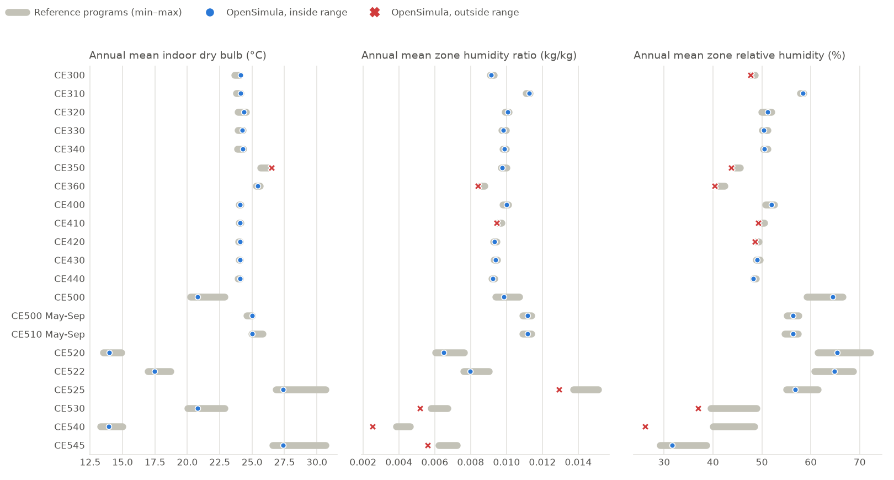

#### Annual mean indoor dry bulb (°C)

| Case | OpenSimula | Min | Max | Programs | Result |
|---|--:|--:|--:|--:|---|
| CE300 | 24.093 | 23.624 | 24.091 | 6 | ✓ inside |
| CE310 | 24.097 | 23.756 | 24.111 | 6 | ✓ inside |
| CE320 | 24.349 | 23.900 | 24.530 | 6 | ✓ inside |
| CE330 | 24.252 | 23.880 | 24.295 | 6 | ✓ inside |
| CE340 | 24.285 | 23.876 | 24.309 | 6 | ✓ inside |
| CE350 | 26.490 | 25.659 | 26.269 | 6 | ✗ +0.22 °C above max |
| CE360 | 25.430 | 25.323 | 25.611 | 6 | ✓ inside |
| CE400 | 24.072 | 23.990 | 24.126 | 5 | ✓ inside |
| CE410 | 24.061 | 23.990 | 24.122 | 4 | ✓ inside |
| CE420 | 24.061 | 23.926 | 24.091 | 5 | ✓ inside |
| CE430 | 24.058 | 23.990 | 24.091 | 5 | ✓ inside |
| CE440 | 24.063 | 23.912 | 24.091 | 5 | ✓ inside |
| CE500 | 20.794 | 20.234 | 22.860 | 6 | ✓ inside |
| CE500 May-Sep | 25.000 | 24.572 | 25.000 | 6 | ✓ inside |
| CE510 May-Sep | 25.000 | 24.960 | 25.817 | 6 | ✓ inside |
| CE520 | 13.974 | 13.517 | 14.890 | 6 | ✓ inside |
| CE522 | 17.482 | 16.946 | 18.700 | 6 | ✓ inside |
| CE525 | 27.410 | 26.844 | 30.690 | 6 | ✓ inside |
| CE530 | 20.794 | 20.025 | 22.860 | 6 | ✓ inside |
| CE540 | 13.948 | 13.289 | 14.980 | 6 | ✓ inside |
| CE545 | 27.410 | 26.605 | 30.690 | 6 | ✓ inside |

#### Annual mean zone humidity ratio (kg/kg)

| Case | OpenSimula | Min | Max | Programs | Result |
|---|--:|--:|--:|--:|---|
| CE300 | 0.009 | 0.009 | 0.009 | 6 | ✓ inside |
| CE310 | 0.011 | 0.011 | 0.011 | 6 | ✓ inside |
| CE320 | 0.010 | 0.010 | 0.010 | 6 | ✓ inside |
| CE330 | 0.010 | 0.010 | 0.010 | 6 | ✓ inside |
| CE340 | 0.010 | 0.010 | 0.010 | 6 | ✓ inside |
| CE350 | 0.010 | 0.010 | 0.010 | 6 | ✓ inside |
| CE360 | 0.008 | 0.008 | 0.009 | 6 | ✗ -1.2 % below min |
| CE400 | 0.010 | 0.010 | 0.010 | 5 | ✓ inside |
| CE410 | 0.009 | 0.009 | 0.010 | 4 | ✗ -0.5 % below min |
| CE420 | 0.009 | 0.009 | 0.009 | 5 | ✓ inside |
| CE430 | 0.009 | 0.009 | 0.009 | 5 | ✓ inside |
| CE440 | 0.009 | 0.009 | 0.009 | 5 | ✓ inside |
| CE500 | 0.010 | 0.009 | 0.011 | 4 | ✓ inside |
| CE500 May-Sep | 0.011 | 0.011 | 0.011 | 6 | ✓ inside |
| CE510 May-Sep | 0.011 | 0.011 | 0.011 | 6 | ✓ inside |
| CE520 | 0.006 | 0.006 | 0.008 | 4 | ✓ inside |
| CE522 | 0.008 | 0.008 | 0.009 | 4 | ✓ inside |
| CE525 | 0.013 | 0.014 | 0.015 | 4 | ✗ -5.8 % below min |
| CE530 | 0.005 | 0.006 | 0.007 | 4 | ✗ -11.0 % below min |
| CE540 | 0.003 | 0.004 | 0.005 | 4 | ✗ -34.2 % below min |
| CE545 | 0.006 | 0.006 | 0.007 | 4 | ✗ -10.2 % below min |

#### Annual mean zone relative humidity (%)

| Case | OpenSimula | Min | Max | Programs | Result |
|---|--:|--:|--:|--:|---|
| CE300 | 47.716 | 47.826 | 48.615 | 6 | ✗ -0.2 % below min |
| CE310 | 58.349 | 57.800 | 58.551 | 6 | ✓ inside |
| CE320 | 51.159 | 49.940 | 52.005 | 6 | ✓ inside |
| CE330 | 50.364 | 50.085 | 51.176 | 6 | ✓ inside |
| CE340 | 50.457 | 50.297 | 51.148 | 6 | ✓ inside |
| CE350 | 43.721 | 44.316 | 45.550 | 6 | ✗ -1.3 % below min |
| CE360 | 40.340 | 40.871 | 42.369 | 6 | ✗ -1.3 % below min |
| CE400 | 51.970 | 50.771 | 52.549 | 5 | ✓ inside |
| CE410 | 49.304 | 49.630 | 50.497 | 4 | ✗ -0.7 % below min |
| CE420 | 48.628 | 48.760 | 49.398 | 5 | ✗ -0.3 % below min |
| CE430 | 49.061 | 48.822 | 49.600 | 5 | ✓ inside |
| CE440 | 48.213 | 48.230 | 48.829 | 5 | ✓ inside |
| CE500 | 64.488 | 59.198 | 66.526 | 4 | ✓ inside |
| CE500 May-Sep | 56.349 | 55.130 | 57.470 | 6 | ✓ inside |
| CE510 May-Sep | 56.345 | 54.700 | 57.436 | 6 | ✓ inside |
| CE520 | 65.351 | 61.405 | 72.170 | 4 | ✓ inside |
| CE522 | 64.814 | 60.752 | 68.677 | 4 | ✓ inside |
| CE525 | 56.854 | 54.994 | 61.467 | 4 | ✓ inside |
| CE530 | 37.015 | 39.600 | 48.973 | 4 | ✗ -6.5 % below min |
| CE540 | 26.087 | 40.051 | 48.521 | 4 | ✗ -34.9 % below min |
| CE545 | 31.643 | 29.200 | 38.631 | 4 | ✓ inside |

### Annual hourly maxima of consumption and loads

| Output | Values | Inside range | Outside range |
|---|--:|--:|--:|
| Maximum hourly consumption (compressor + both fans) (Wh) | 20 | 12 | 8 |
| Maximum hourly coil sensible load (Wh) | 20 | 17 | 3 |
| Maximum hourly coil latent load (Wh) | 20 | 16 | 4 |
| Maximum hourly coil total load (Wh) | 20 | 19 | 1 |

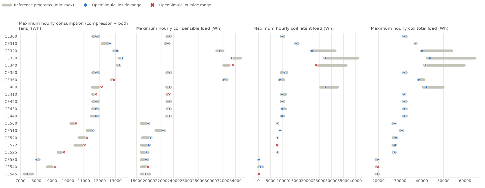

#### Maximum hourly consumption (compressor + both fans) (Wh)

| Case | OpenSimula | Date | Min | Max | Programs | Result |
|---|--:|---|--:|--:|--:|---|
| CE300 | 11748.488 | 20-Jul 15 | 11548.000 | 11932.000 | 6 | ✓ inside |
| CE310 | 12629.802 | 20-Jul 15 | 12162.000 | 12653.000 | 6 | ✓ inside |
| CE320 | 13095.665 | 20-Jul 15 | 12875.000 | 13104.000 | 6 | ✓ inside |
| CE330 | 13428.331 | 20-Jul 15 | 13212.000 | 13467.000 | 6 | ✓ inside |
| CE340 | 13250.092 | 20-Jul 15 | 13101.000 | 13277.000 | 6 | ✓ inside |
| CE350 | 11748.490 | 20-Jul 15 | 11546.000 | 11932.000 | 6 | ✓ inside |
| CE360 | 12896.248 | 20-Jul 15 | 12726.000 | 12863.000 | 6 | ✗ +0.3 % above max |
| CE400 | 12109.718 | 17-Sep 15 | 11519.000 | 11899.860 | 5 | ✗ +1.8 % above max |
| CE410 | 11748.624 | 20-Jul 15 | 11549.000 | 11627.868 | 4 | ✗ +1.0 % above max |
| CE420 | 11749.228 | 20-Jul 15 | 11548.000 | 11899.860 | 5 | ✓ inside |
| CE430 | 11748.624 | 20-Jul 15 | 11548.000 | 11899.860 | 5 | ✓ inside |
| CE440 | 11748.488 | 20-Jul 15 | 11461.000 | 11899.860 | 5 | ✓ inside |
| CE500 | 10498.410 | 20-Jul 15 | 10166.483 | 10431.000 | 6 | ✗ +0.6 % above max |
| CE510 | 11525.149 | 20-Jul 15 | 11186.000 | 11590.000 | 6 | ✓ inside |
| CE520 | 11175.055 | 20-Jul 15 | 10684.000 | 11100.525 | 6 | ✗ +0.7 % above max |
| CE522 | 11040.590 | 20-Jul 15 | 10430.779 | 10972.000 | 6 | ✗ +0.6 % above max |
| CE525 | 9731.006 | 20-Jul 15 | 9366.748 | 9585.000 | 6 | ✗ +1.5 % above max |
| CE530 | 7991.194 | 20-Jul 15 | 7992.000 | 8171.048 | 6 | ✓ inside |
| CE540 | 9150.880 | 20-Jul 15 | 8677.402 | 8985.000 | 6 | ✗ +1.8 % above max |
| CE545 | 7426.513 | 20-Jul 15 | 7204.827 | 7762.756 | 6 | ✓ inside |

#### Maximum hourly coil sensible load (Wh)

| Case | OpenSimula | Date | Min | Max | Programs | Result |
|---|--:|---|--:|--:|--:|---|
| CE300 | 23308.090 | 20-Jul 15 | 22908.000 | 23530.807 | 6 | ✓ inside |
| CE310 | 23082.325 | 11-Jul 15 | 22649.000 | 23276.459 | 6 | ✓ inside |
| CE320 | 31426.940 | 24-Apr 16 | 30967.000 | 31972.085 | 6 | ✓ inside |
| CE330 | 33303.448 | 24-Apr 16 | 33226.100 | 34764.779 | 6 | ✓ inside |
| CE340 | 33592.284 | 24-Apr 16 | 32086.000 | 32940.000 | 6 | ✗ +2.0 % above max |
| CE350 | 23308.090 | 20-Jul 15 | 22876.000 | 23530.807 | 6 | ✓ inside |
| CE360 | 32089.058 | 24-Apr 16 | 31981.000 | 32620.913 | 6 | ✓ inside |
| CE400 | 23308.121 | 20-Jul 15 | 22877.000 | 23530.807 | 5 | ✓ inside |
| CE410 | 23308.079 | 20-Jul 15 | 22893.000 | 23265.700 | 4 | ✗ +0.2 % above max |
| CE420 | 23308.121 | 20-Jul 15 | 22893.000 | 23530.807 | 5 | ✓ inside |
| CE430 | 23308.079 | 20-Jul 15 | 22893.000 | 23530.807 | 5 | ✓ inside |
| CE440 | 23308.090 | 20-Jul 15 | 22875.000 | 23530.807 | 5 | ✓ inside |
| CE500 | 19809.171 | 20-Jul 15 | 18776.000 | 20009.000 | 6 | ✓ inside |
| CE510 | 22283.255 | 20-Jul 15 | 21121.000 | 22513.000 | 6 | ✓ inside |
| CE520 | 20255.396 | 29-Jun 16 | 18969.000 | 20378.000 | 6 | ✓ inside |
| CE522 | 19960.303 | 20-Jul 15 | 18785.000 | 20137.000 | 6 | ✓ inside |
| CE525 | 19608.937 | 20-Jul 15 | 18759.000 | 19850.000 | 6 | ✓ inside |
| CE530 | 19552.024 | 20-Jul 15 | 18776.000 | 19834.100 | 6 | ✓ inside |
| CE540 | 19824.312 | 20-Jul 15 | 18794.000 | 19799.000 | 6 | ✗ +0.1 % above max |
| CE545 | 19410.684 | 20-Jul 15 | 18759.000 | 20075.200 | 6 | ✓ inside |

#### Maximum hourly coil latent load (Wh)

| Case | OpenSimula | Date | Min | Max | Programs | Result |
|---|--:|---|--:|--:|--:|---|
| CE300 | 9719.774 | 03-Sep 15 | 9304.000 | 10392.000 | 6 | ✓ inside |
| CE310 | 15505.089 | 03-Sep 15 | 15139.000 | 16274.838 | 6 | ✓ inside |
| CE320 | 21938.037 | 02-Oct 9 | 21697.000 | 31503.000 | 6 | ✓ inside |
| CE330 | 27593.838 | 18-Sep 15 | 26941.000 | 40809.000 | 6 | ✓ inside |
| CE340 | 23603.086 | 02-Oct 9 | 23794.000 | 36011.000 | 6 | ✗ -0.8 % below min |
| CE350 | 10615.053 | 02-Oct 9 | 9303.000 | 11603.000 | 6 | ✓ inside |
| CE360 | 8799.820 | 02-Oct 9 | 8520.318 | 10336.000 | 6 | ✓ inside |
| CE400 | 27593.838 | 18-Sep 15 | 25578.000 | 32396.000 | 5 | ✓ inside |
| CE410 | 9719.951 | 03-Sep 15 | 9304.000 | 11138.900 | 4 | ✓ inside |
| CE420 | 9719.130 | 03-Sep 15 | 9304.000 | 10394.000 | 5 | ✓ inside |
| CE430 | 9719.951 | 03-Sep 15 | 9635.700 | 11105.000 | 5 | ✓ inside |
| CE440 | 9719.774 | 03-Sep 15 | 9304.000 | 10234.822 | 5 | ✓ inside |
| CE500 | 7706.828 | 29-Jun 16 | 7733.000 | 7965.460 | 6 | ✗ -0.3 % below min |
| CE510 | 8703.996 | 17-Jun 14 | 8723.000 | 8954.792 | 6 | ✗ -0.2 % below min |
| CE520 | 7771.679 | 29-Jun 16 | 7698.534 | 7964.000 | 6 | ✓ inside |
| CE522 | 7671.315 | 29-Jun 16 | 7743.000 | 7906.700 | 6 | ✗ -0.9 % below min |
| CE525 | 7765.875 | 29-Jun 16 | 7663.000 | 8037.070 | 6 | ✓ inside |
| CE530 | 0.000 | 01-Jan 1 | 0.000 | 179.000 | 6 | ✓ inside |
| CE540 | 1.925 | 01-Jan 1 | 0.000 | 1654.951 | 6 | ✓ inside |
| CE545 | 0.000 | 01-Jan 1 | 0.000 | 4.000 | 6 | ✓ inside |

#### Maximum hourly coil total load (Wh)

| Case | OpenSimula | Date | Min | Max | Programs | Result |
|---|--:|---|--:|--:|--:|---|
| CE300 | 31846.698 | 20-Jul 15 | 31401.000 | 32733.256 | 6 | ✓ inside |
| CE310 | 36994.946 | 03-Sep 15 | 36750.000 | 37328.000 | 6 | ✓ inside |
| CE320 | 40083.310 | 03-Sep 15 | 39765.183 | 53823.000 | 6 | ✓ inside |
| CE330 | 43643.481 | 02-Oct 9 | 42415.000 | 64572.000 | 6 | ✓ inside |
| CE340 | 41601.507 | 02-Oct 9 | 41132.000 | 59549.000 | 6 | ✓ inside |
| CE350 | 31846.703 | 20-Jul 15 | 31401.000 | 32733.265 | 6 | ✓ inside |
| CE360 | 38563.821 | 02-Oct 9 | 38322.000 | 41019.000 | 6 | ✓ inside |
| CE400 | 42045.693 | 18-Sep 15 | 40543.000 | 49838.000 | 5 | ✓ inside |
| CE410 | 31847.289 | 20-Jul 15 | 31401.000 | 32091.730 | 4 | ✓ inside |
| CE420 | 31849.646 | 20-Jul 15 | 31401.000 | 32733.256 | 5 | ✓ inside |
| CE430 | 31847.289 | 20-Jul 15 | 31401.000 | 32733.256 | 5 | ✓ inside |
| CE440 | 31846.698 | 20-Jul 15 | 31401.000 | 32733.256 | 5 | ✓ inside |
| CE500 | 27440.917 | 20-Jul 16 | 26567.000 | 27707.000 | 6 | ✓ inside |
| CE510 | 30865.439 | 20-Jul 16 | 29948.000 | 31188.000 | 6 | ✓ inside |
| CE520 | 28027.075 | 29-Jun 16 | 26675.000 | 28343.000 | 6 | ✓ inside |
| CE522 | 27573.628 | 20-Jul 15 | 26514.000 | 27868.000 | 6 | ✓ inside |
| CE525 | 27312.172 | 29-Jun 16 | 26683.000 | 27739.770 | 6 | ✓ inside |
| CE530 | 19552.024 | 20-Jul 15 | 18776.000 | 19834.100 | 6 | ✓ inside |
| CE540 | 19824.312 | 20-Jul 15 | 18794.000 | 19799.000 | 6 | ✗ +0.1 % above max |
| CE545 | 19410.684 | 20-Jul 15 | 18764.000 | 20075.200 | 6 | ✓ inside |

### Annual hourly maxima and minima of COP2 and zone conditions

| Output | Values | Inside range | Outside range |
|---|--:|--:|--:|
| Maximum hourly COP2 (-) | 20 | 18 | 2 |
| Minimum hourly COP2 (-) | 20 | 18 | 2 |
| Maximum indoor dry bulb (°C) | 20 | 17 | 3 |
| Minimum indoor dry bulb (°C) | 20 | 12 | 8 |
| Maximum zone humidity ratio (kg/kg) | 20 | 7 | 13 |
| Minimum zone humidity ratio (kg/kg) | 20 | 12 | 8 |
| Maximum zone relative humidity (%) | 20 | 18 | 2 |
| Minimum zone relative humidity (%) | 20 | 14 | 6 |

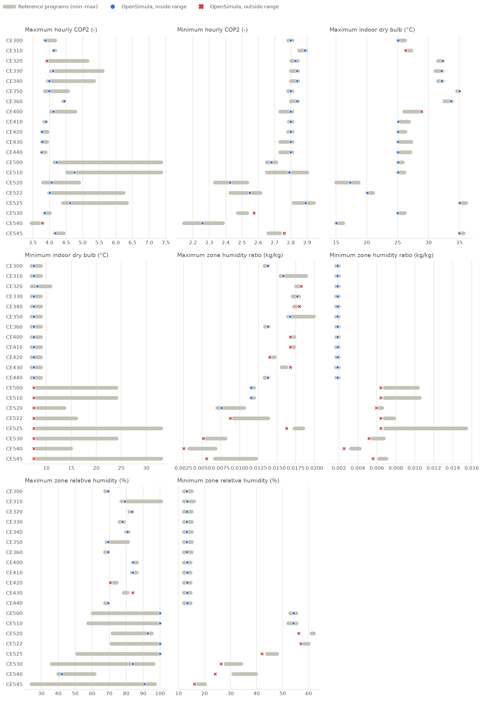

#### Maximum hourly COP2 (-)

| Case | OpenSimula | Date | Min | Max | Programs | Result |
|---|--:|---|--:|--:|--:|---|
| CE300 | 3.874 | 30-Apr 16 | 3.857 | 4.168 | 6 | ✓ inside |
| CE310 | 4.123 | 30-Apr 16 | 4.120 | 4.173 | 6 | ✓ inside |
| CE320 | 3.917 | 16-Sep 15 | 3.940 | 5.143 | 6 | ✗ -0.6 % below min |
| CE330 | 4.109 | 17-Jun 16 | 4.050 | 5.595 | 6 | ✓ inside |
| CE340 | 3.993 | 16-Sep 16 | 3.950 | 5.339 | 6 | ✓ inside |
| CE350 | 3.995 | 12-Oct 24 | 3.863 | 4.555 | 6 | ✓ inside |
| CE360 | 4.444 | 04-Oct 24 | 4.401 | 4.455 | 6 | ✓ inside |
| CE400 | 4.116 | 24-Oct 16 | 4.050 | 4.776 | 5 | ✓ inside |
| CE410 | 3.898 | 30-Apr 15 | 3.840 | 3.903 | 4 | ✓ inside |
| CE420 | 3.783 | 21-May 15 | 3.759 | 3.940 | 5 | ✓ inside |
| CE430 | 3.784 | 21-May 15 | 3.759 | 3.930 | 5 | ✓ inside |
| CE440 | 3.759 | 27-Sep 15 | 3.759 | 3.883 | 5 | ✓ inside |
| CE500 | 4.215 | 16-Mar 10 | 4.140 | 7.367 | 6 | ✓ inside |
| CE510 | 4.747 | 04-Oct 24 | 4.530 | 7.367 | 6 | ✓ inside |
| CE520 | 4.060 | 01-Jan 1 | 3.802 | 4.896 | 6 | ✓ inside |
| CE522 | 4.003 | 30-Apr 16 | 3.986 | 6.233 | 6 | ✓ inside |
| CE525 | 4.619 | 16-Mar 10 | 4.400 | 6.325 | 6 | ✓ inside |
| CE530 | 3.859 | 16-Mar 10 | 3.840 | 4.006 | 6 | ✓ inside |
| CE540 | 3.789 | 01-Jan 1 | 3.455 | 3.696 | 6 | ✗ +2.5 % above max |
| CE545 | 4.179 | 16-Mar 10 | 4.156 | 4.428 | 6 | ✓ inside |

#### Minimum hourly COP2 (-)

| Case | OpenSimula | Date | Min | Max | Programs | Result |
|---|--:|---|--:|--:|--:|---|
| CE300 | 2.799 | 13-Jun 17 | 2.782 | 2.810 | 6 | ✓ inside |
| CE310 | 2.886 | 01-Dec 15 | 2.850 | 2.893 | 6 | ✓ inside |
| CE320 | 2.828 | 31-Mar 15 | 2.801 | 2.842 | 6 | ✓ inside |
| CE330 | 2.838 | 31-Mar 15 | 2.798 | 2.844 | 6 | ✓ inside |
| CE340 | 2.838 | 31-Mar 15 | 2.798 | 2.844 | 6 | ✓ inside |
| CE350 | 2.799 | 13-Jun 17 | 2.782 | 2.810 | 6 | ✓ inside |
| CE360 | 2.838 | 31-Mar 15 | 2.799 | 2.844 | 6 | ✓ inside |
| CE400 | 2.798 | 03-Dec 14 | 2.734 | 2.810 | 5 | ✓ inside |
| CE410 | 2.799 | 13-Jun 17 | 2.786 | 2.810 | 4 | ✓ inside |
| CE420 | 2.799 | 13-Jun 17 | 2.782 | 2.810 | 5 | ✓ inside |
| CE430 | 2.798 | 03-Dec 14 | 2.734 | 2.810 | 5 | ✓ inside |
| CE440 | 2.798 | 03-Dec 14 | 2.734 | 2.810 | 5 | ✓ inside |
| CE500 | 2.680 | 29-Jul 12 | 2.652 | 2.710 | 6 | ✓ inside |
| CE510 | 2.789 | 05-Apr 17 | 2.652 | 2.900 | 6 | ✓ inside |
| CE520 | 2.426 | 29-Jul 12 | 2.333 | 2.532 | 6 | ✓ inside |
| CE522 | 2.547 | 29-Jul 12 | 2.429 | 2.613 | 6 | ✓ inside |
| CE525 | 2.889 | 29-Jul 12 | 2.814 | 2.940 | 6 | ✓ inside |
| CE530 | 2.574 | 29-Jul 12 | 2.473 | 2.532 | 6 | ✗ +1.6 % above max |
| CE540 | 2.256 | 29-Jul 12 | 2.143 | 2.383 | 6 | ✓ inside |
| CE545 | 2.758 | 29-Jul 12 | 2.660 | 2.733 | 6 | ✗ +0.9 % above max |

#### Maximum indoor dry bulb (°C)

| Case | OpenSimula | Date | Min | Max | Programs | Result |
|---|--:|---|--:|--:|--:|---|
| CE300 | 25.004 | 17-Mar 14 | 25.002 | 26.200 | 6 | ✓ inside |
| CE310 | 26.256 | 20-Jul 15 | 26.475 | 27.190 | 6 | ✗ -0.22 °C below min |
| CE320 | 32.277 | 20-Jul 15 | 31.500 | 32.360 | 6 | ✓ inside |
| CE330 | 32.120 | 20-Jul 15 | 31.069 | 32.232 | 6 | ✓ inside |
| CE340 | 32.133 | 20-Jul 15 | 31.498 | 32.307 | 6 | ✓ inside |
| CE350 | 35.004 | 23-Sep 2 | 34.584 | 35.002 | 6 | ✓ inside |
| CE360 | 33.680 | 20-Jul 15 | 32.511 | 33.758 | 6 | ✓ inside |
| CE400 | 28.873 | 05-Aug 16 | 26.040 | 28.830 | 5 | ✗ +0.04 °C above max |
| CE410 | 25.003 | 04-Oct 10 | 25.110 | 26.826 | 4 | ✗ -0.11 °C below min |
| CE420 | 25.004 | 11-Aug 16 | 25.002 | 26.230 | 5 | ✓ inside |
| CE430 | 25.002 | 29-Apr 13 | 25.003 | 27.199 | 5 | ✓ inside |
| CE440 | 25.002 | 21-Apr 2 | 25.003 | 27.045 | 5 | ✓ inside |
| CE500 | 25.007 | 04-Apr 17 | 25.000 | 25.805 | 6 | ✓ inside |
| CE510 | 25.007 | 04-Apr 17 | 25.000 | 26.100 | 6 | ✓ inside |
| CE520 | 17.240 | 04-Jun 16 | 15.000 | 18.620 | 6 | ✓ inside |
| CE522 | 20.020 | 17-Apr 22 | 20.000 | 21.009 | 6 | ✓ inside |
| CE525 | 35.000 | 11-Mar 10 | 34.999 | 36.080 | 6 | ✓ inside |
| CE530 | 25.007 | 04-Apr 17 | 25.000 | 26.116 | 6 | ✓ inside |
| CE540 | 15.044 | 10-Apr 4 | 15.000 | 16.146 | 6 | ✓ inside |
| CE545 | 35.000 | 11-Mar 10 | 35.000 | 35.672 | 6 | ✓ inside |

#### Minimum indoor dry bulb (°C)

| Case | OpenSimula | Date | Min | Max | Programs | Result |
|---|--:|---|--:|--:|--:|---|
| CE300 | 7.472 | 06-Jan 5 | 6.990 | 8.890 | 6 | ✓ inside |
| CE310 | 7.472 | 06-Jan 5 | 6.990 | 8.890 | 6 | ✓ inside |
| CE320 | 8.187 | 06-Jan 5 | 6.990 | 10.830 | 6 | ✓ inside |
| CE330 | 7.472 | 06-Jan 5 | 6.990 | 8.890 | 6 | ✓ inside |
| CE340 | 7.472 | 06-Jan 5 | 6.990 | 8.890 | 6 | ✓ inside |
| CE350 | 7.472 | 06-Jan 5 | 6.990 | 8.890 | 6 | ✓ inside |
| CE360 | 7.473 | 06-Jan 5 | 6.990 | 8.890 | 6 | ✓ inside |
| CE400 | 7.472 | 06-Jan 5 | 6.990 | 8.890 | 5 | ✓ inside |
| CE410 | 7.472 | 06-Jan 5 | 6.990 | 8.890 | 4 | ✓ inside |
| CE420 | 7.472 | 06-Jan 5 | 6.990 | 8.890 | 5 | ✓ inside |
| CE430 | 7.472 | 06-Jan 5 | 6.990 | 8.890 | 5 | ✓ inside |
| CE440 | 7.472 | 06-Jan 5 | 7.000 | 8.890 | 5 | ✓ inside |
| CE500 | 7.482 | 20-Dec 12 | 7.940 | 24.040 | 6 | ✗ -0.46 °C below min |
| CE510 | 7.482 | 20-Dec 12 | 7.940 | 24.040 | 6 | ✗ -0.46 °C below min |
| CE520 | 7.460 | 20-Dec 12 | 7.890 | 13.570 | 6 | ✗ -0.43 °C below min |
| CE522 | 7.481 | 20-Dec 12 | 7.940 | 15.980 | 6 | ✗ -0.46 °C below min |
| CE525 | 7.483 | 20-Dec 12 | 7.940 | 33.010 | 6 | ✗ -0.46 °C below min |
| CE530 | 7.482 | 20-Dec 12 | 7.940 | 24.040 | 6 | ✗ -0.46 °C below min |
| CE540 | 7.460 | 20-Dec 12 | 7.890 | 14.950 | 6 | ✗ -0.43 °C below min |
| CE545 | 7.483 | 20-Dec 12 | 7.940 | 33.010 | 6 | ✗ -0.46 °C below min |

#### Maximum zone humidity ratio (kg/kg)

| Case | OpenSimula | Date | Min | Max | Programs | Result |
|---|--:|---|--:|--:|--:|---|
| CE300 | 0.014 | 16-Nov 16 | 0.013 | 0.014 | 6 | ✓ inside |
| CE310 | 0.016 | 01-Oct 8 | 0.015 | 0.019 | 6 | ✓ inside |
| CE320 | 0.018 | 02-Oct 9 | 0.018 | 0.018 | 6 | ✗ +1.0 % above max |
| CE330 | 0.018 | 10-Jul 12 | 0.017 | 0.018 | 6 | ✓ inside |
| CE340 | 0.018 | 10-Jul 12 | 0.017 | 0.018 | 6 | ✗ +0.6 % above max |
| CE350 | 0.017 | 01-Oct 8 | 0.016 | 0.020 | 6 | ✓ inside |
| CE360 | 0.014 | 16-Nov 16 | 0.013 | 0.014 | 6 | ✓ inside |
| CE400 | 0.017 | 05-Apr 22 | 0.017 | 0.017 | 5 | ✗ -0.5 % below min |
| CE410 | 0.017 | 02-Apr 5 | 0.017 | 0.017 | 4 | ✗ -0.4 % below min |
| CE420 | 0.014 | 17-Apr 3 | 0.014 | 0.015 | 5 | ✗ -0.6 % below min |
| CE430 | 0.017 | 02-Apr 5 | 0.016 | 0.016 | 5 | ✗ +3.3 % above max |
| CE440 | 0.014 | 16-Nov 16 | 0.013 | 0.014 | 5 | ✓ inside |
| CE500 | 0.011 | 20-Jul 15 | 0.011 | 0.012 | 6 | ✗ -0.1 % below min |
| CE510 | 0.011 | 20-Jul 15 | 0.011 | 0.012 | 6 | ✗ -0.1 % below min |
| CE520 | 0.008 | 04-Jun 16 | 0.007 | 0.011 | 6 | ✓ inside |
| CE522 | 0.009 | 20-Jul 15 | 0.009 | 0.014 | 6 | ✗ -4.2 % below min |
| CE525 | 0.016 | 20-Jul 15 | 0.017 | 0.018 | 6 | ✗ -5.9 % below min |
| CE530 | 0.005 | 01-Jan 1 | 0.005 | 0.008 | 6 | ✗ -6.0 % below min |
| CE540 | 0.003 | 01-Jan 1 | 0.003 | 0.007 | 6 | ✗ -22.1 % below min |
| CE545 | 0.006 | 01-Jan 1 | 0.007 | 0.012 | 6 | ✗ -16.4 % below min |

#### Minimum zone humidity ratio (kg/kg)

| Case | OpenSimula | Date | Min | Max | Programs | Result |
|---|--:|---|--:|--:|--:|---|
| CE300 | 0.002 | 11-Jan 2 | 0.002 | 0.002 | 6 | ✓ inside |
| CE310 | 0.002 | 11-Jan 2 | 0.002 | 0.002 | 6 | ✓ inside |
| CE320 | 0.002 | 11-Jan 2 | 0.002 | 0.002 | 6 | ✓ inside |
| CE330 | 0.002 | 11-Jan 2 | 0.002 | 0.002 | 6 | ✓ inside |
| CE340 | 0.002 | 11-Jan 2 | 0.002 | 0.002 | 6 | ✓ inside |
| CE350 | 0.002 | 11-Jan 2 | 0.002 | 0.002 | 6 | ✓ inside |
| CE360 | 0.002 | 11-Jan 2 | 0.002 | 0.002 | 6 | ✓ inside |
| CE400 | 0.002 | 11-Jan 2 | 0.002 | 0.002 | 5 | ✓ inside |
| CE410 | 0.002 | 11-Jan 2 | 0.002 | 0.002 | 4 | ✓ inside |
| CE420 | 0.002 | 11-Jan 2 | 0.002 | 0.002 | 5 | ✓ inside |
| CE430 | 0.002 | 11-Jan 2 | 0.002 | 0.002 | 5 | ✓ inside |
| CE440 | 0.002 | 11-Jan 2 | 0.002 | 0.002 | 5 | ✓ inside |
| CE500 | 0.006 | 20-Dec 12 | 0.007 | 0.010 | 4 | ✗ -5.9 % below min |
| CE510 | 0.006 | 20-Dec 12 | 0.007 | 0.011 | 4 | ✗ -5.9 % below min |
| CE520 | 0.006 | 27-Nov 23 | 0.006 | 0.007 | 4 | ✗ -2.8 % below min |
| CE522 | 0.006 | 20-Dec 13 | 0.007 | 0.008 | 4 | ✗ -5.8 % below min |
| CE525 | 0.006 | 20-Dec 12 | 0.007 | 0.015 | 4 | ✗ -6.0 % below min |
| CE530 | 0.005 | 01-Apr 1 | 0.005 | 0.007 | 4 | ✗ -5.4 % below min |
| CE540 | 0.003 | 01-Apr 1 | 0.003 | 0.004 | 4 | ✗ -22.0 % below min |
| CE545 | 0.006 | 01-Apr 1 | 0.006 | 0.007 | 4 | ✗ -10.0 % below min |

#### Maximum zone relative humidity (%)

| Case | OpenSimula | Date | Min | Max | Programs | Result |
|---|--:|---|--:|--:|--:|---|
| CE300 | 69.344 | 16-Nov 16 | 67.440 | 69.350 | 6 | ✓ inside |
| CE310 | 79.297 | 01-Oct 8 | 77.000 | 100.700 | 6 | ✓ inside |
| CE320 | 83.370 | 22-Apr 18 | 81.836 | 83.670 | 6 | ✓ inside |
| CE330 | 77.769 | 30-Aug 12 | 76.000 | 78.700 | 6 | ✓ inside |
| CE340 | 80.757 | 22-Apr 18 | 79.929 | 81.370 | 6 | ✓ inside |
| CE350 | 69.344 | 16-Nov 16 | 68.367 | 81.120 | 6 | ✓ inside |
| CE360 | 69.344 | 16-Nov 16 | 67.440 | 69.350 | 6 | ✓ inside |
| CE400 | 84.014 | 05-Apr 22 | 83.753 | 86.310 | 5 | ✓ inside |
| CE410 | 83.935 | 02-Apr 5 | 83.225 | 86.180 | 4 | ✓ inside |
| CE420 | 70.560 | 17-Apr 3 | 70.841 | 74.510 | 5 | ✗ -0.4 % below min |
| CE430 | 83.935 | 02-Apr 5 | 78.430 | 80.743 | 5 | ✗ +4.0 % above max |
| CE440 | 69.344 | 16-Nov 16 | 67.510 | 69.350 | 5 | ✓ inside |
| CE500 | 100.000 | 13-Jan 3 | 60.080 | 100.000 | 4 | ✓ inside |
| CE510 | 100.000 | 13-Jan 3 | 57.510 | 100.000 | 4 | ✓ inside |
| CE520 | 92.564 | 20-Dec 12 | 71.770 | 95.000 | 4 | ✓ inside |
| CE522 | 100.000 | 13-Jan 3 | 71.320 | 100.000 | 4 | ✓ inside |
| CE525 | 100.000 | 13-Jan 3 | 51.120 | 100.000 | 4 | ✓ inside |
| CE530 | 83.836 | 14-Jan 8 | 36.010 | 96.160 | 4 | ✓ inside |
| CE540 | 42.240 | 14-Jan 8 | 39.960 | 61.275 | 4 | ✓ inside |
| CE545 | 90.743 | 14-Jan 8 | 24.140 | 97.000 | 4 | ✓ inside |

#### Minimum zone relative humidity (%)

| Case | OpenSimula | Date | Min | Max | Programs | Result |
|---|--:|---|--:|--:|--:|---|
| CE300 | 13.108 | 06-Nov 5 | 11.970 | 15.000 | 6 | ✓ inside |
| CE310 | 13.326 | 06-Nov 5 | 11.970 | 16.000 | 6 | ✓ inside |
| CE320 | 13.108 | 06-Nov 5 | 11.970 | 15.000 | 6 | ✓ inside |
| CE330 | 13.108 | 06-Nov 5 | 11.970 | 15.000 | 6 | ✓ inside |
| CE340 | 13.108 | 06-Nov 5 | 11.970 | 15.000 | 6 | ✓ inside |
| CE350 | 13.108 | 06-Nov 5 | 11.970 | 15.000 | 6 | ✓ inside |
| CE360 | 13.108 | 06-Nov 5 | 11.970 | 15.000 | 6 | ✓ inside |
| CE400 | 13.313 | 06-Nov 5 | 11.970 | 14.570 | 5 | ✓ inside |
| CE410 | 13.313 | 06-Nov 5 | 11.970 | 14.580 | 4 | ✓ inside |
| CE420 | 13.313 | 06-Nov 5 | 11.970 | 14.590 | 5 | ✓ inside |
| CE430 | 13.313 | 06-Nov 5 | 11.970 | 14.580 | 5 | ✓ inside |
| CE440 | 13.313 | 06-Nov 5 | 11.970 | 14.540 | 5 | ✓ inside |
| CE500 | 54.195 | 05-Oct 1 | 52.830 | 55.167 | 4 | ✓ inside |
| CE510 | 54.134 | 04-Oct 24 | 52.088 | 55.288 | 4 | ✓ inside |
| CE520 | 56.124 | 27-Nov 23 | 61.000 | 61.900 | 4 | ✗ -8.0 % below min |
| CE522 | 57.007 | 05-Oct 1 | 57.970 | 60.000 | 4 | ✗ -1.7 % below min |
| CE525 | 42.048 | 05-Oct 2 | 44.000 | 47.852 | 4 | ✗ -4.4 % below min |
| CE530 | 26.291 | 04-Apr 17 | 28.000 | 34.028 | 4 | ✗ -6.1 % below min |
| CE540 | 24.066 | 10-Apr 4 | 31.000 | 39.740 | 4 | ✗ -22.4 % below min |
| CE545 | 16.032 | 01-Apr 10 | 17.124 | 20.140 | 4 | ✗ -6.4 % below min |

### Weather checks, case CE300

| Output | Values | Inside range | Outside range |
|---|--:|--:|--:|
| Annual mean outdoor dry bulb (°C) | 1 | 1 | 0 |
| Annual mean outdoor humidity ratio (kg/kg) | 1 | 1 | 0 |
| Maximum outdoor dry bulb (°C) | 1 | 1 | 0 |
| Maximum outdoor humidity ratio (kg/kg) | 1 | 1 | 0 |

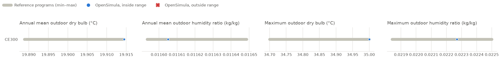

#### Annual mean outdoor dry bulb (°C)

| Case | OpenSimula | Min | Max | Programs | Result |
|---|--:|--:|--:|--:|---|
| CE300 | 19.914 | 19.889 | 19.914 | 6 | ✓ inside |

#### Annual mean outdoor humidity ratio (kg/kg)

| Case | OpenSimula | Min | Max | Programs | Result |
|---|--:|--:|--:|--:|---|
| CE300 | 0.012 | 0.012 | 0.012 | 6 | ✓ inside |

#### Maximum outdoor dry bulb (°C)

| Case | OpenSimula | Date | Min | Max | Programs | Result |
|---|--:|---|--:|--:|--:|---|
| CE300 | 35.000 | 20-Jul 15 | 34.700 | 35.000 | 6 | ✓ inside |

#### Maximum outdoor humidity ratio (kg/kg)

| Case | OpenSimula | Date | Min | Max | Programs | Result |
|---|--:|---|--:|--:|--:|---|
| CE300 | 0.022 | 02-Oct 9 | 0.022 | 0.022 | 6 | ✓ inside |

### June 28 hourly output, case CE300

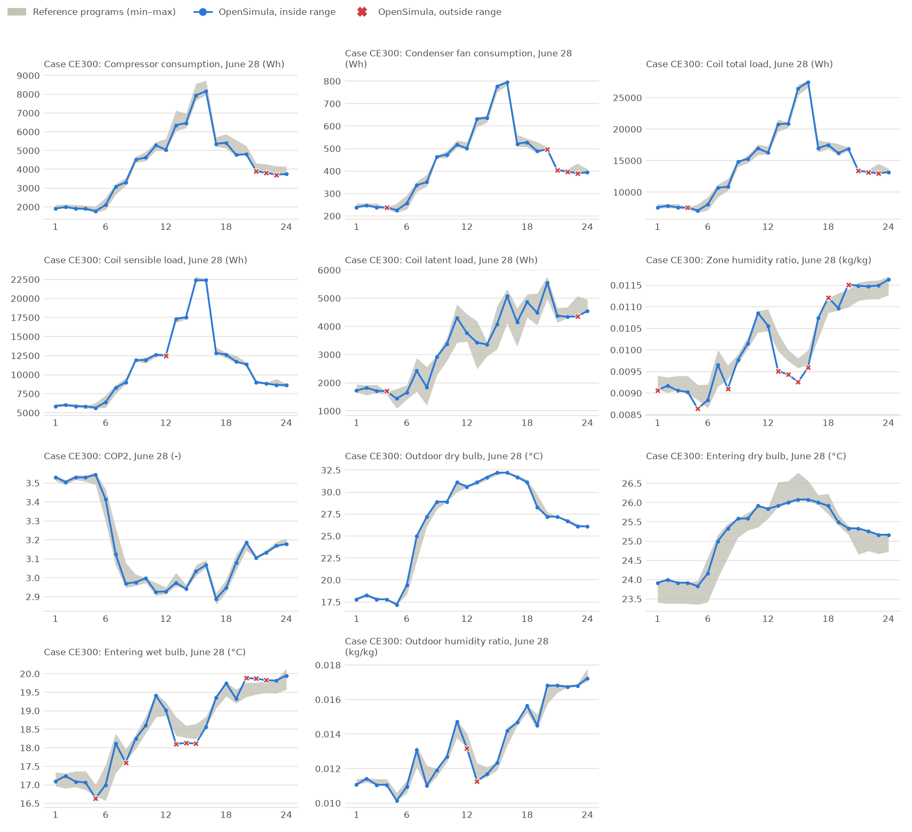

| Case | Output | Values | Inside range | Largest distance outside range |
|---|---|--:|--:|--:|
| CE300 | Compressor consumption, June 28 (Wh) | 24 | 21 | 38 Wh |
| CE300 | Condenser fan consumption, June 28 (Wh) | 24 | 19 | 3.57 Wh |
| CE300 | Coil total load, June 28 (Wh) | 24 | 20 | 148 Wh |
| CE300 | Coil sensible load, June 28 (Wh) | 24 | 23 | 77.3 Wh |
| CE300 | Coil latent load, June 28 (Wh) | 24 | 22 | 53.6 Wh |
| CE300 | Zone humidity ratio, June 28 (kg/kg) | 24 | 17 | 0.000461 kg/kg |
| CE300 | COP2, June 28 (-) | 24 | 24 | – |
| CE300 | Outdoor dry bulb, June 28 (°C) | 24 | 24 | – |
| CE300 | Entering dry bulb, June 28 (°C) | 24 | 24 | 0.00453 °C |
| CE300 | Entering wet bulb, June 28 (°C) | 24 | 16 | 0.22 °C |
| CE300 | Outdoor humidity ratio, June 28 (kg/kg) | 24 | 22 | 2.46e-05 kg/kg |

### Daily average outputs, cases CE500 and CE530

| Output | Values | Inside range | Outside range |
|---|--:|--:|--:|
| Daily average total consumption (Wh) | 4 | 4 | 0 |
| Daily average compressor consumption (Wh) | 4 | 4 | 0 |
| Daily average condenser fan consumption (Wh) | 4 | 4 | 0 |
| Daily average indoor fan consumption (Wh) | 4 | 3 | 1 |
| Daily average coil total load (Wh) | 4 | 4 | 0 |
| Daily average coil sensible load (Wh) | 4 | 4 | 0 |
| Daily average coil latent load (Wh) | 4 | 4 | 0 |
| Daily average zone humidity ratio (kg/kg) | 4 | 2 | 2 |
| Daily average cOP2 (-) | 4 | 3 | 1 |
| Daily average outdoor dry bulb (°C) | 4 | 4 | 0 |
| Daily average entering dry bulb (°C) | 4 | 4 | 0 |

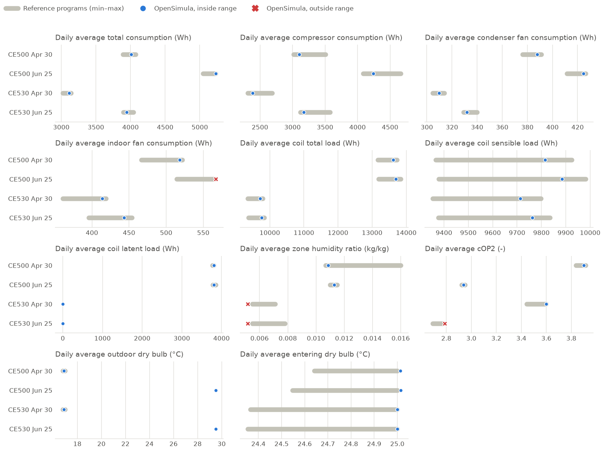

#### Daily average total consumption (Wh)

| Case | OpenSimula | Min | Max | Programs | Result |
|---|--:|--:|--:|--:|---|
| CE500 Apr 30 | 4010.886 | 3892.939 | 4073.000 | 6 | ✓ inside |
| CE500 Jun 25 | 5231.519 | 5044.922 | 5230.000 | 6 | ✓ inside |
| CE530 Apr 30 | 3112.503 | 3022.773 | 3144.000 | 6 | ✓ inside |
| CE530 Jun 25 | 3946.516 | 3894.123 | 4043.000 | 6 | ✓ inside |

#### Daily average compressor consumption (Wh)

| Case | OpenSimula | Min | Max | Programs | Result |
|---|--:|--:|--:|--:|---|
| CE500 Apr 30 | 3104.611 | 3014.619 | 3509.897 | 6 | ✓ inside |
| CE500 Jun 25 | 4239.761 | 4083.883 | 4663.240 | 6 | ✓ inside |
| CE530 Apr 30 | 2389.070 | 2311.472 | 2689.040 | 6 | ✓ inside |
| CE530 Jun 25 | 3171.343 | 3118.095 | 3578.620 | 6 | ✓ inside |

#### Daily average condenser fan consumption (Wh)

| Case | OpenSimula | Min | Max | Programs | Result |
|---|--:|--:|--:|--:|---|
| CE500 Apr 30 | 388.046 | 376.076 | 391.000 | 5 | ✓ inside |
| CE500 Jun 25 | 424.648 | 411.333 | 426.333 | 5 | ✓ inside |
| CE530 Apr 30 | 309.757 | 304.562 | 314.000 | 5 | ✓ inside |
| CE530 Jun 25 | 331.911 | 329.250 | 340.000 | 5 | ✓ inside |

#### Daily average indoor fan consumption (Wh)

| Case | OpenSimula | Min | Max | Programs | Result |
|---|--:|--:|--:|--:|---|
| CE500 Apr 30 | 518.229 | 466.417 | 522.000 | 6 | ✓ inside |
| CE500 Jun 25 | 567.110 | 514.333 | 566.000 | 6 | ✗ +0.2 % above max |
| CE530 Apr 30 | 413.676 | 360.750 | 419.000 | 6 | ✓ inside |
| CE530 Jun 25 | 443.262 | 395.500 | 454.000 | 6 | ✓ inside |

#### Daily average coil total load (Wh)

| Case | OpenSimula | Min | Max | Programs | Result |
|---|--:|--:|--:|--:|---|
| CE500 Apr 30 | 13619.363 | 13169.542 | 13732.907 | 6 | ✓ inside |
| CE500 Jun 25 | 13692.548 | 13188.050 | 13837.532 | 6 | ✓ inside |
| CE530 Apr 30 | 9713.436 | 9353.163 | 9798.000 | 6 | ✓ inside |
| CE530 Jun 25 | 9762.706 | 9376.296 | 9835.136 | 6 | ✓ inside |

#### Daily average coil sensible load (Wh)

| Case | OpenSimula | Min | Max | Programs | Result |
|---|--:|--:|--:|--:|---|
| CE500 Apr 30 | 9811.996 | 9365.458 | 9925.025 | 6 | ✓ inside |
| CE500 Jun 25 | 9881.868 | 9377.687 | 9981.240 | 6 | ✓ inside |
| CE530 Apr 30 | 9713.436 | 9353.163 | 9798.000 | 6 | ✓ inside |
| CE530 Jun 25 | 9762.706 | 9376.296 | 9835.136 | 6 | ✓ inside |

#### Daily average coil latent load (Wh)

| Case | OpenSimula | Min | Max | Programs | Result |
|---|--:|--:|--:|--:|---|
| CE500 Apr 30 | 3807.367 | 3770.000 | 3810.890 | 6 | ✓ inside |
| CE500 Jun 25 | 3810.680 | 3780.000 | 3856.292 | 6 | ✓ inside |
| CE530 Apr 30 | 0.000 | -0.000 | 0.000 | 6 | ✓ inside |
| CE530 Jun 25 | 0.000 | 0.000 | 0.024 | 6 | ✓ inside |

#### Daily average zone humidity ratio (kg/kg)

| Case | OpenSimula | Min | Max | Programs | Result |
|---|--:|--:|--:|--:|---|
| CE500 Apr 30 | 0.011 | 0.011 | 0.016 | 6 | ✓ inside |
| CE500 Jun 25 | 0.011 | 0.011 | 0.011 | 6 | ✓ inside |
| CE530 Apr 30 | 0.005 | 0.005 | 0.007 | 6 | ✗ -5.9 % below min |
| CE530 Jun 25 | 0.005 | 0.005 | 0.008 | 6 | ✗ -5.8 % below min |

#### Daily average cOP2 (-)

| Case | OpenSimula | Min | Max | Programs | Result |
|---|--:|--:|--:|--:|---|
| CE500 Apr 30 | 3.899 | 3.837 | 3.914 | 6 | ✓ inside |
| CE500 Jun 25 | 2.936 | 2.921 | 2.951 | 6 | ✓ inside |
| CE530 Apr 30 | 3.599 | 3.441 | 3.599 | 6 | ✓ inside |
| CE530 Jun 25 | 2.787 | 2.690 | 2.780 | 6 | ✗ +0.3 % above max |

#### Daily average outdoor dry bulb (°C)

| Case | OpenSimula | Min | Max | Programs | Result |
|---|--:|--:|--:|--:|---|
| CE500 Apr 30 | 16.883 | 16.792 | 16.960 | 6 | ✓ inside |
| CE500 Jun 25 | 29.517 | 29.500 | 29.517 | 6 | ✓ inside |
| CE530 Apr 30 | 16.883 | 16.792 | 16.960 | 6 | ✓ inside |
| CE530 Jun 25 | 29.517 | 29.500 | 29.517 | 6 | ✓ inside |

#### Daily average entering dry bulb (°C)

| Case | OpenSimula | Min | Max | Programs | Result |
|---|--:|--:|--:|--:|---|
| CE500 Apr 30 | 25.000 | 24.641 | 25.000 | 6 | ✓ inside |
| CE500 Jun 25 | 25.000 | 24.548 | 25.000 | 6 | ✓ inside |
| CE530 Apr 30 | 25.000 | 24.365 | 25.000 | 6 | ✓ inside |
| CE530 Jun 25 | 25.000 | 24.354 | 25.000 | 6 | ✓ inside |

## Ground-coupled slab-on-grade tests (GC30b–GC80c)

Reference programs: BASECALC, EnergyPlus, ESP-r, FLUENT, GHT, MATLAB, SUNREL-GC, TRNSYS, VA114 (example results from `Std140_GC_Results.xlsx`). **71 of 82 values inside the reference range; 7888 of 17520 profile points (hourly, monthly…).**

### Steady-state cases

| Output | Values | Inside range | Outside range |
|---|--:|--:|--:|
| Steady-state floor conduction (W) | 4 | 4 | 0 |
| Steady-state zone load (W) | 4 | 4 | 0 |
| Steady-state zone temperature (°C) | 4 | 4 | 0 |

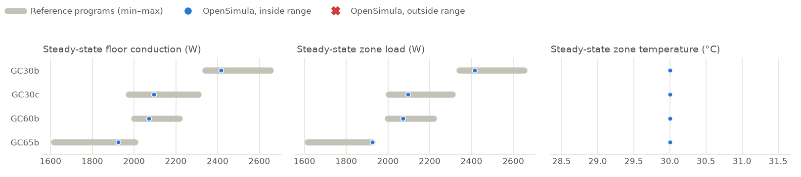

#### Steady-state floor conduction (W)

| Case | OpenSimula | Min | Max | Programs | Result |
|---|--:|--:|--:|--:|---|
| GC30b | 2415.949 | 2341.200 | 2652.423 | 7 | ✓ inside |
| GC30c | 2094.947 | 1973.000 | 2307.922 | 7 | ✓ inside |
| GC60b | 2071.989 | 1999.000 | 2218.583 | 6 | ✓ inside |
| GC65b | 1923.640 | 1615.545 | 2003.662 | 6 | ✓ inside |

#### Steady-state zone load (W)

| Case | OpenSimula | Min | Max | Programs | Result |
|---|--:|--:|--:|--:|---|
| GC30b | 2416.497 | 2341.200 | 2652.423 | 3 | ✓ inside |
| GC30c | 2095.494 | 2003.000 | 2307.922 | 4 | ✓ inside |
| GC60b | 2072.537 | 1999.000 | 2218.583 | 3 | ✓ inside |
| GC65b | 1924.187 | 1615.545 | 1925.000 | 3 | ✓ inside |

#### Steady-state zone temperature (°C)

| Case | OpenSimula | Min | Max | Programs | Result |
|---|--:|--:|--:|--:|---|
| GC30b | 30.000 | 30.000 | 30.000 | 3 | ✓ inside |
| GC30c | 30.000 | 30.000 | 30.000 | 4 | ✓ inside |
| GC60b | 30.000 | 30.000 | 30.000 | 3 | ✓ inside |
| GC65b | 30.000 | 30.000 | 30.000 | 3 | ✓ inside |

### Harmonic cases: annual sums and mean

| Output | Values | Inside range | Outside range |
|---|--:|--:|--:|
| Annual floor conduction (kWh) | 10 | 9 | 1 |
| Annual zone heating load (kWh) | 10 | 9 | 1 |
| Annual mean zone temperature (°C) | 10 | 10 | 0 |

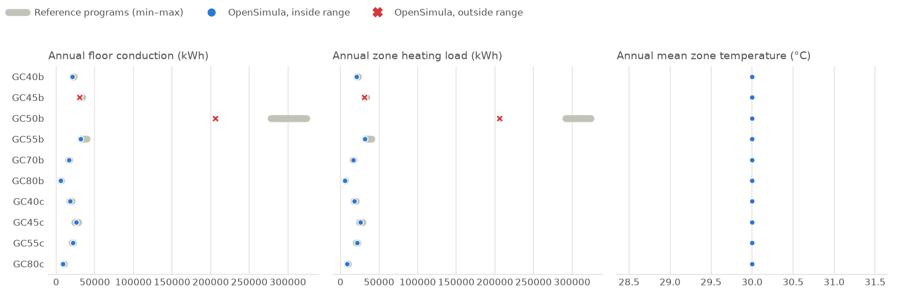

#### Annual floor conduction (kWh)

| Case | OpenSimula | Min | Max | Programs | Result |
|---|--:|--:|--:|--:|---|
| GC40b | 21163.041 | 20513.000 | 23203.808 | 7 | ✓ inside |
| GC45b | 30555.053 | 30856.000 | 33483.459 | 5 | ✗ -1.0 % below min |
| GC50b | 302864.785 | 277923.255 | 324257.108 | 5 | ✓ inside |
| GC55b | 31814.146 | 31601.000 | 39931.573 | 6 | ✓ inside |
| GC70b | 16850.545 | 15553.340 | 17552.083 | 6 | ✓ inside |
| GC80b | 5710.883 | 5661.000 | 6151.434 | 6 | ✓ inside |
| GC40c | 18351.149 | 17285.000 | 20255.001 | 7 | ✓ inside |
| GC45c | 25868.341 | 23849.000 | 28706.632 | 7 | ✓ inside |
| GC55c | 21671.214 | 20172.000 | 22569.791 | 7 | ✓ inside |
| GC80c | 8958.918 | 8635.000 | 10073.167 | 7 | ✓ inside |

#### Annual zone heating load (kWh)

| Case | OpenSimula | Min | Max | Programs | Result |
|---|--:|--:|--:|--:|---|
| GC40b | 21167.834 | 20513.000 | 23203.808 | 3 | ✓ inside |
| GC45b | 30561.360 | 30924.000 | 33414.567 | 2 | ✗ -1.2 % below min |
| GC50b | 302992.046 | 291502.000 | 324257.108 | 2 | ✓ inside |
| GC55b | 31818.939 | 31654.000 | 39931.573 | 3 | ✓ inside |
| GC70b | 16855.339 | 15553.340 | 16865.000 | 3 | ✓ inside |
| GC80b | 5715.676 | 5661.000 | 6059.122 | 3 | ✓ inside |
| GC40c | 18355.943 | 17545.000 | 20255.001 | 4 | ✓ inside |
| GC45c | 25874.648 | 24185.000 | 28706.632 | 4 | ✓ inside |
| GC55c | 21676.007 | 20221.000 | 22569.791 | 4 | ✓ inside |
| GC80c | 8963.711 | 8848.000 | 10073.167 | 4 | ✓ inside |

#### Annual mean zone temperature (°C)

| Case | OpenSimula | Min | Max | Programs | Result |
|---|--:|--:|--:|--:|---|
| GC40b | 30.000 | 30.000 | 30.000 | 3 | ✓ inside |
| GC45b | 30.000 | 30.000 | 30.000 | 2 | ✓ inside |
| GC50b | 30.000 | 30.000 | 30.000 | 2 | ✓ inside |
| GC55b | 30.000 | 30.000 | 30.000 | 3 | ✓ inside |
| GC70b | 30.000 | 30.000 | 30.000 | 3 | ✓ inside |
| GC80b | 30.000 | 30.000 | 30.000 | 3 | ✓ inside |
| GC40c | 30.000 | 30.000 | 30.000 | 4 | ✓ inside |
| GC45c | 30.000 | 30.000 | 30.000 | 4 | ✓ inside |
| GC55c | 30.000 | 30.000 | 30.000 | 4 | ✓ inside |
| GC80c | 30.000 | 30.000 | 30.000 | 4 | ✓ inside |

### Harmonic cases: annual hourly maxima and minimum outdoor temperature

| Output | Values | Inside range | Outside range |
|---|--:|--:|--:|
| Annual hourly maximum floor conduction (Wh/h) | 10 | 6 | 4 |
| Annual hourly maximum zone heating load (Wh/h) | 10 | 5 | 5 |
| Annual minimum outdoor dry bulb (°C) | 10 | 10 | 0 |
| Hours at the annual minimum outdoor dry bulb (h) | 10 | 10 | 0 |

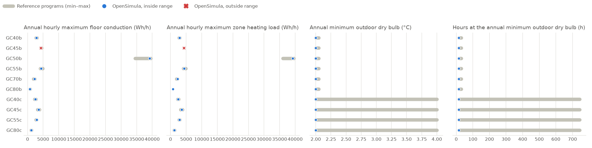

#### Annual hourly maximum floor conduction (Wh/h)

| Case | OpenSimula | Date | Min | Max | Programs | Result |
|---|--:|---|--:|--:|--:|---|
| GC40b | 2822.007 | 02-Feb 9 | 2710.200 | 3004.843 | 7 | ✓ inside |
| GC45b | 3982.547 | 02-Feb 5 | 4318.000 | 4550.930 | 5 | ✗ -7.8 % below min |
| GC50b | 40253.364 | 02-Feb 15 | 34510.160 | 39569.943 | 5 | ✗ +1.7 % above max |
| GC55b | 4242.335 | 02-Feb 4 | 4085.000 | 4859.684 | 6 | ✓ inside |
| GC70b | 2303.342 | 03-Feb 19 | 1905.897 | 2276.372 | 6 | ✗ +1.2 % above max |
| GC80b | 782.161 | 07-Feb 9 | 722.400 | 793.632 | 6 | ✓ inside |
| GC40c | 2485.875 | 03-Feb 17 | 2224.000 | 2650.387 | 7 | ✓ inside |
| GC45c | 3429.606 | 03-Feb 9 | 3178.000 | 3826.683 | 7 | ✓ inside |
| GC55c | 2935.670 | 03-Feb 13 | 2659.000 | 2925.849 | 7 | ✗ +0.3 % above max |
| GC80c | 1227.278 | 05-Feb 24 | 1091.000 | 1299.782 | 7 | ✓ inside |

#### Annual hourly maximum zone heating load (Wh/h)

| Case | OpenSimula | Date | Min | Max | Programs | Result |
|---|--:|---|--:|--:|--:|---|
| GC40b | 2822.762 | 02-Feb 5 | 2710.200 | 3004.843 | 3 | ✓ inside |
| GC45b | 3983.542 | 02-Feb 4 | 4328.000 | 4414.522 | 2 | ✗ -8.0 % below min |
| GC50b | 40273.312 | 02-Feb 5 | 36021.000 | 39569.943 | 2 | ✗ +1.8 % above max |
| GC55b | 4243.091 | 02-Feb 4 | 4093.000 | 4859.684 | 3 | ✓ inside |
| GC70b | 2304.088 | 04-Feb 4 | 1905.897 | 2259.000 | 3 | ✗ +2.0 % above max |
| GC80b | 782.913 | 07-Feb 5 | 722.400 | 765.809 | 3 | ✗ +2.2 % above max |
| GC40c | 2486.618 | 04-Feb 4 | 2261.000 | 2650.387 | 4 | ✓ inside |
| GC45c | 3430.600 | 03-Feb 5 | 3228.000 | 3826.683 | 4 | ✓ inside |
| GC55c | 2936.419 | 03-Feb 5 | 2690.000 | 2925.849 | 4 | ✗ +0.4 % above max |
| GC80c | 1228.031 | 06-Feb 4 | 1122.000 | 1299.782 | 4 | ✓ inside |

#### Annual minimum outdoor dry bulb (°C)

| Case | OpenSimula | Date | Min | Max | Programs | Result |
|---|--:|---|--:|--:|--:|---|
| GC40b | 2.000 | 08-Jan 4 | 2.000 | 2.050 | 6 | ✓ inside |
| GC45b | 2.000 | 08-Jan 4 | 2.000 | 2.050 | 4 | ✓ inside |
| GC50b | 2.000 | 08-Jan 4 | 2.000 | 2.050 | 4 | ✓ inside |
| GC55b | 2.000 | 08-Jan 4 | 2.000 | 2.050 | 5 | ✓ inside |
| GC70b | 2.000 | 08-Jan 4 | 2.000 | 2.050 | 5 | ✓ inside |
| GC80b | 2.000 | 08-Jan 4 | 2.000 | 2.050 | 5 | ✓ inside |
| GC40c | 2.000 | 08-Jan 4 | 2.000 | 4.000 | 6 | ✓ inside |
| GC45c | 2.000 | 08-Jan 4 | 2.000 | 4.000 | 6 | ✓ inside |
| GC55c | 2.000 | 08-Jan 4 | 2.000 | 4.000 | 6 | ✓ inside |
| GC80c | 2.000 | 08-Jan 4 | 2.000 | 4.000 | 6 | ✓ inside |

#### Hours at the annual minimum outdoor dry bulb (h)

| Case | OpenSimula | Min | Max | Programs | Result |
|---|--:|--:|--:|--:|---|
| GC40b | 15.000 | 15.000 | 30.000 | 6 | ✓ inside |
| GC45b | 15.000 | 15.000 | 30.000 | 4 | ✓ inside |
| GC50b | 15.000 | 15.000 | 30.000 | 4 | ✓ inside |
| GC55b | 15.000 | 15.000 | 30.000 | 5 | ✓ inside |
| GC70b | 15.000 | 15.000 | 30.000 | 5 | ✓ inside |
| GC80b | 15.000 | 15.000 | 30.000 | 5 | ✓ inside |
| GC40c | 15.000 | 15.000 | 744.000 | 6 | ✓ inside |
| GC45c | 15.000 | 15.000 | 744.000 | 6 | ✓ inside |
| GC55c | 15.000 | 15.000 | 744.000 | 6 | ✓ inside |
| GC80c | 15.000 | 15.000 | 744.000 | 6 | ✓ inside |

### Hourly floor conduction, cases GC40b and GC40c

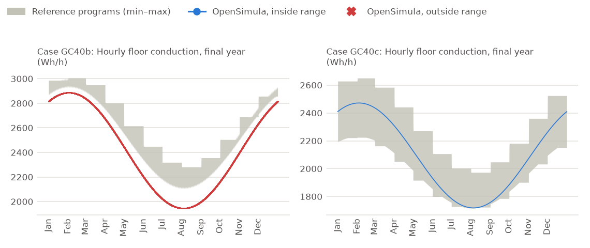

| Case | Output | Values | Inside range | Largest distance outside range |
|---|---|--:|--:|--:|
| GC40b | Hourly floor conduction, final year (Wh/h) | 8760 | 0 | 121 Wh/h |
| GC40c | Hourly floor conduction, final year (Wh/h) | 8760 | 7888 | 12.2 Wh/h |

## Air-side HVAC equipment tests (AE101–AE445)

Reference programs: QAS, DEEAP, DeST, DOE-2.2, EnergyPlus, IES-VE, LCEM, TRNSYS (example results from `Std140_AE_FCSZ_Results.xlsx`). **1219 of 1371 values inside the reference range.**

### AE100 series: loads

| Output | Values | Inside range | Outside range |
|---|--:|--:|--:|
| Zone sensible heating load (kWh/h) | 3 | 3 | 0 |
| Zone sensible cooling load (kWh/h) | 3 | 3 | 0 |
| Zone latent load (kWh/h) | 3 | 3 | 0 |
| Heating (preheat) coil load (kWh/h) | 3 | 3 | 0 |
| Cooling coil sensible load (kWh/h) | 3 | 2 | 1 |
| Cooling coil latent load (kWh/h) | 3 | 3 | 0 |
| Cooling coil total load (kWh/h) | 3 | 2 | 1 |

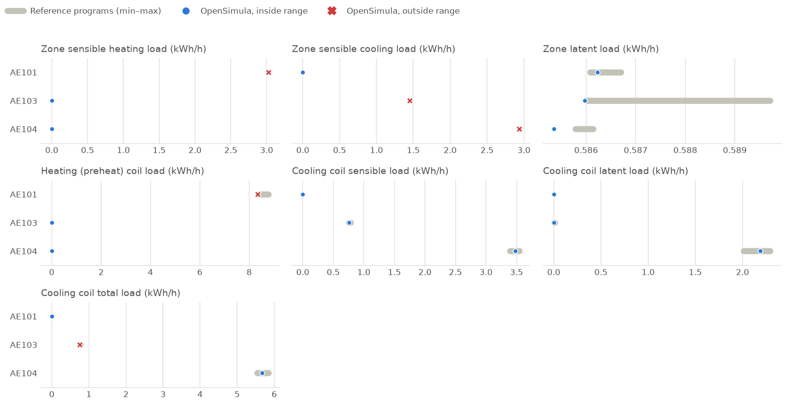

#### Zone sensible heating load (kWh/h)

| Case | OpenSimula | Min | Max | Programs | Result |
|---|--:|--:|--:|--:|---|
| AE101 | 2.931 | 2.930 | 2.931 | 8 | ✓ inside |
| AE103 | 0.000 | 0.000 | 0.000 | 5 | ✓ inside |
| AE104 | 0.000 | 0.000 | 0.000 | 5 | ✓ inside |

#### Zone sensible cooling load (kWh/h)

| Case | OpenSimula | Min | Max | Programs | Result |
|---|--:|--:|--:|--:|---|
| AE101 | 0.000 | 0.000 | 0.000 | 5 | ✓ inside |
| AE103 | 1.465 | 1.465 | 1.467 | 8 | ✓ inside |
| AE104 | 2.931 | 2.930 | 2.931 | 8 | ✓ inside |

#### Zone latent load (kWh/h)

| Case | OpenSimula | Min | Max | Programs | Result |
|---|--:|--:|--:|--:|---|
| AE101 | 0.586 | 0.586 | 0.587 | 8 | ✓ inside |
| AE103 | 0.586 | 0.586 | 0.590 | 8 | ✓ inside |
| AE104 | 0.586 | 0.586 | 0.586 | 8 | ✓ inside |

#### Heating (preheat) coil load (kWh/h)

| Case | OpenSimula | Min | Max | Programs | Result |
|---|--:|--:|--:|--:|---|
| AE101 | 8.416 | 8.372 | 8.768 | 8 | ✓ inside |
| AE103 | 0.000 | 0.000 | 0.000 | 8 | ✓ inside |
| AE104 | 0.000 | 0.000 | 0.000 | 8 | ✓ inside |

#### Cooling coil sensible load (kWh/h)

| Case | OpenSimula | Min | Max | Programs | Result |
|---|--:|--:|--:|--:|---|
| AE101 | 0.000 | 0.000 | 0.000 | 8 | ✓ inside |
| AE103 | 0.788 | 0.752 | 0.784 | 8 | ✗ +0.5 % above max |
| AE104 | 3.466 | 3.389 | 3.543 | 8 | ✓ inside |

#### Cooling coil latent load (kWh/h)

| Case | OpenSimula | Min | Max | Programs | Result |
|---|--:|--:|--:|--:|---|
| AE101 | 0.000 | 0.000 | 0.000 | 8 | ✓ inside |
| AE103 | -0.000 | 0.000 | 0.010 | 8 | ✓ inside |
| AE104 | 2.136 | 2.012 | 2.293 | 8 | ✓ inside |

#### Cooling coil total load (kWh/h)

| Case | OpenSimula | Min | Max | Programs | Result |
|---|--:|--:|--:|--:|---|
| AE101 | 0.000 | 0.000 | 0.000 | 8 | ✓ inside |
| AE103 | 0.788 | 0.762 | 0.784 | 8 | ✗ +0.5 % above max |
| AE104 | 5.603 | 5.533 | 5.836 | 8 | ✓ inside |

### AE100 series: coil outlet humidity and air states

| Output | Values | Inside range | Outside range |
|---|--:|--:|--:|
| Cooling coil outlet relative humidity (%) | 3 | 2 | 1 |
| Dry bulb temperature (°C) | 21 | 18 | 3 |
| Humidity ratio (kg/kg) | 21 | 20 | 1 |
| Specific volume (L/kg) | 21 | 20 | 1 |
| Enthalpy (kJ/kg) | 21 | 15 | 6 |
| Dry air mass flow rate (kg/s) | 18 | 17 | 1 |

#### Cooling coil outlet relative humidity (%)

| Case | OpenSimula | Min | Max | Programs | Result |
|---|--:|--:|--:|--:|---|
| AE101 | 6.459 | 6.353 | 6.867 | 7 | ✓ inside |
| AE103 | 33.085 | 31.654 | 33.030 | 8 | ✗ +0.2 % above max |
| AE104 | 99.736 | 98.660 | 100.000 | 8 | ✓ inside |

#### Dry bulb temperature (°C)

| Case | OpenSimula | Min | Max | Programs | Result |
|---|--:|--:|--:|--:|---|
| AE101 oa | -29.000 | -29.000 | -29.000 | 8 | ✓ inside |
| AE101 ma | 3.960 | 4.003 | 4.454 | 8 | ✗ -0.04 °C below min |
| AE101 hco | 29.344 | 28.994 | 29.326 | 8 | ✓ inside |
| AE101 cco | 29.344 | 28.994 | 29.326 | 8 | ✓ inside |
| AE101 sa | 29.951 | 29.222 | 29.933 | 8 | ✓ inside |
| AE101 z1 | 21.112 | 21.099 | 21.118 | 8 | ✓ inside |
| AE101 ra | 21.112 | 21.099 | 21.118 | 7 | ✓ inside |
| AE103 oa | 15.500 | 15.500 | 15.500 | 8 | ✓ inside |
| AE103 ma | 20.768 | 20.689 | 20.774 | 8 | ✓ inside |
| AE103 hco | 18.466 | 20.721 | 21.278 | 8 | ✗ -2.25 °C below min |
| AE103 cco | 18.466 | 18.462 | 19.000 | 8 | ✓ inside |
| AE103 sa | 19.055 | 19.000 | 19.101 | 8 | ✓ inside |
| AE103 z1 | 23.333 | 23.329 | 23.348 | 8 | ✓ inside |
| AE103 ra | 23.333 | 23.329 | 23.348 | 7 | ✓ inside |
| AE104 oa | 26.900 | 26.889 | 26.900 | 8 | ✓ inside |
| AE104 ma | 24.860 | 24.864 | 24.906 | 8 | ✓ inside |
| AE104 hco | 14.769 | 24.864 | 25.500 | 8 | ✗ -10.10 °C below min |
| AE104 cco | 14.769 | 14.701 | 15.222 | 8 | ✓ inside |
| AE104 sa | 15.355 | 15.222 | 15.525 | 8 | ✓ inside |
| AE104 z1 | 23.888 | 23.876 | 23.890 | 8 | ✓ inside |
| AE104 ra | 23.888 | 23.876 | 23.890 | 7 | ✓ inside |

#### Humidity ratio (kg/kg)

| Case | OpenSimula | Min | Max | Programs | Result |
|---|--:|--:|--:|--:|---|
| AE101 oa | 0.000 | 0.000 | 0.000 | 8 | ✓ inside |
| AE101 ma | 0.002 | 0.002 | 0.002 | 8 | ✓ inside |
| AE101 hco | 0.002 | 0.002 | 0.002 | 8 | ✓ inside |
| AE101 cco | 0.002 | 0.002 | 0.002 | 8 | ✓ inside |
| AE101 sa | 0.002 | 0.002 | 0.002 | 8 | ✓ inside |
| AE101 z1 | 0.002 | 0.002 | 0.002 | 8 | ✓ inside |
| AE101 ra | 0.002 | 0.002 | 0.002 | 7 | ✓ inside |
| AE103 oa | 0.003 | 0.003 | 0.003 | 8 | ✓ inside |
| AE103 ma | 0.004 | 0.004 | 0.004 | 8 | ✓ inside |
| AE103 hco | 0.004 | 0.004 | 0.004 | 8 | ✓ inside |
| AE103 cco | 0.004 | 0.004 | 0.004 | 8 | ✓ inside |
| AE103 sa | 0.004 | 0.004 | 0.004 | 8 | ✓ inside |
| AE103 z1 | 0.005 | 0.005 | 0.005 | 8 | ✓ inside |
| AE103 ra | 0.005 | 0.005 | 0.005 | 7 | ✓ inside |
| AE104 oa | 0.017 | 0.017 | 0.017 | 8 | ✓ inside |
| AE104 ma | 0.013 | 0.013 | 0.013 | 8 | ✓ inside |
| AE104 hco | 0.010 | 0.013 | 0.013 | 8 | ✗ -19.2 % below min |
| AE104 cco | 0.010 | 0.010 | 0.011 | 8 | ✓ inside |
| AE104 sa | 0.010 | 0.010 | 0.011 | 8 | ✓ inside |
| AE104 z1 | 0.011 | 0.011 | 0.011 | 8 | ✓ inside |
| AE104 ra | 0.011 | 0.011 | 0.011 | 7 | ✓ inside |

#### Specific volume (L/kg)

| Case | OpenSimula | Min | Max | Programs | Result |
|---|--:|--:|--:|--:|---|
| AE101 oa | 691.937 | 691.841 | 833.330 | 6 | ✓ inside |
| AE101 ma | 787.072 | 787.059 | 833.330 | 6 | ✓ inside |
| AE101 hco | 859.170 | 830.352 | 859.055 | 6 | ✓ inside |
| AE101 cco | 859.170 | 830.352 | 859.055 | 6 | ✓ inside |
| AE101 sa | 860.895 | 830.352 | 860.776 | 6 | ✓ inside |
| AE101 z1 | 836.741 | 830.352 | 836.689 | 6 | ✓ inside |
| AE101 ra | 836.741 | 830.352 | 836.689 | 5 | ✓ inside |
| AE103 oa | 821.567 | 821.405 | 833.330 | 6 | ✓ inside |
| AE103 ma | 838.454 | 830.352 | 838.437 | 6 | ✓ inside |
| AE103 hco | 831.890 | 830.352 | 838.437 | 6 | ✓ inside |
| AE103 cco | 831.890 | 830.352 | 833.330 | 6 | ✓ inside |
| AE103 sa | 833.568 | 829.577 | 833.628 | 6 | ✓ inside |
| AE103 z1 | 846.702 | 830.352 | 846.664 | 6 | ✓ inside |
| AE103 ra | 846.702 | 830.352 | 846.664 | 5 | ✓ inside |
| AE104 oa | 872.920 | 830.352 | 872.931 | 6 | ✓ inside |
| AE104 ma | 861.822 | 830.352 | 861.984 | 6 | ✓ inside |
| AE104 hco | 829.358 | 830.352 | 861.984 | 6 | ✗ -0.1 % below min |
| AE104 cco | 829.358 | 829.891 | 833.330 | 6 | ✓ inside |
| AE104 sa | 831.047 | 827.667 | 833.330 | 6 | ✓ inside |
| AE104 z1 | 856.555 | 830.352 | 856.758 | 6 | ✓ inside |
| AE104 ra | 856.555 | 830.352 | 856.758 | 5 | ✓ inside |

#### Enthalpy (kJ/kg)

| Case | OpenSimula | Min | Max | Programs | Result |
|---|--:|--:|--:|--:|---|
| AE101 oa | -28.540 | -28.540 | -28.330 | 5 | ✓ inside |
| AE101 ma | 8.060 | 8.031 | 8.680 | 5 | ✓ inside |
| AE101 hco | 33.674 | 33.309 | 33.592 | 5 | ✗ +0.2 % above max |
| AE101 cco | 33.674 | 33.309 | 33.592 | 5 | ✗ +0.2 % above max |
| AE101 sa | 34.287 | 33.900 | 34.203 | 5 | ✗ +0.2 % above max |
| AE101 z1 | 27.174 | 27.034 | 27.263 | 5 | ✓ inside |
| AE101 ra | 27.174 | 27.034 | 27.263 | 5 | ✓ inside |
| AE103 oa | 23.010 | 22.996 | 23.032 | 5 | ✓ inside |
| AE103 ma | 31.931 | 31.706 | 31.890 | 5 | ✗ +0.1 % above max |
| AE103 hco | 29.598 | 31.706 | 31.890 | 5 | ✗ -6.6 % below min |
| AE103 cco | 29.598 | 29.461 | 29.598 | 5 | ✓ inside |
| AE103 sa | 30.195 | 30.052 | 30.190 | 5 | ✓ inside |
| AE103 z1 | 36.285 | 36.062 | 36.260 | 5 | ✓ inside |
| AE103 ra | 36.285 | 36.062 | 36.260 | 5 | ✓ inside |
| AE104 oa | 69.831 | 69.795 | 69.994 | 5 | ✓ inside |
| AE104 ma | 58.024 | 57.970 | 58.382 | 5 | ✓ inside |
| AE104 hco | 41.304 | 57.970 | 58.382 | 5 | ✗ -28.8 % below min |
| AE104 cco | 41.304 | 40.790 | 41.874 | 5 | ✓ inside |
| AE104 sa | 41.905 | 41.400 | 42.465 | 5 | ✓ inside |
| AE104 z1 | 52.402 | 51.940 | 52.774 | 5 | ✓ inside |
| AE104 ra | 52.402 | 51.940 | 52.774 | 5 | ✓ inside |

#### Dry air mass flow rate (kg/s)

| Case | OpenSimula | Min | Max | Programs | Result |
|---|--:|--:|--:|--:|---|
| AE101 oa | 0.113 | 0.113 | 0.120 | 8 | ✓ inside |
| AE101 ma | 0.330 | 0.330 | 0.359 | 8 | ✓ inside |
| AE101 hco | 0.330 | 0.330 | 0.359 | 8 | ✓ inside |
| AE101 cco | 0.330 | 0.330 | 0.359 | 8 | ✓ inside |
| AE101 sa | 0.330 | 0.330 | 0.359 | 8 | ✓ inside |
| AE101 ra | 0.217 | 0.217 | 0.239 | 7 | ✓ inside |
| AE103 oa | 0.111 | 0.111 | 0.114 | 8 | ✓ inside |
| AE103 ma | 0.340 | 0.337 | 0.341 | 8 | ✓ inside |
| AE103 hco | 0.340 | 0.337 | 0.341 | 8 | ✓ inside |
| AE103 cco | 0.340 | 0.337 | 0.341 | 8 | ✓ inside |
| AE103 sa | 0.340 | 0.337 | 0.341 | 8 | ✓ inside |
| AE103 ra | 0.229 | 0.225 | 0.229 | 7 | ✓ inside |
| AE104 oa | 0.110 | 0.109 | 0.114 | 8 | ✓ inside |
| AE104 ma | 0.341 | 0.328 | 0.341 | 8 | ✓ inside |
| AE104 hco | 0.341 | 0.328 | 0.341 | 8 | ✓ inside |
| AE104 cco | 0.341 | 0.328 | 0.341 | 8 | ✓ inside |
| AE104 sa | 0.341 | 0.328 | 0.341 | 8 | ✓ inside |
| AE104 ra | 0.231 | 0.219 | 0.231 | 7 | ✗ +0.1 % above max |

### AE200 series: loads

| Output | Values | Inside range | Outside range |
|---|--:|--:|--:|
| Zone sensible heating load (kWh/h) | 7 | 7 | 0 |
| Zone sensible cooling load (kWh/h) | 7 | 7 | 0 |
| Zone latent load (kWh/h) | 7 | 7 | 0 |
| Heating (preheat) coil load (kWh/h) | 7 | 7 | 0 |
| Cooling coil sensible load (kWh/h) | 7 | 7 | 0 |
| Cooling coil latent load (kWh/h) | 7 | 7 | 0 |
| Cooling coil total load (kWh/h) | 7 | 7 | 0 |

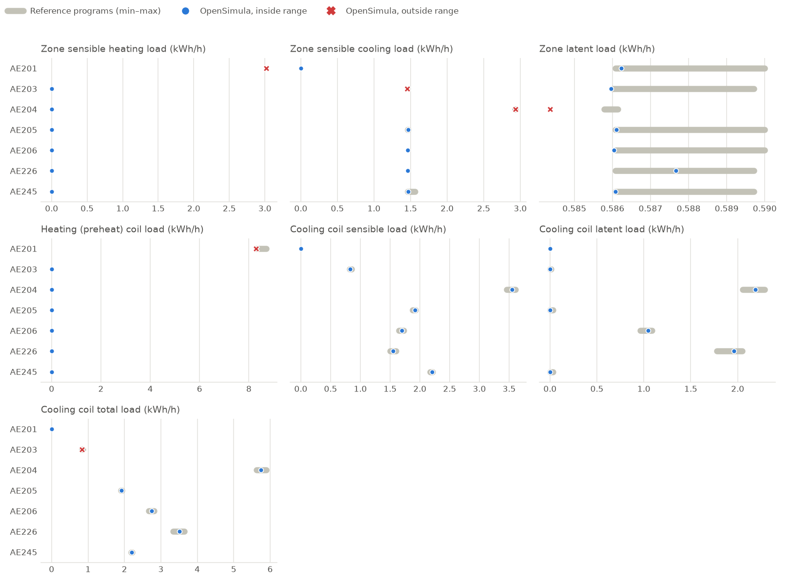

#### Zone sensible heating load (kWh/h)

| Case | OpenSimula | Min | Max | Programs | Result |
|---|--:|--:|--:|--:|---|
| AE201 | 2.931 | 2.930 | 2.931 | 8 | ✓ inside |
| AE203 | 0.000 | 0.000 | 0.000 | 5 | ✓ inside |
| AE204 | 0.000 | 0.000 | 0.000 | 5 | ✓ inside |
| AE205 | 0.000 | 0.000 | 0.000 | 5 | ✓ inside |
| AE206 | 0.000 | 0.000 | 0.000 | 5 | ✓ inside |
| AE226 | 0.000 | 0.000 | 0.000 | 5 | ✓ inside |
| AE245 | 0.000 | 0.000 | 0.000 | 5 | ✓ inside |

#### Zone sensible cooling load (kWh/h)

| Case | OpenSimula | Min | Max | Programs | Result |
|---|--:|--:|--:|--:|---|
| AE201 | 0.000 | 0.000 | 0.000 | 5 | ✓ inside |
| AE203 | 1.465 | 1.465 | 1.467 | 8 | ✓ inside |
| AE204 | 2.931 | 2.930 | 2.931 | 8 | ✓ inside |
| AE205 | 1.465 | 1.464 | 1.470 | 8 | ✓ inside |
| AE206 | 1.465 | 1.464 | 1.470 | 8 | ✓ inside |
| AE226 | 1.465 | 1.464 | 1.466 | 8 | ✓ inside |
| AE245 | 1.465 | 1.464 | 1.564 | 8 | ✓ inside |

#### Zone latent load (kWh/h)

| Case | OpenSimula | Min | Max | Programs | Result |
|---|--:|--:|--:|--:|---|
| AE201 | 0.586 | 0.586 | 0.590 | 8 | ✓ inside |
| AE203 | 0.586 | 0.586 | 0.590 | 8 | ✓ inside |
| AE204 | 0.587 | 0.586 | 0.586 | 8 | ✓ inside |
| AE205 | 0.586 | 0.586 | 0.590 | 8 | ✓ inside |
| AE206 | 0.586 | 0.586 | 0.590 | 8 | ✓ inside |
| AE226 | 0.587 | 0.586 | 0.590 | 8 | ✓ inside |
| AE245 | 0.586 | 0.586 | 0.590 | 8 | ✓ inside |

#### Heating (preheat) coil load (kWh/h)

| Case | OpenSimula | Min | Max | Programs | Result |
|---|--:|--:|--:|--:|---|
| AE201 | 8.349 | 8.302 | 8.709 | 8 | ✓ inside |
| AE203 | 0.000 | 0.000 | 0.000 | 8 | ✓ inside |
| AE204 | 0.000 | 0.000 | 0.000 | 8 | ✓ inside |
| AE205 | 0.000 | 0.000 | 0.000 | 8 | ✓ inside |
| AE206 | 0.000 | 0.000 | 0.000 | 8 | ✓ inside |
| AE226 | 0.000 | 0.000 | 0.000 | 8 | ✓ inside |
| AE245 | 0.000 | 0.000 | 0.000 | 8 | ✓ inside |

#### Cooling coil sensible load (kWh/h)

| Case | OpenSimula | Min | Max | Programs | Result |
|---|--:|--:|--:|--:|---|
| AE201 | 0.000 | 0.000 | 0.000 | 8 | ✓ inside |
| AE203 | 0.855 | 0.819 | 0.856 | 8 | ✓ inside |
| AE204 | 3.533 | 3.456 | 3.608 | 8 | ✓ inside |
| AE205 | 1.909 | 1.880 | 1.929 | 8 | ✓ inside |
| AE206 | 1.697 | 1.646 | 1.731 | 8 | ✓ inside |
| AE226 | 1.554 | 1.503 | 1.597 | 8 | ✓ inside |
| AE245 | 2.203 | 2.171 | 2.216 | 8 | ✓ inside |

#### Cooling coil latent load (kWh/h)

| Case | OpenSimula | Min | Max | Programs | Result |
|---|--:|--:|--:|--:|---|
| AE201 | 0.000 | 0.000 | 0.000 | 8 | ✓ inside |
| AE203 | -0.000 | 0.000 | 0.011 | 8 | ✓ inside |
| AE204 | 2.137 | 2.054 | 2.289 | 8 | ✓ inside |
| AE205 | -0.000 | 0.000 | 0.031 | 8 | ✓ inside |
| AE206 | 1.039 | 0.963 | 1.087 | 8 | ✓ inside |
| AE226 | 1.961 | 1.778 | 2.050 | 8 | ✓ inside |
| AE245 | -0.000 | 0.000 | 0.031 | 8 | ✓ inside |

#### Cooling coil total load (kWh/h)

| Case | OpenSimula | Min | Max | Programs | Result |
|---|--:|--:|--:|--:|---|
| AE201 | 0.000 | 0.000 | 0.000 | 8 | ✓ inside |
| AE203 | 0.855 | 0.830 | 0.856 | 8 | ✓ inside |
| AE204 | 5.670 | 5.623 | 5.897 | 8 | ✓ inside |
| AE205 | 1.909 | 1.908 | 1.929 | 8 | ✓ inside |
| AE206 | 2.735 | 2.664 | 2.818 | 8 | ✓ inside |
| AE226 | 3.515 | 3.335 | 3.643 | 8 | ✓ inside |
| AE245 | 2.203 | 2.188 | 2.216 | 8 | ✓ inside |

### AE200 series: coil outlet humidity and air states

| Output | Values | Inside range | Outside range |
|---|--:|--:|--:|
| Cooling coil outlet relative humidity (%) | 7 | 6 | 1 |
| Dry bulb temperature (°C) | 56 | 45 | 11 |
| Humidity ratio (kg/kg) | 56 | 47 | 9 |
| Specific volume (L/kg) | 56 | 55 | 1 |
| Enthalpy (kJ/kg) | 56 | 45 | 11 |
| Dry air mass flow rate (kg/s) | 49 | 49 | 0 |

#### Cooling coil outlet relative humidity (%)

| Case | OpenSimula | Min | Max | Programs | Result |
|---|--:|--:|--:|--:|---|
| AE201 | 6.459 | 6.353 | 6.871 | 7 | ✓ inside |
| AE203 | 33.085 | 32.515 | 33.030 | 8 | ✗ +0.2 % above max |
| AE204 | 99.734 | 98.620 | 100.000 | 8 | ✓ inside |
| AE205 | 44.815 | 44.111 | 44.853 | 8 | ✓ inside |
| AE206 | 99.647 | 99.025 | 100.000 | 8 | ✓ inside |
| AE226 | 99.704 | 99.650 | 100.000 | 8 | ✓ inside |
| AE245 | 34.098 | 33.839 | 34.330 | 8 | ✓ inside |

#### Dry bulb temperature (°C)

| Case | OpenSimula | Min | Max | Programs | Result |
|---|--:|--:|--:|--:|---|
| AE201 oa | -29.000 | -29.000 | -29.000 | 8 | ✓ inside |
| AE201 ma | 4.163 | 4.183 | 4.648 | 8 | ✗ -0.02 °C below min |
| AE201 hco | 29.344 | 28.667 | 29.326 | 8 | ✓ inside |
| AE201 cco | 29.344 | 28.667 | 29.326 | 8 | ✓ inside |
| AE201 sa | 29.951 | 29.576 | 29.933 | 7 | ✓ inside |
| AE201 z1 | 21.112 | 21.099 | 21.119 | 8 | ✓ inside |
| AE201 rfi | 21.112 | 21.099 | 21.119 | 8 | ✓ inside |
| AE201 rfo | 21.420 | 21.383 | 21.408 | 8 | ✓ inside |
| AE203 oa | 15.500 | 15.500 | 15.500 | 8 | ✓ inside |
| AE203 ma | 20.964 | 20.889 | 20.985 | 8 | ✓ inside |
| AE203 hco | 18.466 | 20.889 | 20.985 | 8 | ✗ -2.42 °C below min |
| AE203 cco | 18.466 | 18.444 | 18.519 | 8 | ✓ inside |
| AE203 sa | 19.055 | 19.052 | 19.101 | 7 | ✓ inside |
| AE203 z1 | 23.333 | 23.329 | 23.348 | 8 | ✓ inside |
| AE203 rfi | 23.333 | 23.329 | 23.348 | 8 | ✓ inside |
| AE203 rfo | 23.625 | 23.611 | 23.648 | 8 | ✓ inside |
| AE204 oa | 26.900 | 26.889 | 26.900 | 8 | ✓ inside |
| AE204 ma | 25.056 | 25.065 | 25.111 | 8 | ✓ inside |
| AE204 hco | 14.769 | 25.065 | 25.111 | 8 | ✗ -10.30 °C below min |
| AE204 cco | 14.769 | 14.611 | 14.949 | 8 | ✓ inside |
| AE204 sa | 15.355 | 15.312 | 15.525 | 7 | ✓ inside |
| AE204 z1 | 23.888 | 23.882 | 23.897 | 8 | ✓ inside |
| AE204 rfi | 23.888 | 23.882 | 23.897 | 8 | ✓ inside |
| AE204 rfo | 24.177 | 24.167 | 24.217 | 8 | ✓ inside |
| AE205 oa | 24.900 | 24.889 | 24.900 | 8 | ✓ inside |
| AE205 ma | 24.043 | 24.041 | 24.056 | 8 | ✓ inside |
| AE205 hco | 18.455 | 24.041 | 24.056 | 8 | ✗ -5.59 °C below min |
| AE205 cco | 18.455 | 18.444 | 18.524 | 8 | ✓ inside |
| AE205 sa | 19.044 | 19.053 | 19.109 | 7 | ✓ inside |
| AE205 z1 | 23.333 | 23.330 | 23.348 | 8 | ✓ inside |
| AE205 rfi | 23.333 | 23.330 | 23.348 | 8 | ✓ inside |
| AE205 rfo | 23.625 | 23.620 | 23.667 | 8 | ✓ inside |
| AE206 oa | 23.000 | 23.000 | 23.000 | 8 | ✓ inside |
| AE206 ma | 23.423 | 23.407 | 23.444 | 8 | ✓ inside |
| AE206 hco | 18.399 | 23.407 | 23.444 | 8 | ✗ -5.01 °C below min |
| AE206 cco | 18.399 | 18.444 | 18.589 | 8 | ✗ -0.05 °C below min |
| AE206 sa | 18.995 | 19.045 | 19.165 | 7 | ✗ -0.05 °C below min |
| AE206 z1 | 23.333 | 23.330 | 23.338 | 8 | ✓ inside |
| AE206 rfi | 23.333 | 23.330 | 23.338 | 8 | ✓ inside |
| AE206 rfo | 23.629 | 23.611 | 23.648 | 8 | ✓ inside |
| AE226 oa | 23.000 | 23.000 | 23.000 | 8 | ✓ inside |
| AE226 ma | 23.000 | 23.000 | 23.000 | 8 | ✓ inside |
| AE226 hco | 18.399 | 23.000 | 23.000 | 8 | ✗ -4.60 °C below min |
| AE226 cco | 18.399 | 18.444 | 18.590 | 8 | ✗ -0.05 °C below min |
| AE226 sa | 18.995 | 19.034 | 19.165 | 7 | ✗ -0.04 °C below min |
| AE226 z1 | 23.333 | 23.327 | 23.333 | 8 | ✓ inside |
| AE226 rfi | 23.333 | 23.327 | 23.333 | 8 | ✓ inside |
| AE226 rfo | 23.629 | 23.616 | 23.667 | 8 | ✓ inside |
| AE245 oa | 24.900 | 24.889 | 24.900 | 8 | ✓ inside |
| AE245 ma | 24.900 | 24.889 | 24.900 | 8 | ✓ inside |
| AE245 hco | 18.466 | 24.889 | 24.900 | 8 | ✗ -6.42 °C below min |
| AE245 cco | 18.466 | 18.444 | 18.519 | 8 | ✓ inside |
| AE245 sa | 19.054 | 19.053 | 19.101 | 7 | ✓ inside |
| AE245 z1 | 23.333 | 23.323 | 23.348 | 8 | ✓ inside |
| AE245 rfi | 23.333 | 23.323 | 23.348 | 8 | ✓ inside |
| AE245 rfo | 23.624 | 23.621 | 23.667 | 8 | ✓ inside |

#### Humidity ratio (kg/kg)

| Case | OpenSimula | Min | Max | Programs | Result |
|---|--:|--:|--:|--:|---|
| AE201 oa | 0.000 | 0.000 | 0.000 | 8 | ✓ inside |
| AE201 ma | 0.002 | 0.002 | 0.002 | 8 | ✓ inside |
| AE201 hco | 0.002 | 0.002 | 0.002 | 8 | ✓ inside |
| AE201 cco | 0.002 | 0.002 | 0.002 | 8 | ✓ inside |
| AE201 sa | 0.002 | 0.002 | 0.002 | 8 | ✓ inside |
| AE201 z1 | 0.002 | 0.002 | 0.002 | 8 | ✓ inside |
| AE201 rfi | 0.002 | 0.002 | 0.002 | 8 | ✓ inside |
| AE201 rfo | 0.002 | 0.002 | 0.002 | 8 | ✓ inside |
| AE203 oa | 0.003 | 0.003 | 0.003 | 8 | ✓ inside |
| AE203 ma | 0.004 | 0.004 | 0.004 | 8 | ✓ inside |
| AE203 hco | 0.004 | 0.004 | 0.004 | 8 | ✓ inside |
| AE203 cco | 0.004 | 0.004 | 0.004 | 8 | ✓ inside |
| AE203 sa | 0.004 | 0.004 | 0.004 | 8 | ✓ inside |
| AE203 z1 | 0.005 | 0.005 | 0.005 | 8 | ✓ inside |
| AE203 rfi | 0.005 | 0.005 | 0.005 | 8 | ✓ inside |
| AE203 rfo | 0.005 | 0.005 | 0.005 | 8 | ✓ inside |
| AE204 oa | 0.017 | 0.017 | 0.017 | 8 | ✓ inside |
| AE204 ma | 0.013 | 0.013 | 0.013 | 8 | ✓ inside |
| AE204 hco | 0.010 | 0.013 | 0.013 | 8 | ✗ -19.2 % below min |
| AE204 cco | 0.010 | 0.010 | 0.011 | 8 | ✓ inside |
| AE204 sa | 0.010 | 0.010 | 0.011 | 8 | ✓ inside |
| AE204 z1 | 0.011 | 0.011 | 0.011 | 8 | ✓ inside |
| AE204 rfi | 0.011 | 0.011 | 0.011 | 8 | ✓ inside |
| AE204 rfo | 0.011 | 0.011 | 0.011 | 8 | ✓ inside |
| AE205 oa | 0.004 | 0.004 | 0.005 | 8 | ✓ inside |
| AE205 ma | 0.006 | 0.006 | 0.006 | 8 | ✓ inside |
| AE205 hco | 0.006 | 0.006 | 0.006 | 8 | ✓ inside |
| AE205 cco | 0.006 | 0.006 | 0.006 | 8 | ✓ inside |
| AE205 sa | 0.006 | 0.006 | 0.006 | 8 | ✓ inside |
| AE205 z1 | 0.007 | 0.007 | 0.007 | 8 | ✓ inside |
| AE205 rfi | 0.007 | 0.007 | 0.007 | 8 | ✓ inside |
| AE205 rfo | 0.007 | 0.007 | 0.007 | 8 | ✓ inside |
| AE206 oa | 0.016 | 0.016 | 0.016 | 8 | ✓ inside |
| AE206 ma | 0.014 | 0.014 | 0.015 | 8 | ✗ -0.2 % below min |
| AE206 hco | 0.013 | 0.014 | 0.015 | 8 | ✗ -8.7 % below min |
| AE206 cco | 0.013 | 0.013 | 0.013 | 8 | ✓ inside |
| AE206 sa | 0.013 | 0.013 | 0.013 | 8 | ✓ inside |
| AE206 z1 | 0.014 | 0.014 | 0.014 | 8 | ✓ inside |
| AE206 rfi | 0.014 | 0.014 | 0.014 | 8 | ✓ inside |
| AE206 rfo | 0.014 | 0.014 | 0.014 | 8 | ✓ inside |
| AE226 oa | 0.016 | 0.016 | 0.016 | 8 | ✓ inside |
| AE226 ma | 0.016 | 0.016 | 0.016 | 8 | ✓ inside |
| AE226 hco | 0.013 | 0.016 | 0.016 | 8 | ✗ -14.8 % below min |
| AE226 cco | 0.013 | 0.013 | 0.013 | 8 | ✗ -0.2 % below min |
| AE226 sa | 0.013 | 0.013 | 0.013 | 8 | ✗ -0.2 % below min |
| AE226 z1 | 0.014 | 0.014 | 0.014 | 8 | ✗ -0.2 % below min |
| AE226 rfi | 0.014 | 0.014 | 0.014 | 8 | ✗ -0.2 % below min |
| AE226 rfo | 0.014 | 0.014 | 0.014 | 8 | ✗ -0.2 % below min |
| AE245 oa | 0.004 | 0.004 | 0.005 | 8 | ✓ inside |
| AE245 ma | 0.004 | 0.004 | 0.005 | 8 | ✓ inside |
| AE245 hco | 0.004 | 0.004 | 0.005 | 8 | ✓ inside |
| AE245 cco | 0.004 | 0.004 | 0.005 | 8 | ✓ inside |
| AE245 sa | 0.004 | 0.004 | 0.005 | 8 | ✓ inside |
| AE245 z1 | 0.005 | 0.005 | 0.005 | 8 | ✓ inside |
| AE245 rfi | 0.005 | 0.005 | 0.005 | 8 | ✓ inside |
| AE245 rfo | 0.005 | 0.005 | 0.005 | 8 | ✓ inside |

#### Specific volume (L/kg)

| Case | OpenSimula | Min | Max | Programs | Result |
|---|--:|--:|--:|--:|---|
| AE201 oa | 691.937 | 691.841 | 833.330 | 6 | ✓ inside |
| AE201 ma | 787.648 | 787.610 | 833.330 | 6 | ✓ inside |
| AE201 hco | 859.170 | 830.352 | 859.055 | 6 | ✓ inside |
| AE201 cco | 859.170 | 830.352 | 859.055 | 6 | ✓ inside |
| AE201 sa | 860.895 | 830.352 | 860.776 | 6 | ✓ inside |
| AE201 z1 | 836.741 | 830.352 | 836.689 | 6 | ✓ inside |
| AE201 rfi | 836.741 | 830.352 | 836.689 | 6 | ✓ inside |
| AE201 rfo | 837.617 | 830.352 | 837.463 | 6 | ✓ inside |
| AE203 oa | 821.567 | 821.405 | 833.330 | 6 | ✓ inside |
| AE203 ma | 839.014 | 830.352 | 839.044 | 6 | ✓ inside |
| AE203 hco | 831.890 | 830.352 | 839.044 | 6 | ✓ inside |
| AE203 cco | 831.890 | 830.352 | 833.330 | 6 | ✓ inside |
| AE203 sa | 833.568 | 829.586 | 833.628 | 6 | ✓ inside |
| AE203 z1 | 846.702 | 830.352 | 846.674 | 6 | ✓ inside |
| AE203 rfi | 846.702 | 830.352 | 846.674 | 6 | ✓ inside |
| AE203 rfo | 847.535 | 830.352 | 847.544 | 6 | ✓ inside |
| AE204 oa | 872.920 | 830.352 | 872.931 | 6 | ✓ inside |
| AE204 ma | 862.387 | 830.352 | 862.620 | 6 | ✓ inside |
| AE204 hco | 829.357 | 830.352 | 862.620 | 6 | ✗ -0.1 % below min |
| AE204 cco | 829.357 | 829.891 | 833.330 | 6 | ✓ inside |
| AE204 sa | 831.046 | 827.667 | 833.330 | 6 | ✓ inside |
| AE204 z1 | 856.554 | 830.352 | 856.758 | 6 | ✓ inside |
| AE204 rfi | 856.554 | 830.352 | 856.758 | 6 | ✓ inside |
| AE204 rfo | 857.386 | 830.352 | 857.672 | 6 | ✓ inside |
| AE205 oa | 850.421 | 830.352 | 850.438 | 6 | ✓ inside |
| AE205 ma | 849.896 | 830.352 | 849.907 | 6 | ✓ inside |
| AE205 hco | 833.916 | 830.352 | 849.907 | 6 | ✓ inside |
| AE205 cco | 833.916 | 830.352 | 834.058 | 6 | ✓ inside |
| AE205 sa | 835.603 | 830.352 | 835.706 | 6 | ✓ inside |
| AE205 z1 | 848.799 | 830.352 | 848.765 | 6 | ✓ inside |
| AE205 rfi | 848.799 | 830.352 | 848.765 | 6 | ✓ inside |
| AE205 rfo | 849.636 | 830.352 | 849.653 | 6 | ✓ inside |
| AE206 oa | 859.948 | 830.352 | 859.942 | 6 | ✓ inside |
| AE206 ma | 859.688 | 830.352 | 859.843 | 6 | ✓ inside |
| AE206 hco | 843.482 | 830.352 | 859.843 | 6 | ✓ inside |
| AE206 cco | 843.482 | 830.352 | 844.047 | 6 | ✓ inside |
| AE206 sa | 845.207 | 830.352 | 845.690 | 6 | ✓ inside |
| AE206 z1 | 858.700 | 830.352 | 858.905 | 6 | ✓ inside |
| AE206 rfi | 858.700 | 830.352 | 858.905 | 6 | ✓ inside |
| AE206 rfo | 859.557 | 830.352 | 859.780 | 6 | ✓ inside |
| AE226 oa | 859.948 | 830.352 | 859.942 | 6 | ✓ inside |
| AE226 ma | 859.954 | 830.352 | 859.942 | 6 | ✓ inside |
| AE226 hco | 843.492 | 830.352 | 859.942 | 6 | ✓ inside |
| AE226 cco | 843.492 | 830.352 | 844.033 | 6 | ✓ inside |
| AE226 sa | 845.217 | 830.352 | 845.690 | 6 | ✓ inside |
| AE226 z1 | 858.711 | 830.352 | 858.892 | 6 | ✓ inside |
| AE226 rfi | 858.711 | 830.352 | 858.892 | 6 | ✓ inside |
| AE226 rfo | 859.568 | 830.352 | 859.780 | 6 | ✓ inside |
| AE245 oa | 850.421 | 830.352 | 850.438 | 6 | ✓ inside |
| AE245 ma | 850.424 | 830.352 | 850.438 | 6 | ✓ inside |
| AE245 hco | 832.065 | 830.352 | 850.438 | 6 | ✓ inside |
| AE245 cco | 832.065 | 830.352 | 833.330 | 6 | ✓ inside |
| AE245 sa | 833.744 | 829.764 | 833.848 | 6 | ✓ inside |
| AE245 z1 | 846.882 | 830.352 | 846.875 | 6 | ✓ inside |
| AE245 rfi | 846.882 | 830.352 | 846.875 | 6 | ✓ inside |
| AE245 rfo | 847.715 | 830.352 | 847.768 | 6 | ✓ inside |

#### Enthalpy (kJ/kg)

| Case | OpenSimula | Min | Max | Programs | Result |
|---|--:|--:|--:|--:|---|
| AE201 oa | -28.540 | -28.543 | -28.330 | 5 | ✓ inside |
| AE201 ma | 8.265 | 8.212 | 8.892 | 5 | ✓ inside |
| AE201 hco | 33.674 | 33.309 | 33.594 | 5 | ✗ +0.2 % above max |
| AE201 cco | 33.674 | 33.309 | 33.594 | 5 | ✗ +0.2 % above max |
| AE201 sa | 34.287 | 33.900 | 34.206 | 5 | ✗ +0.2 % above max |
| AE201 z1 | 27.174 | 27.035 | 27.266 | 5 | ✓ inside |
| AE201 rfi | 27.174 | 27.035 | 27.266 | 5 | ✓ inside |
| AE201 rfo | 27.485 | 27.327 | 27.564 | 5 | ✓ inside |
| AE203 oa | 23.010 | 22.996 | 23.032 | 5 | ✓ inside |
| AE203 ma | 32.131 | 31.903 | 32.106 | 5 | ✓ inside |
| AE203 hco | 29.598 | 31.903 | 32.106 | 5 | ✗ -7.2 % below min |
| AE203 cco | 29.598 | 29.461 | 29.601 | 5 | ✓ inside |
| AE203 sa | 30.195 | 30.052 | 30.193 | 5 | ✓ inside |
| AE203 z1 | 36.285 | 36.061 | 36.260 | 5 | ✓ inside |
| AE203 rfi | 36.285 | 36.061 | 36.260 | 5 | ✓ inside |
| AE203 rfo | 36.581 | 36.357 | 36.560 | 5 | ✓ inside |
| AE204 oa | 69.831 | 69.795 | 69.994 | 5 | ✓ inside |
| AE204 ma | 58.226 | 58.200 | 58.581 | 5 | ✓ inside |
| AE204 hco | 41.302 | 58.200 | 58.581 | 5 | ✗ -29.0 % below min |
| AE204 cco | 41.302 | 40.840 | 41.874 | 5 | ✓ inside |
| AE204 sa | 41.904 | 41.440 | 42.465 | 5 | ✓ inside |
| AE204 z1 | 52.402 | 51.990 | 52.775 | 5 | ✓ inside |
| AE204 rfi | 52.402 | 51.990 | 52.775 | 5 | ✓ inside |
| AE204 rfo | 52.698 | 52.290 | 53.109 | 5 | ✓ inside |
| AE205 oa | 36.457 | 36.435 | 36.500 | 5 | ✓ inside |
| AE205 ma | 39.202 | 39.008 | 39.183 | 5 | ✓ inside |
| AE205 hco | 33.519 | 39.008 | 39.183 | 5 | ✗ -14.1 % below min |
| AE205 cco | 33.519 | 33.399 | 33.549 | 5 | ✓ inside |
| AE205 sa | 34.119 | 33.990 | 34.142 | 5 | ✓ inside |
| AE205 z1 | 40.237 | 39.999 | 40.230 | 5 | ✓ inside |
| AE205 rfi | 40.237 | 39.999 | 40.230 | 5 | ✓ inside |
| AE205 rfo | 40.534 | 40.295 | 40.530 | 5 | ✓ inside |
| AE206 oa | 62.719 | 62.663 | 62.851 | 5 | ✓ inside |
| AE206 ma | 60.354 | 60.360 | 60.625 | 5 | ✓ inside |
| AE206 hco | 52.029 | 60.360 | 60.625 | 5 | ✗ -13.8 % below min |
| AE206 cco | 52.029 | 52.060 | 52.683 | 5 | ✓ inside |
| AE206 sa | 52.644 | 52.670 | 53.290 | 5 | ✓ inside |
| AE206 z1 | 58.891 | 58.850 | 59.302 | 5 | ✓ inside |
| AE206 rfi | 58.891 | 58.850 | 59.302 | 5 | ✓ inside |
| AE206 rfo | 59.196 | 59.160 | 59.606 | 5 | ✓ inside |
| AE226 oa | 62.719 | 62.663 | 62.851 | 5 | ✓ inside |
| AE226 ma | 62.731 | 62.663 | 62.851 | 5 | ✓ inside |
| AE226 hco | 52.048 | 62.663 | 62.851 | 5 | ✗ -16.9 % below min |
| AE226 cco | 52.048 | 52.130 | 52.683 | 5 | ✗ -0.2 % below min |
| AE226 sa | 52.663 | 52.740 | 53.290 | 5 | ✗ -0.1 % below min |
| AE226 z1 | 58.912 | 58.920 | 59.302 | 5 | ✓ inside |
| AE226 rfi | 58.912 | 58.920 | 59.302 | 5 | ✓ inside |
| AE226 rfo | 59.217 | 58.920 | 59.606 | 5 | ✓ inside |
| AE245 oa | 36.457 | 36.435 | 36.510 | 5 | ✓ inside |
| AE245 ma | 36.463 | 36.435 | 36.510 | 5 | ✓ inside |
| AE245 hco | 29.937 | 36.435 | 36.510 | 5 | ✗ -17.8 % below min |
| AE245 cco | 29.937 | 29.962 | 30.003 | 5 | ✓ inside |
| AE245 sa | 30.533 | 30.553 | 30.596 | 5 | ✓ inside |
| AE245 z1 | 36.625 | 36.562 | 36.700 | 5 | ✓ inside |
| AE245 rfi | 36.625 | 36.562 | 36.700 | 5 | ✓ inside |
| AE245 rfo | 36.922 | 36.700 | 36.942 | 5 | ✓ inside |

#### Dry air mass flow rate (kg/s)

| Case | OpenSimula | Min | Max | Programs | Result |
|---|--:|--:|--:|--:|---|
| AE201 oa | 0.113 | 0.113 | 0.120 | 8 | ✓ inside |
| AE201 ma | 0.330 | 0.330 | 0.359 | 8 | ✓ inside |
| AE201 hco | 0.330 | 0.330 | 0.359 | 8 | ✓ inside |
| AE201 cco | 0.330 | 0.330 | 0.359 | 8 | ✓ inside |
| AE201 sa | 0.330 | 0.330 | 0.359 | 8 | ✓ inside |
| AE201 rfi | 0.217 | 0.217 | 0.239 | 8 | ✓ inside |
| AE201 rfo | 0.217 | 0.217 | 0.239 | 8 | ✓ inside |
| AE203 oa | 0.111 | 0.111 | 0.114 | 8 | ✓ inside |
| AE203 ma | 0.340 | 0.338 | 0.341 | 8 | ✓ inside |
| AE203 hco | 0.340 | 0.338 | 0.341 | 8 | ✓ inside |
| AE203 cco | 0.340 | 0.338 | 0.341 | 8 | ✓ inside |
| AE203 sa | 0.340 | 0.338 | 0.341 | 8 | ✓ inside |
| AE203 rfi | 0.229 | 0.225 | 0.229 | 8 | ✓ inside |
| AE203 rfo | 0.229 | 0.225 | 0.229 | 8 | ✓ inside |
| AE204 oa | 0.110 | 0.109 | 0.114 | 8 | ✓ inside |
| AE204 ma | 0.341 | 0.328 | 0.341 | 8 | ✓ inside |
| AE204 hco | 0.341 | 0.328 | 0.341 | 8 | ✓ inside |
| AE204 cco | 0.341 | 0.328 | 0.341 | 8 | ✓ inside |
| AE204 sa | 0.341 | 0.328 | 0.341 | 8 | ✓ inside |
| AE204 rfi | 0.231 | 0.219 | 0.231 | 8 | ✓ inside |
| AE204 rfo | 0.231 | 0.219 | 0.231 | 8 | ✓ inside |
| AE205 oa | 0.111 | 0.111 | 0.114 | 8 | ✓ inside |
| AE205 ma | 0.340 | 0.333 | 0.341 | 8 | ✓ inside |
| AE205 hco | 0.340 | 0.333 | 0.341 | 8 | ✓ inside |
| AE205 cco | 0.340 | 0.333 | 0.341 | 8 | ✓ inside |
| AE205 sa | 0.340 | 0.333 | 0.341 | 8 | ✓ inside |
| AE205 rfi | 0.228 | 0.222 | 0.228 | 8 | ✓ inside |
| AE205 rfo | 0.228 | 0.222 | 0.228 | 8 | ✓ inside |
| AE206 oa | 0.110 | 0.110 | 0.114 | 8 | ✓ inside |
| AE206 ma | 0.336 | 0.329 | 0.341 | 8 | ✓ inside |
| AE206 hco | 0.336 | 0.329 | 0.341 | 8 | ✓ inside |
| AE206 cco | 0.336 | 0.329 | 0.341 | 8 | ✓ inside |
| AE206 sa | 0.336 | 0.329 | 0.341 | 8 | ✓ inside |
| AE206 rfi | 0.226 | 0.220 | 0.227 | 8 | ✓ inside |
| AE206 rfo | 0.226 | 0.220 | 0.227 | 8 | ✓ inside |
| AE226 oa | 0.336 | 0.329 | 0.341 | 8 | ✓ inside |
| AE226 ma | 0.336 | 0.329 | 0.341 | 8 | ✓ inside |
| AE226 hco | 0.336 | 0.329 | 0.341 | 8 | ✓ inside |
| AE226 cco | 0.336 | 0.329 | 0.341 | 8 | ✓ inside |
| AE226 sa | 0.336 | 0.329 | 0.341 | 8 | ✓ inside |
| AE226 rfi | 0.226 | 0.220 | 0.227 | 8 | ✓ inside |
| AE226 rfo | 0.226 | 0.220 | 0.227 | 8 | ✓ inside |
| AE245 oa | 0.340 | 0.333 | 0.341 | 8 | ✓ inside |
| AE245 ma | 0.340 | 0.333 | 0.341 | 8 | ✓ inside |
| AE245 hco | 0.340 | 0.333 | 0.341 | 8 | ✓ inside |
| AE245 cco | 0.340 | 0.333 | 0.341 | 8 | ✓ inside |
| AE245 sa | 0.340 | 0.333 | 0.341 | 8 | ✓ inside |
| AE245 rfi | 0.229 | 0.222 | 0.229 | 8 | ✓ inside |
| AE245 rfo | 0.229 | 0.222 | 0.229 | 8 | ✓ inside |

### AE300 series: loads

| Output | Values | Inside range | Outside range |
|---|--:|--:|--:|
| Zone 1 sensible heating load (kWh/h) | 7 | 7 | 0 |
| Zone 1 sensible cooling load (kWh/h) | 7 | 7 | 0 |
| Zone 1 latent load (kWh/h) | 7 | 6 | 1 |
| Zone 2 sensible heating load (kWh/h) | 7 | 7 | 0 |
| Zone 2 sensible cooling load (kWh/h) | 7 | 7 | 0 |
| Zone 2 latent load (kWh/h) | 7 | 6 | 1 |
| Heating (preheat) coil load (kWh/h) | 7 | 7 | 0 |
| Cooling coil sensible load (kWh/h) | 7 | 7 | 0 |
| Cooling coil latent load (kWh/h) | 7 | 7 | 0 |
| Cooling coil total load (kWh/h) | 7 | 7 | 0 |
| Zone 1 reheat coil load (kWh/h) | 7 | 7 | 0 |
| Zone 2 reheat coil load (kWh/h) | 7 | 7 | 0 |

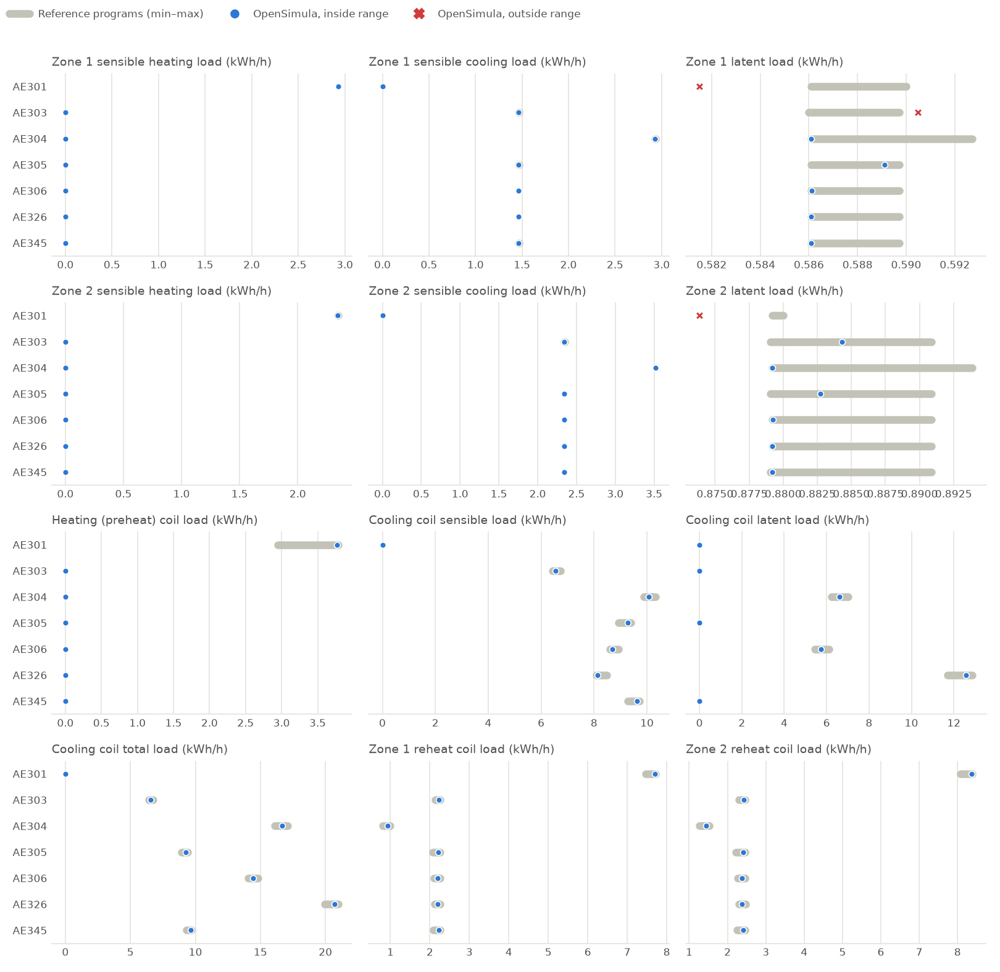

#### Zone 1 sensible heating load (kWh/h)

| Case | OpenSimula | Min | Max | Programs | Result |
|---|--:|--:|--:|--:|---|
| AE301 | 2.931 | 2.930 | 2.931 | 7 | ✓ inside |
| AE303 | 0.000 | 0.000 | 0.000 | 4 | ✓ inside |
| AE304 | 0.000 | 0.000 | 0.000 | 4 | ✓ inside |
| AE305 | 0.000 | 0.000 | 0.000 | 4 | ✓ inside |
| AE306 | 0.000 | 0.000 | 0.000 | 4 | ✓ inside |
| AE326 | 0.000 | 0.000 | 0.000 | 4 | ✓ inside |
| AE345 | 0.000 | 0.000 | 0.000 | 4 | ✓ inside |

#### Zone 1 sensible cooling load (kWh/h)

| Case | OpenSimula | Min | Max | Programs | Result |
|---|--:|--:|--:|--:|---|
| AE301 | 0.000 | 0.000 | 0.000 | 4 | ✓ inside |
| AE303 | 1.465 | 1.465 | 1.467 | 7 | ✓ inside |
| AE304 | 2.931 | 2.931 | 2.934 | 7 | ✓ inside |
| AE305 | 1.465 | 1.465 | 1.466 | 7 | ✓ inside |
| AE306 | 1.465 | 1.465 | 1.466 | 7 | ✓ inside |
| AE326 | 1.465 | 1.465 | 1.466 | 7 | ✓ inside |
| AE345 | 1.465 | 1.465 | 1.466 | 7 | ✓ inside |

#### Zone 1 latent load (kWh/h)

| Case | OpenSimula | Min | Max | Programs | Result |
|---|--:|--:|--:|--:|---|
| AE301 | 0.583 | 0.586 | 0.590 | 7 | ✗ -0.6 % below min |
| AE303 | 0.589 | 0.586 | 0.590 | 7 | ✓ inside |
| AE304 | 0.586 | 0.586 | 0.593 | 7 | ✓ inside |
| AE305 | 0.590 | 0.586 | 0.590 | 7 | ✓ inside |
| AE306 | 0.586 | 0.586 | 0.590 | 7 | ✓ inside |
| AE326 | 0.586 | 0.586 | 0.590 | 7 | ✓ inside |
| AE345 | 0.586 | 0.586 | 0.590 | 7 | ✓ inside |

#### Zone 2 sensible heating load (kWh/h)

| Case | OpenSimula | Min | Max | Programs | Result |
|---|--:|--:|--:|--:|---|
| AE301 | 2.345 | 2.345 | 2.350 | 7 | ✓ inside |
| AE303 | 0.000 | 0.000 | 0.000 | 4 | ✓ inside |
| AE304 | 0.000 | 0.000 | 0.000 | 4 | ✓ inside |
| AE305 | 0.000 | 0.000 | 0.000 | 4 | ✓ inside |
| AE306 | 0.000 | 0.000 | 0.000 | 4 | ✓ inside |
| AE326 | 0.000 | 0.000 | 0.000 | 4 | ✓ inside |
| AE345 | 0.000 | 0.000 | 0.000 | 4 | ✓ inside |

#### Zone 2 sensible cooling load (kWh/h)

| Case | OpenSimula | Min | Max | Programs | Result |
|---|--:|--:|--:|--:|---|
| AE301 | 0.000 | 0.000 | 0.000 | 4 | ✓ inside |
| AE303 | 2.345 | 2.345 | 2.346 | 7 | ✓ inside |
| AE304 | 3.517 | 3.516 | 3.517 | 7 | ✓ inside |
| AE305 | 2.345 | 2.344 | 2.345 | 7 | ✓ inside |
| AE306 | 2.345 | 2.345 | 2.345 | 7 | ✓ inside |
| AE326 | 2.345 | 2.345 | 2.345 | 7 | ✓ inside |
| AE345 | 2.345 | 2.344 | 2.345 | 7 | ✓ inside |

#### Zone 2 latent load (kWh/h)

| Case | OpenSimula | Min | Max | Programs | Result |
|---|--:|--:|--:|--:|---|
| AE301 | 0.875 | 0.879 | 0.880 | 7 | ✗ -0.5 % below min |
| AE303 | 0.883 | 0.879 | 0.891 | 7 | ✓ inside |
| AE304 | 0.879 | 0.879 | 0.894 | 7 | ✓ inside |
| AE305 | 0.883 | 0.879 | 0.891 | 7 | ✓ inside |
| AE306 | 0.879 | 0.879 | 0.891 | 7 | ✓ inside |
| AE326 | 0.879 | 0.879 | 0.891 | 7 | ✓ inside |
| AE345 | 0.879 | 0.879 | 0.891 | 7 | ✓ inside |

#### Heating (preheat) coil load (kWh/h)

| Case | OpenSimula | Min | Max | Programs | Result |
|---|--:|--:|--:|--:|---|
| AE301 | 3.017 | 2.947 | 3.788 | 7 | ✓ inside |
| AE303 | 0.000 | 0.000 | 0.000 | 7 | ✓ inside |
| AE304 | 0.000 | 0.000 | 0.000 | 7 | ✓ inside |
| AE305 | 0.000 | 0.000 | 0.000 | 7 | ✓ inside |
| AE306 | 0.000 | 0.000 | 0.000 | 7 | ✓ inside |
| AE326 | 0.000 | 0.000 | 0.000 | 7 | ✓ inside |
| AE345 | 0.000 | 0.000 | 0.000 | 7 | ✓ inside |

#### Cooling coil sensible load (kWh/h)

| Case | OpenSimula | Min | Max | Programs | Result |
|---|--:|--:|--:|--:|---|
| AE301 | 0.000 | 0.000 | 0.000 | 7 | ✓ inside |
| AE303 | 6.647 | 6.420 | 6.735 | 7 | ✓ inside |
| AE304 | 10.033 | 9.890 | 10.320 | 7 | ✓ inside |
| AE305 | 9.256 | 8.929 | 9.383 | 7 | ✓ inside |
| AE306 | 8.687 | 8.598 | 8.921 | 7 | ✓ inside |
| AE326 | 8.130 | 8.096 | 8.470 | 7 | ✓ inside |
| AE345 | 9.624 | 9.285 | 9.707 | 7 | ✓ inside |

#### Cooling coil latent load (kWh/h)

| Case | OpenSimula | Min | Max | Programs | Result |
|---|--:|--:|--:|--:|---|
| AE301 | 0.000 | 0.000 | 0.000 | 7 | ✓ inside |
| AE303 | -0.000 | 0.000 | 0.000 | 7 | ✓ inside |
| AE304 | 6.379 | 6.214 | 7.011 | 7 | ✓ inside |
| AE305 | -0.000 | 0.000 | 0.000 | 7 | ✓ inside |
| AE306 | 5.563 | 5.434 | 6.103 | 7 | ✓ inside |
| AE326 | 12.571 | 11.712 | 12.879 | 7 | ✓ inside |
| AE345 | -0.000 | 0.000 | 0.000 | 7 | ✓ inside |

#### Cooling coil total load (kWh/h)

| Case | OpenSimula | Min | Max | Programs | Result |
|---|--:|--:|--:|--:|---|
| AE301 | 0.000 | 0.000 | 0.000 | 7 | ✓ inside |
| AE303 | 6.647 | 6.420 | 6.735 | 7 | ✓ inside |
| AE304 | 16.411 | 16.104 | 17.070 | 7 | ✓ inside |
| AE305 | 9.256 | 8.929 | 9.383 | 7 | ✓ inside |
| AE306 | 14.250 | 14.031 | 14.802 | 7 | ✓ inside |
| AE326 | 20.701 | 19.944 | 20.993 | 7 | ✓ inside |
| AE345 | 9.624 | 9.285 | 9.707 | 7 | ✓ inside |

#### Zone 1 reheat coil load (kWh/h)

| Case | OpenSimula | Min | Max | Programs | Result |
|---|--:|--:|--:|--:|---|
| AE301 | 7.698 | 7.472 | 7.713 | 7 | ✓ inside |
| AE303 | 2.229 | 2.136 | 2.258 | 7 | ✓ inside |
| AE304 | 0.929 | 0.798 | 0.993 | 7 | ✓ inside |
| AE305 | 2.219 | 2.072 | 2.260 | 7 | ✓ inside |
| AE306 | 2.202 | 2.111 | 2.262 | 7 | ✓ inside |
| AE326 | 2.202 | 2.126 | 2.267 | 7 | ✓ inside |
| AE345 | 2.227 | 2.089 | 2.261 | 7 | ✓ inside |

#### Zone 2 reheat coil load (kWh/h)

| Case | OpenSimula | Min | Max | Programs | Result |
|---|--:|--:|--:|--:|---|
| AE301 | 8.371 | 8.077 | 8.389 | 7 | ✓ inside |
| AE303 | 2.418 | 2.300 | 2.457 | 7 | ✓ inside |
| AE304 | 1.437 | 1.268 | 1.524 | 7 | ✓ inside |
| AE305 | 2.406 | 2.223 | 2.459 | 7 | ✓ inside |
| AE306 | 2.383 | 2.270 | 2.462 | 7 | ✓ inside |
| AE326 | 2.383 | 2.289 | 2.468 | 7 | ✓ inside |
| AE345 | 2.416 | 2.241 | 2.461 | 7 | ✓ inside |

### AE300 series: coil outlet humidity and air states

| Output | Values | Inside range | Outside range |
|---|--:|--:|--:|
| Cooling coil outlet relative humidity (%) | 7 | 4 | 3 |
| Dry bulb temperature (°C) | 77 | 71 | 6 |
| Humidity ratio (kg/kg) | 77 | 56 | 21 |
| Specific volume (L/kg) | 77 | 71 | 6 |
| Enthalpy (kJ/kg) | 77 | 65 | 12 |
| Dry air mass flow rate (kg/s) | 63 | 63 | 0 |

#### Cooling coil outlet relative humidity (%)

| Case | OpenSimula | Min | Max | Programs | Result |
|---|--:|--:|--:|--:|---|
| AE301 | 24.930 | 23.891 | 24.733 | 6 | ✗ +0.8 % above max |
| AE303 | 48.438 | 47.457 | 48.220 | 7 | ✗ +0.5 % above max |
| AE304 | 100.000 | 95.490 | 100.000 | 7 | ✓ inside |
| AE305 | 65.941 | 64.909 | 65.840 | 7 | ✗ +0.2 % above max |
| AE306 | 99.861 | 96.210 | 100.000 | 7 | ✓ inside |
| AE326 | 100.000 | 98.890 | 100.000 | 7 | ✓ inside |
| AE345 | 50.983 | 50.707 | 51.330 | 7 | ✓ inside |

#### Dry bulb temperature (°C)

| Case | OpenSimula | Min | Max | Programs | Result |
|---|--:|--:|--:|--:|---|
| AE301 oa | -29.000 | -29.000 | -29.000 | 7 | ✓ inside |
| AE301 ma | 3.330 | 2.358 | 3.432 | 6 | ✓ inside |
| AE301 pco | 7.222 | 7.220 | 7.222 | 7 | ✓ inside |
| AE301 cco | 7.222 | 7.220 | 7.222 | 7 | ✓ inside |
| AE301 sa | 7.785 | 7.778 | 7.810 | 7 | ✓ inside |
| AE301 z1s | 29.304 | 29.270 | 29.670 | 6 | ✓ inside |
| AE301 z2s | 27.840 | 27.810 | 28.089 | 6 | ✓ inside |
| AE301 z1 | 21.111 | 21.110 | 21.130 | 7 | ✓ inside |
| AE301 z2 | 22.222 | 22.217 | 22.248 | 7 | ✓ inside |
| AE301 rfi | 21.666 | 21.666 | 21.709 | 6 | ✓ inside |
| AE301 rfo | 21.939 | 21.944 | 22.019 | 7 | ✓ inside |
| AE303 oa | 15.500 | 15.500 | 15.500 | 7 | ✓ inside |
| AE303 ma | 20.970 | 20.833 | 21.018 | 7 | ✓ inside |
| AE303 pco | 12.204 | 20.833 | 21.018 | 7 | ✗ -8.63 °C below min |
| AE303 cco | 12.204 | 12.167 | 12.215 | 7 | ✓ inside |
| AE303 sa | 12.780 | 12.778 | 12.795 | 7 | ✓ inside |
| AE303 z1s | 19.147 | 19.050 | 19.180 | 6 | ✓ inside |
| AE303 z2s | 18.701 | 18.570 | 18.750 | 6 | ✓ inside |
| AE303 z1 | 23.333 | 23.328 | 23.339 | 7 | ✓ inside |
| AE303 z2 | 24.444 | 24.439 | 24.452 | 7 | ✓ inside |
| AE303 rfi | 23.889 | 23.887 | 23.946 | 6 | ✓ inside |
| AE303 rfo | 24.169 | 24.178 | 24.241 | 7 | ✓ inside |
| AE304 oa | 26.900 | 26.889 | 26.900 | 7 | ✓ inside |
| AE304 ma | 25.527 | 25.541 | 25.596 | 7 | ✓ inside |
| AE304 pco | 12.200 | 25.541 | 25.596 | 7 | ✗ -13.34 °C below min |
| AE304 cco | 12.200 | 12.199 | 12.222 | 7 | ✓ inside |
| AE304 sa | 12.780 | 12.778 | 12.833 | 7 | ✓ inside |
| AE304 z1s | 15.453 | 15.310 | 15.590 | 6 | ✓ inside |
| AE304 z2s | 16.324 | 16.185 | 16.480 | 6 | ✓ inside |
| AE304 z1 | 23.889 | 23.881 | 23.891 | 7 | ✓ inside |
| AE304 z2 | 25.000 | 25.000 | 25.005 | 7 | ✓ inside |
| AE304 rfi | 24.445 | 24.445 | 24.502 | 6 | ✓ inside |
| AE304 rfo | 24.727 | 24.722 | 24.797 | 7 | ✓ inside |
| AE305 oa | 24.900 | 24.889 | 24.900 | 7 | ✓ inside |
| AE305 ma | 24.439 | 24.444 | 24.485 | 7 | ✓ inside |
| AE305 pco | 12.203 | 24.444 | 24.485 | 7 | ✗ -12.24 °C below min |
| AE305 cco | 12.203 | 12.199 | 12.278 | 7 | ✓ inside |
| AE305 sa | 12.780 | 12.778 | 12.889 | 7 | ✓ inside |
| AE305 z1s | 19.137 | 19.051 | 19.181 | 6 | ✓ inside |
| AE305 z2s | 18.687 | 18.572 | 18.750 | 6 | ✓ inside |
| AE305 z1 | 23.333 | 23.327 | 23.339 | 7 | ✓ inside |
| AE305 z2 | 24.444 | 24.437 | 24.452 | 7 | ✓ inside |
| AE305 rfi | 23.889 | 23.885 | 23.946 | 6 | ✓ inside |
| AE305 rfo | 24.170 | 24.167 | 24.241 | 7 | ✓ inside |
| AE306 oa | 23.000 | 23.000 | 23.000 | 7 | ✓ inside |
| AE306 ma | 23.739 | 23.722 | 23.774 | 7 | ✓ inside |
| AE306 pco | 12.200 | 23.722 | 23.774 | 7 | ✗ -11.52 °C below min |
| AE306 cco | 12.200 | 12.176 | 12.222 | 7 | ✓ inside |
| AE306 sa | 12.780 | 12.766 | 12.784 | 7 | ✓ inside |
| AE306 z1s | 19.117 | 19.025 | 19.190 | 6 | ✓ inside |
| AE306 z2s | 18.659 | 18.540 | 18.760 | 6 | ✓ inside |
| AE306 z1 | 23.333 | 23.331 | 23.339 | 7 | ✓ inside |
| AE306 z2 | 24.444 | 24.442 | 24.452 | 7 | ✓ inside |
| AE306 rfi | 23.889 | 23.887 | 23.917 | 6 | ✓ inside |
| AE306 rfo | 24.171 | 24.167 | 24.232 | 7 | ✓ inside |
| AE326 oa | 23.000 | 23.000 | 23.000 | 7 | ✓ inside |
| AE326 ma | 23.000 | 23.000 | 23.000 | 7 | ✓ inside |
| AE326 pco | 12.200 | 23.000 | 23.000 | 7 | ✗ -10.80 °C below min |
| AE326 cco | 12.200 | 12.199 | 12.222 | 7 | ✓ inside |
| AE326 sa | 12.780 | 12.770 | 12.794 | 7 | ✓ inside |
| AE326 z1s | 19.117 | 19.052 | 19.190 | 6 | ✓ inside |
| AE326 z2s | 18.659 | 18.568 | 18.760 | 6 | ✓ inside |
| AE326 z1 | 23.333 | 23.331 | 23.339 | 7 | ✓ inside |
| AE326 z2 | 24.444 | 24.442 | 24.452 | 7 | ✓ inside |
| AE326 rfi | 23.889 | 23.887 | 23.945 | 6 | ✓ inside |
| AE326 rfo | 24.171 | 24.167 | 24.240 | 7 | ✓ inside |
| AE345 oa | 24.900 | 24.889 | 24.900 | 7 | ✓ inside |
| AE345 ma | 24.900 | 24.889 | 24.900 | 7 | ✓ inside |
| AE345 pco | 12.204 | 24.889 | 24.900 | 7 | ✗ -12.68 °C below min |
| AE345 cco | 12.204 | 12.197 | 12.222 | 7 | ✓ inside |
| AE345 sa | 12.780 | 12.771 | 12.795 | 7 | ✓ inside |
| AE345 z1s | 19.146 | 19.052 | 19.180 | 6 | ✓ inside |
| AE345 z2s | 18.699 | 18.572 | 18.750 | 6 | ✓ inside |
| AE345 z1 | 23.333 | 23.328 | 23.339 | 7 | ✓ inside |
| AE345 z2 | 24.444 | 24.438 | 24.452 | 7 | ✓ inside |
| AE345 rfi | 23.889 | 23.887 | 23.946 | 6 | ✓ inside |
| AE345 rfo | 24.169 | 24.167 | 24.241 | 7 | ✓ inside |

#### Humidity ratio (kg/kg)

| Case | OpenSimula | Min | Max | Programs | Result |
|---|--:|--:|--:|--:|---|
| AE301 oa | 0.000 | 0.000 | 0.000 | 7 | ✓ inside |
| AE301 ma | 0.002 | 0.001 | 0.002 | 7 | ✗ +0.8 % above max |
| AE301 pco | 0.002 | 0.001 | 0.002 | 7 | ✗ +0.8 % above max |
| AE301 cco | 0.002 | 0.001 | 0.002 | 7 | ✗ +0.8 % above max |
| AE301 sa | 0.002 | 0.001 | 0.002 | 7 | ✗ +0.8 % above max |
| AE301 z1s | 0.002 | 0.001 | 0.002 | 7 | ✗ +0.8 % above max |
| AE301 z2s | 0.002 | 0.001 | 0.002 | 7 | ✗ +0.8 % above max |
| AE301 z1 | 0.002 | 0.002 | 0.002 | 6 | ✓ inside |
| AE301 z2 | 0.002 | 0.002 | 0.002 | 6 | ✓ inside |
| AE301 rfi | 0.002 | 0.002 | 0.002 | 7 | ✓ inside |
| AE301 rfo | 0.002 | 0.002 | 0.002 | 7 | ✓ inside |
| AE303 oa | 0.003 | 0.003 | 0.003 | 7 | ✓ inside |
| AE303 ma | 0.004 | 0.004 | 0.004 | 7 | ✗ +0.5 % above max |
| AE303 pco | 0.004 | 0.004 | 0.004 | 7 | ✗ +0.5 % above max |
| AE303 cco | 0.004 | 0.004 | 0.004 | 7 | ✗ +0.5 % above max |
| AE303 sa | 0.004 | 0.004 | 0.004 | 7 | ✗ +0.5 % above max |
| AE303 z1s | 0.004 | 0.004 | 0.004 | 7 | ✗ +0.5 % above max |
| AE303 z2s | 0.004 | 0.004 | 0.004 | 7 | ✗ +0.5 % above max |
| AE303 z1 | 0.005 | 0.005 | 0.005 | 6 | ✓ inside |
| AE303 z2 | 0.005 | 0.005 | 0.005 | 6 | ✓ inside |
| AE303 rfi | 0.005 | 0.005 | 0.005 | 7 | ✓ inside |
| AE303 rfo | 0.005 | 0.005 | 0.005 | 7 | ✓ inside |
| AE304 oa | 0.017 | 0.017 | 0.017 | 7 | ✓ inside |
| AE304 ma | 0.012 | 0.012 | 0.012 | 7 | ✓ inside |
| AE304 pco | 0.009 | 0.012 | 0.012 | 7 | ✗ -27.4 % below min |
| AE304 cco | 0.009 | 0.008 | 0.009 | 7 | ✓ inside |
| AE304 sa | 0.009 | 0.008 | 0.009 | 7 | ✓ inside |
| AE304 z1s | 0.009 | 0.008 | 0.009 | 7 | ✓ inside |
| AE304 z2s | 0.009 | 0.008 | 0.009 | 7 | ✓ inside |
| AE304 z1 | 0.010 | 0.009 | 0.010 | 6 | ✓ inside |
| AE304 z2 | 0.010 | 0.009 | 0.010 | 6 | ✓ inside |
| AE304 rfi | 0.010 | 0.009 | 0.010 | 7 | ✓ inside |
| AE304 rfo | 0.010 | 0.009 | 0.010 | 7 | ✓ inside |
| AE305 oa | 0.004 | 0.004 | 0.005 | 7 | ✓ inside |
| AE305 ma | 0.006 | 0.006 | 0.006 | 7 | ✗ +0.1 % above max |
| AE305 pco | 0.006 | 0.006 | 0.006 | 7 | ✗ +0.1 % above max |
| AE305 cco | 0.006 | 0.006 | 0.006 | 7 | ✗ +0.1 % above max |
| AE305 sa | 0.006 | 0.006 | 0.006 | 7 | ✗ +0.1 % above max |
| AE305 z1s | 0.006 | 0.006 | 0.006 | 7 | ✗ +0.1 % above max |
| AE305 z2s | 0.006 | 0.006 | 0.006 | 7 | ✗ +0.1 % above max |
| AE305 z1 | 0.006 | 0.006 | 0.006 | 6 | ✓ inside |
| AE305 z2 | 0.007 | 0.007 | 0.007 | 6 | ✓ inside |
| AE305 rfi | 0.007 | 0.006 | 0.007 | 7 | ✓ inside |
| AE305 rfo | 0.007 | 0.006 | 0.007 | 7 | ✓ inside |
| AE306 oa | 0.016 | 0.016 | 0.016 | 7 | ✓ inside |
| AE306 ma | 0.012 | 0.012 | 0.012 | 7 | ✓ inside |
| AE306 pco | 0.009 | 0.012 | 0.012 | 7 | ✗ -24.8 % below min |
| AE306 cco | 0.009 | 0.008 | 0.009 | 7 | ✓ inside |
| AE306 sa | 0.009 | 0.008 | 0.009 | 7 | ✓ inside |
| AE306 z1s | 0.009 | 0.008 | 0.009 | 7 | ✓ inside |
| AE306 z2s | 0.009 | 0.008 | 0.009 | 7 | ✓ inside |
| AE306 z1 | 0.010 | 0.009 | 0.010 | 6 | ✓ inside |
| AE306 z2 | 0.010 | 0.009 | 0.010 | 6 | ✓ inside |
| AE306 rfi | 0.010 | 0.009 | 0.010 | 7 | ✓ inside |
| AE306 rfo | 0.010 | 0.010 | 0.010 | 7 | ✓ inside |
| AE326 oa | 0.016 | 0.016 | 0.016 | 7 | ✓ inside |
| AE326 ma | 0.016 | 0.016 | 0.016 | 7 | ✓ inside |
| AE326 pco | 0.009 | 0.016 | 0.016 | 7 | ✗ -43.0 % below min |
| AE326 cco | 0.009 | 0.009 | 0.009 | 7 | ✓ inside |
| AE326 sa | 0.009 | 0.009 | 0.009 | 7 | ✓ inside |
| AE326 z1s | 0.009 | 0.009 | 0.009 | 7 | ✓ inside |
| AE326 z2s | 0.009 | 0.009 | 0.009 | 7 | ✓ inside |
| AE326 z1 | 0.010 | 0.009 | 0.010 | 6 | ✓ inside |
| AE326 z2 | 0.010 | 0.010 | 0.010 | 6 | ✓ inside |
| AE326 rfi | 0.010 | 0.010 | 0.010 | 7 | ✓ inside |
| AE326 rfo | 0.010 | 0.010 | 0.010 | 7 | ✓ inside |
| AE345 oa | 0.004 | 0.004 | 0.005 | 7 | ✓ inside |
| AE345 ma | 0.004 | 0.004 | 0.005 | 7 | ✓ inside |
| AE345 pco | 0.004 | 0.004 | 0.005 | 7 | ✓ inside |
| AE345 cco | 0.004 | 0.004 | 0.005 | 7 | ✓ inside |
| AE345 sa | 0.004 | 0.004 | 0.005 | 7 | ✓ inside |
| AE345 z1s | 0.004 | 0.004 | 0.005 | 7 | ✓ inside |
| AE345 z2s | 0.004 | 0.004 | 0.005 | 7 | ✓ inside |
| AE345 z1 | 0.005 | 0.005 | 0.005 | 6 | ✓ inside |
| AE345 z2 | 0.005 | 0.005 | 0.005 | 6 | ✓ inside |
| AE345 rfi | 0.005 | 0.005 | 0.005 | 7 | ✓ inside |
| AE345 rfo | 0.005 | 0.005 | 0.005 | 7 | ✓ inside |

#### Specific volume (L/kg)

| Case | OpenSimula | Min | Max | Programs | Result |
|---|--:|--:|--:|--:|---|
| AE301 oa | 691.937 | 691.841 | 833.330 | 5 | ✓ inside |
| AE301 ma | 785.201 | 785.271 | 833.330 | 5 | ✓ inside |
| AE301 pco | 796.255 | 796.130 | 833.330 | 5 | ✓ inside |
| AE301 cco | 796.255 | 796.130 | 833.330 | 5 | ✓ inside |
| AE301 sa | 797.854 | 793.917 | 833.330 | 5 | ✓ inside |
| AE301 z1s | 858.966 | 830.352 | 858.872 | 5 | ✓ inside |
| AE301 z2s | 854.811 | 830.352 | 854.737 | 5 | ✓ inside |
| AE301 z1 | 836.577 | 830.352 | 836.546 | 5 | ✓ inside |
| AE301 z2 | 839.989 | 830.352 | 839.953 | 5 | ✓ inside |
| AE301 rfi | 838.283 | 830.352 | 838.262 | 5 | ✓ inside |
| AE301 rfo | 839.059 | 830.352 | 839.252 | 5 | ✓ inside |
| AE303 oa | 821.567 | 821.405 | 833.330 | 5 | ✓ inside |
| AE303 ma | 838.909 | 830.352 | 839.011 | 5 | ✓ inside |
| AE303 pco | 813.907 | 830.352 | 839.011 | 5 | ✗ -2.0 % below min |
| AE303 cco | 813.907 | 813.714 | 833.330 | 5 | ✓ inside |
| AE303 sa | 815.549 | 811.552 | 833.330 | 5 | ✓ inside |
| AE303 z1s | 833.710 | 830.352 | 833.777 | 5 | ✓ inside |
| AE303 z2s | 832.438 | 830.352 | 833.330 | 5 | ✓ inside |
| AE303 z1 | 846.563 | 830.352 | 846.506 | 5 | ✓ inside |
| AE303 z2 | 849.997 | 830.352 | 849.934 | 5 | ✓ inside |
| AE303 rfi | 848.280 | 830.352 | 848.231 | 5 | ✓ inside |
| AE303 rfo | 849.081 | 830.352 | 849.198 | 5 | ✓ inside |
| AE304 oa | 872.920 | 830.352 | 872.931 | 5 | ✓ inside |
| AE304 ma | 862.791 | 830.352 | 862.918 | 5 | ✓ inside |
| AE304 pco | 819.864 | 830.352 | 862.918 | 5 | ✗ -1.3 % below min |
| AE304 cco | 819.864 | 819.774 | 833.330 | 5 | ✓ inside |
| AE304 sa | 821.530 | 817.526 | 833.330 | 5 | ✓ inside |
| AE304 z1s | 829.211 | 829.468 | 833.330 | 5 | ✓ inside |
| AE304 z2s | 831.712 | 830.352 | 833.330 | 5 | ✓ inside |
| AE304 z1 | 854.366 | 830.352 | 854.349 | 5 | ✓ inside |
| AE304 z2 | 857.825 | 830.352 | 857.827 | 5 | ✓ inside |
| AE304 rfi | 856.095 | 830.352 | 856.095 | 5 | ✓ inside |
| AE304 rfo | 856.907 | 830.352 | 857.070 | 5 | ✓ inside |
| AE305 oa | 850.421 | 830.352 | 850.438 | 5 | ✓ inside |
| AE305 ma | 850.907 | 830.352 | 850.986 | 5 | ✓ inside |
| AE305 pco | 815.920 | 830.352 | 850.986 | 5 | ✗ -1.7 % below min |
| AE305 cco | 815.920 | 815.748 | 833.330 | 5 | ✓ inside |
| AE305 sa | 817.570 | 813.565 | 833.330 | 5 | ✓ inside |
| AE305 z1s | 835.746 | 830.352 | 835.852 | 5 | ✓ inside |
| AE305 z2s | 834.460 | 830.352 | 834.622 | 5 | ✓ inside |
| AE305 z1 | 848.662 | 830.352 | 848.610 | 5 | ✓ inside |
| AE305 z2 | 852.104 | 830.352 | 852.047 | 5 | ✓ inside |
| AE305 rfi | 850.382 | 830.352 | 850.339 | 5 | ✓ inside |
| AE305 rfo | 851.188 | 830.352 | 851.311 | 5 | ✓ inside |
| AE306 oa | 859.948 | 830.352 | 859.942 | 5 | ✓ inside |
| AE306 ma | 857.020 | 830.352 | 857.123 | 5 | ✓ inside |
| AE306 pco | 819.848 | 830.352 | 857.123 | 5 | ✗ -1.3 % below min |
| AE306 cco | 819.848 | 819.774 | 833.330 | 5 | ✓ inside |
| AE306 sa | 821.513 | 817.534 | 833.330 | 5 | ✓ inside |
| AE306 z1s | 839.720 | 830.352 | 839.957 | 5 | ✓ inside |
| AE306 z2s | 838.405 | 830.352 | 839.809 | 5 | ✓ inside |
| AE306 z1 | 852.750 | 830.352 | 852.767 | 5 | ✓ inside |
| AE306 z2 | 856.208 | 830.352 | 856.216 | 5 | ✓ inside |
| AE306 rfi | 854.479 | 830.352 | 854.502 | 5 | ✓ inside |
| AE306 rfo | 855.292 | 830.352 | 855.464 | 5 | ✓ inside |
| AE326 oa | 859.948 | 830.352 | 859.942 | 5 | ✓ inside |
| AE326 ma | 859.954 | 830.352 | 859.942 | 5 | ✓ inside |
| AE326 pco | 819.864 | 830.352 | 859.942 | 5 | ✗ -1.3 % below min |
| AE326 cco | 819.864 | 819.774 | 833.330 | 5 | ✓ inside |
| AE326 sa | 821.530 | 817.484 | 833.330 | 5 | ✓ inside |
| AE326 z1s | 839.736 | 830.352 | 839.947 | 5 | ✓ inside |
| AE326 z2s | 838.421 | 830.352 | 838.711 | 5 | ✓ inside |
| AE326 z1 | 852.767 | 830.352 | 852.756 | 5 | ✓ inside |
| AE326 z2 | 856.225 | 830.352 | 856.204 | 5 | ✓ inside |
| AE326 rfi | 854.496 | 830.352 | 854.491 | 5 | ✓ inside |
| AE326 rfo | 855.309 | 830.352 | 855.464 | 5 | ✓ inside |
| AE345 oa | 850.421 | 830.352 | 850.438 | 5 | ✓ inside |
| AE345 ma | 850.424 | 830.352 | 850.438 | 5 | ✓ inside |
| AE345 pco | 814.199 | 830.352 | 850.438 | 5 | ✗ -1.9 % below min |
| AE345 cco | 814.199 | 814.061 | 833.330 | 5 | ✓ inside |
| AE345 sa | 815.842 | 811.840 | 833.330 | 5 | ✓ inside |
| AE345 z1s | 834.006 | 830.352 | 834.117 | 5 | ✓ inside |
| AE345 z2s | 832.731 | 830.352 | 833.330 | 5 | ✓ inside |
| AE345 z1 | 846.863 | 830.352 | 846.856 | 5 | ✓ inside |
| AE345 z2 | 850.297 | 830.352 | 850.285 | 5 | ✓ inside |
| AE345 rfi | 848.580 | 830.352 | 848.581 | 5 | ✓ inside |
| AE345 rfo | 849.382 | 830.352 | 849.551 | 5 | ✓ inside |

#### Enthalpy (kJ/kg)

| Case | OpenSimula | Min | Max | Programs | Result |
|---|--:|--:|--:|--:|---|
| AE301 oa | -28.540 | -28.543 | -28.507 | 4 | ✓ inside |
| AE301 ma | 7.263 | 6.178 | 7.335 | 4 | ✓ inside |
| AE301 pco | 11.190 | 11.016 | 11.159 | 4 | ✗ +0.3 % above max |
| AE301 cco | 11.190 | 11.016 | 11.159 | 4 | ✗ +0.3 % above max |
| AE301 sa | 11.758 | 11.606 | 11.726 | 4 | ✗ +0.3 % above max |
| AE301 z1s | 33.468 | 33.386 | 33.740 | 4 | ✓ inside |
| AE301 z2s | 31.991 | 31.913 | 32.140 | 4 | ✓ inside |
| AE301 z1 | 26.866 | 26.750 | 26.866 | 4 | ✓ inside |
| AE301 z2 | 28.467 | 28.368 | 28.485 | 4 | ✓ inside |
| AE301 rfi | 27.667 | 27.559 | 27.740 | 4 | ✓ inside |
| AE301 rfo | 27.943 | 27.855 | 28.040 | 4 | ✓ inside |
| AE303 oa | 23.010 | 22.996 | 23.032 | 4 | ✓ inside |
| AE303 ma | 31.905 | 31.540 | 31.900 | 4 | ✓ inside |
| AE303 pco | 23.018 | 31.540 | 31.900 | 4 | ✗ -27.0 % below min |
| AE303 cco | 23.018 | 22.775 | 22.978 | 4 | ✗ +0.2 % above max |
| AE303 sa | 23.601 | 23.365 | 23.557 | 4 | ✗ +0.2 % above max |
| AE303 z1s | 30.057 | 29.766 | 30.039 | 4 | ✓ inside |
| AE303 z2s | 29.605 | 29.299 | 29.604 | 4 | ✓ inside |
| AE303 z1 | 36.024 | 35.775 | 35.990 | 4 | ✓ inside |
| AE303 z2 | 37.642 | 37.393 | 37.630 | 4 | ✓ inside |
| AE303 rfi | 36.833 | 36.584 | 36.890 | 4 | ✓ inside |
| AE303 rfo | 37.118 | 36.880 | 37.190 | 4 | ✓ inside |
| AE304 oa | 69.831 | 69.814 | 69.994 | 4 | ✓ inside |
| AE304 ma | 56.914 | 56.750 | 57.106 | 4 | ✓ inside |
| AE304 pco | 34.602 | 56.750 | 57.106 | 4 | ✗ -39.0 % below min |
| AE304 cco | 34.602 | 33.560 | 34.630 | 4 | ✓ inside |
| AE304 sa | 35.195 | 34.160 | 35.214 | 4 | ✓ inside |
| AE304 z1s | 37.929 | 36.730 | 38.085 | 4 | ✓ inside |
| AE304 z2s | 38.819 | 37.620 | 38.995 | 4 | ✓ inside |
| AE304 z1 | 48.281 | 47.260 | 48.269 | 4 | ✓ inside |
| AE304 z2 | 49.912 | 48.905 | 49.905 | 4 | ✓ inside |
| AE304 rfi | 49.096 | 48.170 | 49.092 | 4 | ✓ inside |
| AE304 rfo | 49.385 | 48.470 | 49.442 | 4 | ✓ inside |
| AE305 oa | 36.457 | 36.435 | 36.506 | 4 | ✓ inside |
| AE305 ma | 39.373 | 39.133 | 39.374 | 4 | ✓ inside |
| AE305 pco | 26.932 | 39.133 | 39.374 | 4 | ✗ -31.2 % below min |
| AE305 cco | 26.932 | 26.682 | 26.908 | 4 | ✓ inside |
| AE305 sa | 27.519 | 27.273 | 27.490 | 4 | ✗ +0.1 % above max |
| AE305 z1s | 33.982 | 33.703 | 33.992 | 4 | ✓ inside |
| AE305 z2s | 33.525 | 33.240 | 33.555 | 4 | ✓ inside |
| AE305 z1 | 39.977 | 39.713 | 39.960 | 4 | ✓ inside |
| AE305 z2 | 41.600 | 41.334 | 41.610 | 4 | ✓ inside |
| AE305 rfi | 40.789 | 40.523 | 40.860 | 4 | ✓ inside |
| AE305 rfo | 41.075 | 40.819 | 41.160 | 4 | ✓ inside |
| AE306 oa | 62.719 | 62.705 | 62.851 | 4 | ✓ inside |
| AE306 ma | 53.934 | 53.770 | 54.042 | 4 | ✓ inside |
| AE306 pco | 34.571 | 53.770 | 54.042 | 4 | ✗ -35.7 % below min |
| AE306 cco | 34.571 | 33.660 | 34.636 | 4 | ✓ inside |
| AE306 sa | 35.164 | 34.260 | 35.220 | 4 | ✓ inside |
| AE306 z1s | 41.642 | 40.650 | 41.769 | 4 | ✓ inside |
| AE306 z2s | 41.175 | 40.150 | 41.330 | 4 | ✓ inside |
| AE306 z1 | 47.680 | 46.810 | 47.709 | 4 | ✓ inside |
| AE306 z2 | 49.311 | 48.470 | 49.331 | 4 | ✓ inside |
| AE306 rfi | 48.495 | 47.690 | 48.525 | 4 | ✓ inside |
| AE306 rfo | 48.785 | 47.990 | 48.872 | 4 | ✓ inside |
| AE326 oa | 62.719 | 62.705 | 62.851 | 4 | ✓ inside |
| AE326 ma | 62.731 | 62.705 | 62.851 | 4 | ✓ inside |
| AE326 pco | 34.602 | 62.705 | 62.851 | 4 | ✗ -44.8 % below min |
| AE326 cco | 34.602 | 34.330 | 34.621 | 4 | ✓ inside |
| AE326 sa | 35.195 | 34.930 | 35.204 | 4 | ✓ inside |
| AE326 z1s | 41.674 | 41.320 | 41.755 | 4 | ✓ inside |
| AE326 z2s | 41.206 | 40.828 | 41.315 | 4 | ✓ inside |
| AE326 z1 | 47.711 | 47.450 | 47.695 | 4 | ✓ inside |
| AE326 z2 | 49.343 | 49.140 | 49.316 | 4 | ✓ inside |
| AE326 rfi | 48.527 | 48.370 | 48.510 | 4 | ✓ inside |
| AE326 rfo | 48.816 | 48.370 | 48.858 | 4 | ✓ inside |
| AE345 oa | 36.457 | 36.435 | 36.506 | 4 | ✓ inside |
| AE345 ma | 36.463 | 36.435 | 36.506 | 4 | ✓ inside |
| AE345 pco | 23.585 | 36.435 | 36.506 | 4 | ✗ -35.3 % below min |
| AE345 cco | 23.585 | 23.564 | 23.640 | 4 | ✓ inside |
| AE345 sa | 24.170 | 24.155 | 24.240 | 4 | ✓ inside |
| AE345 z1s | 30.627 | 30.550 | 30.688 | 4 | ✓ inside |
| AE345 z2s | 30.173 | 30.070 | 30.251 | 4 | ✓ inside |
| AE345 z1 | 36.588 | 36.571 | 36.680 | 4 | ✓ inside |
| AE345 z2 | 38.207 | 38.190 | 38.330 | 4 | ✓ inside |
| AE345 rfi | 37.397 | 37.381 | 37.590 | 4 | ✓ inside |
| AE345 rfo | 37.683 | 37.590 | 37.741 | 4 | ✓ inside |

#### Dry air mass flow rate (kg/s)

| Case | OpenSimula | Min | Max | Programs | Result |
|---|--:|--:|--:|--:|---|
| AE301 oa | 0.281 | 0.281 | 0.296 | 7 | ✓ inside |
| AE301 ma | 0.771 | 0.736 | 0.771 | 7 | ✓ inside |
| AE301 pco | 0.771 | 0.736 | 0.771 | 7 | ✓ inside |
| AE301 cco | 0.771 | 0.736 | 0.771 | 7 | ✓ inside |
| AE301 sa | 0.771 | 0.736 | 0.771 | 7 | ✓ inside |
| AE301 z1s | 0.356 | 0.340 | 0.356 | 7 | ✓ inside |
| AE301 z2s | 0.415 | 0.396 | 0.415 | 7 | ✓ inside |
| AE301 rfi | 0.489 | 0.453 | 0.489 | 7 | ✓ inside |
| AE301 rfo | 0.489 | 0.453 | 0.489 | 7 | ✓ inside |
| AE303 oa | 0.278 | 0.278 | 0.284 | 7 | ✓ inside |
| AE303 ma | 0.754 | 0.732 | 0.754 | 7 | ✓ inside |
| AE303 pco | 0.754 | 0.732 | 0.754 | 7 | ✓ inside |
| AE303 cco | 0.754 | 0.732 | 0.754 | 7 | ✓ inside |
| AE303 sa | 0.754 | 0.732 | 0.754 | 7 | ✓ inside |
| AE303 z1s | 0.348 | 0.338 | 0.348 | 7 | ✓ inside |
| AE303 z2s | 0.406 | 0.394 | 0.406 | 7 | ✓ inside |
| AE303 rfi | 0.476 | 0.450 | 0.476 | 7 | ✓ inside |
| AE303 rfo | 0.476 | 0.450 | 0.476 | 7 | ✓ inside |
| AE304 oa | 0.276 | 0.273 | 0.284 | 7 | ✓ inside |
| AE304 ma | 0.748 | 0.711 | 0.748 | 7 | ✓ inside |
| AE304 pco | 0.748 | 0.711 | 0.748 | 7 | ✓ inside |
| AE304 cco | 0.748 | 0.711 | 0.748 | 7 | ✓ inside |
| AE304 sa | 0.748 | 0.711 | 0.748 | 7 | ✓ inside |
| AE304 z1s | 0.345 | 0.328 | 0.345 | 7 | ✓ inside |
| AE304 z2s | 0.403 | 0.383 | 0.403 | 7 | ✓ inside |
| AE304 rfi | 0.473 | 0.438 | 0.473 | 7 | ✓ inside |
| AE304 rfo | 0.473 | 0.438 | 0.473 | 7 | ✓ inside |
| AE305 oa | 0.277 | 0.277 | 0.284 | 7 | ✓ inside |
| AE305 ma | 0.752 | 0.721 | 0.752 | 7 | ✓ inside |
| AE305 pco | 0.752 | 0.721 | 0.752 | 7 | ✓ inside |
| AE305 cco | 0.752 | 0.721 | 0.752 | 7 | ✓ inside |
| AE305 sa | 0.752 | 0.721 | 0.752 | 7 | ✓ inside |
| AE305 z1s | 0.347 | 0.333 | 0.347 | 7 | ✓ inside |
| AE305 z2s | 0.405 | 0.388 | 0.405 | 7 | ✓ inside |
| AE305 rfi | 0.474 | 0.444 | 0.475 | 7 | ✓ inside |
| AE305 rfo | 0.474 | 0.444 | 0.475 | 7 | ✓ inside |
| AE306 oa | 0.276 | 0.275 | 0.284 | 7 | ✓ inside |
| AE306 ma | 0.748 | 0.716 | 0.748 | 7 | ✓ inside |
| AE306 pco | 0.748 | 0.716 | 0.748 | 7 | ✓ inside |
| AE306 cco | 0.748 | 0.716 | 0.748 | 7 | ✓ inside |
| AE306 sa | 0.748 | 0.716 | 0.748 | 7 | ✓ inside |
| AE306 z1s | 0.345 | 0.330 | 0.345 | 7 | ✓ inside |
| AE306 z2s | 0.403 | 0.386 | 0.403 | 7 | ✓ inside |
| AE306 rfi | 0.472 | 0.441 | 0.472 | 7 | ✓ inside |
| AE306 rfo | 0.472 | 0.441 | 0.472 | 7 | ✓ inside |
| AE326 oa | 0.748 | 0.714 | 0.748 | 7 | ✓ inside |
| AE326 ma | 0.748 | 0.714 | 0.748 | 7 | ✓ inside |
| AE326 pco | 0.748 | 0.714 | 0.748 | 7 | ✓ inside |
| AE326 cco | 0.748 | 0.714 | 0.748 | 7 | ✓ inside |
| AE326 sa | 0.748 | 0.714 | 0.748 | 7 | ✓ inside |
| AE326 z1s | 0.345 | 0.329 | 0.345 | 7 | ✓ inside |
| AE326 z2s | 0.403 | 0.384 | 0.403 | 7 | ✓ inside |
| AE326 rfi | 0.472 | 0.439 | 0.472 | 7 | ✓ inside |
| AE326 rfo | 0.472 | 0.439 | 0.472 | 7 | ✓ inside |
| AE345 oa | 0.754 | 0.722 | 0.754 | 7 | ✓ inside |
| AE345 ma | 0.754 | 0.722 | 0.754 | 7 | ✓ inside |
| AE345 pco | 0.754 | 0.722 | 0.754 | 7 | ✓ inside |
| AE345 cco | 0.754 | 0.722 | 0.754 | 7 | ✓ inside |
| AE345 sa | 0.754 | 0.722 | 0.754 | 7 | ✓ inside |
| AE345 z1s | 0.348 | 0.333 | 0.348 | 7 | ✓ inside |
| AE345 z2s | 0.406 | 0.389 | 0.406 | 7 | ✓ inside |
| AE345 rfi | 0.475 | 0.444 | 0.476 | 7 | ✓ inside |
| AE345 rfo | 0.475 | 0.444 | 0.476 | 7 | ✓ inside |

### AE400 series: loads

| Output | Values | Inside range | Outside range |
|---|--:|--:|--:|
| Zone 1 sensible heating load (kWh/h) | 7 | 7 | 0 |
| Zone 1 sensible cooling load (kWh/h) | 7 | 7 | 0 |
| Zone 1 latent load (kWh/h) | 7 | 7 | 0 |
| Zone 2 sensible heating load (kWh/h) | 7 | 7 | 0 |
| Zone 2 sensible cooling load (kWh/h) | 7 | 7 | 0 |
| Zone 2 latent load (kWh/h) | 7 | 7 | 0 |
| Heating (preheat) coil load (kWh/h) | 7 | 7 | 0 |
| Cooling coil sensible load (kWh/h) | 7 | 4 | 3 |
| Cooling coil latent load (kWh/h) | 7 | 7 | 0 |
| Cooling coil total load (kWh/h) | 7 | 6 | 1 |
| Zone 1 reheat coil load (kWh/h) | 7 | 7 | 0 |
| Zone 2 reheat coil load (kWh/h) | 7 | 7 | 0 |

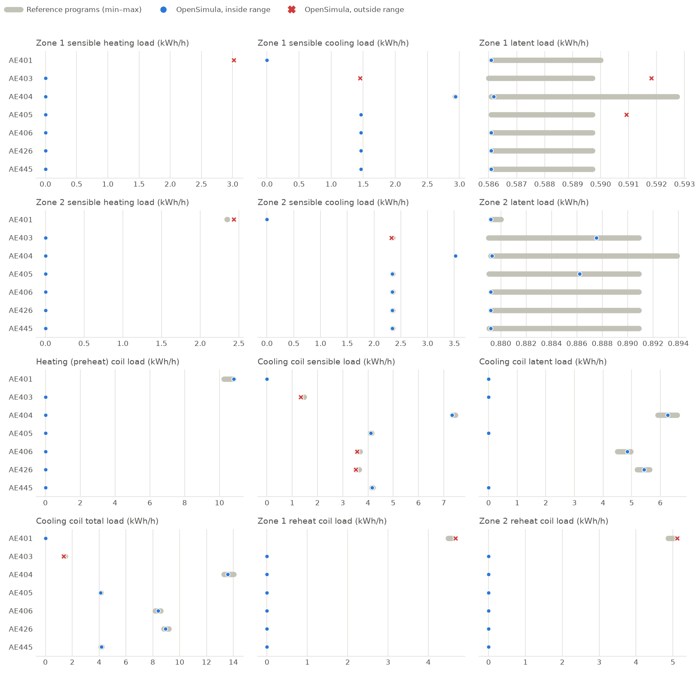

#### Zone 1 sensible heating load (kWh/h)

| Case | OpenSimula | Min | Max | Programs | Result |
|---|--:|--:|--:|--:|---|
| AE401 | 2.931 | 2.930 | 2.931 | 7 | ✓ inside |
| AE403 | 0.000 | 0.000 | 0.000 | 4 | ✓ inside |
| AE404 | 0.000 | 0.000 | 0.000 | 4 | ✓ inside |
| AE405 | 0.000 | 0.000 | 0.000 | 4 | ✓ inside |
| AE406 | 0.000 | 0.000 | 0.000 | 4 | ✓ inside |
| AE426 | 0.000 | 0.000 | 0.000 | 4 | ✓ inside |
| AE445 | 0.000 | 0.000 | 0.000 | 4 | ✓ inside |

#### Zone 1 sensible cooling load (kWh/h)

| Case | OpenSimula | Min | Max | Programs | Result |
|---|--:|--:|--:|--:|---|
| AE401 | 0.000 | 0.000 | 0.000 | 4 | ✓ inside |
| AE403 | 1.465 | 1.465 | 1.467 | 7 | ✓ inside |
| AE404 | 2.931 | 2.931 | 2.934 | 7 | ✓ inside |
| AE405 | 1.465 | 1.465 | 1.466 | 7 | ✓ inside |
| AE406 | 1.465 | 1.465 | 1.466 | 7 | ✓ inside |
| AE426 | 1.465 | 1.465 | 1.466 | 7 | ✓ inside |
| AE445 | 1.465 | 1.465 | 1.466 | 7 | ✓ inside |

#### Zone 1 latent load (kWh/h)

| Case | OpenSimula | Min | Max | Programs | Result |
|---|--:|--:|--:|--:|---|
| AE401 | 0.586 | 0.586 | 0.590 | 7 | ✓ inside |
| AE403 | 0.586 | 0.586 | 0.590 | 7 | ✓ inside |
| AE404 | 0.586 | 0.586 | 0.593 | 7 | ✓ inside |
| AE405 | 0.586 | 0.586 | 0.590 | 7 | ✓ inside |
| AE406 | 0.586 | 0.586 | 0.590 | 7 | ✓ inside |
| AE426 | 0.586 | 0.586 | 0.590 | 7 | ✓ inside |
| AE445 | 0.586 | 0.586 | 0.590 | 7 | ✓ inside |

#### Zone 2 sensible heating load (kWh/h)

| Case | OpenSimula | Min | Max | Programs | Result |
|---|--:|--:|--:|--:|---|
| AE401 | 2.345 | 2.345 | 2.350 | 7 | ✓ inside |
| AE403 | 0.000 | 0.000 | 0.000 | 4 | ✓ inside |
| AE404 | 0.000 | 0.000 | 0.000 | 4 | ✓ inside |
| AE405 | 0.000 | 0.000 | 0.000 | 4 | ✓ inside |
| AE406 | 0.000 | 0.000 | 0.000 | 4 | ✓ inside |
| AE426 | 0.000 | 0.000 | 0.000 | 4 | ✓ inside |
| AE445 | 0.000 | 0.000 | 0.000 | 4 | ✓ inside |

#### Zone 2 sensible cooling load (kWh/h)

| Case | OpenSimula | Min | Max | Programs | Result |
|---|--:|--:|--:|--:|---|
| AE401 | 0.000 | 0.000 | 0.000 | 4 | ✓ inside |
| AE403 | 2.345 | 2.345 | 2.346 | 7 | ✓ inside |
| AE404 | 3.517 | 3.516 | 3.517 | 7 | ✓ inside |
| AE405 | 2.345 | 2.344 | 2.345 | 7 | ✓ inside |
| AE406 | 2.345 | 2.345 | 2.345 | 7 | ✓ inside |
| AE426 | 2.345 | 2.345 | 2.345 | 7 | ✓ inside |
| AE445 | 2.345 | 2.344 | 2.345 | 7 | ✓ inside |

#### Zone 2 latent load (kWh/h)

| Case | OpenSimula | Min | Max | Programs | Result |
|---|--:|--:|--:|--:|---|
| AE401 | 0.879 | 0.879 | 0.880 | 7 | ✓ inside |
| AE403 | 0.880 | 0.879 | 0.891 | 7 | ✓ inside |
| AE404 | 0.879 | 0.879 | 0.894 | 7 | ✓ inside |
| AE405 | 0.879 | 0.879 | 0.891 | 7 | ✓ inside |
| AE406 | 0.879 | 0.879 | 0.891 | 7 | ✓ inside |
| AE426 | 0.879 | 0.879 | 0.891 | 7 | ✓ inside |
| AE445 | 0.879 | 0.879 | 0.891 | 7 | ✓ inside |

#### Heating (preheat) coil load (kWh/h)

| Case | OpenSimula | Min | Max | Programs | Result |
|---|--:|--:|--:|--:|---|
| AE401 | 10.821 | 10.248 | 10.818 | 7 | ✓ inside |
| AE403 | 0.000 | 0.000 | 0.000 | 7 | ✓ inside |
| AE404 | 0.000 | 0.000 | 0.000 | 7 | ✓ inside |
| AE405 | 0.000 | 0.000 | 0.000 | 7 | ✓ inside |
| AE406 | 0.000 | 0.000 | 0.000 | 7 | ✓ inside |
| AE426 | 0.000 | 0.000 | 0.000 | 7 | ✓ inside |
| AE445 | 0.000 | 0.000 | 0.000 | 7 | ✓ inside |

#### Cooling coil sensible load (kWh/h)

| Case | OpenSimula | Min | Max | Programs | Result |
|---|--:|--:|--:|--:|---|
| AE401 | 0.000 | 0.000 | 0.000 | 7 | ✓ inside |
| AE403 | 1.370 | 1.399 | 1.466 | 7 | ✗ -2.0 % below min |
| AE404 | 7.323 | 7.333 | 7.459 | 7 | ✗ -0.1 % below min |
| AE405 | 4.112 | 4.091 | 4.143 | 7 | ✓ inside |
| AE406 | 3.562 | 3.567 | 3.680 | 7 | ✗ -0.1 % below min |
| AE426 | 3.514 | 3.516 | 3.642 | 7 | ✓ inside |
| AE445 | 4.159 | 4.145 | 4.191 | 7 | ✓ inside |

#### Cooling coil latent load (kWh/h)

| Case | OpenSimula | Min | Max | Programs | Result |
|---|--:|--:|--:|--:|---|
| AE401 | 0.000 | 0.000 | 0.000 | 7 | ✓ inside |
| AE403 | -0.000 | 0.000 | 0.000 | 7 | ✓ inside |
| AE404 | 6.260 | 5.917 | 6.581 | 7 | ✓ inside |
| AE405 | -0.000 | 0.000 | 0.000 | 7 | ✓ inside |
| AE406 | 4.846 | 4.495 | 4.969 | 7 | ✓ inside |
| AE426 | 5.442 | 5.189 | 5.633 | 7 | ✓ inside |
| AE445 | -0.000 | 0.000 | 0.000 | 7 | ✓ inside |

#### Cooling coil total load (kWh/h)

| Case | OpenSimula | Min | Max | Programs | Result |
|---|--:|--:|--:|--:|---|
| AE401 | 0.000 | 0.000 | 0.000 | 7 | ✓ inside |
| AE403 | 1.370 | 1.399 | 1.466 | 7 | ✗ -2.0 % below min |
| AE404 | 13.583 | 13.308 | 14.031 | 7 | ✓ inside |
| AE405 | 4.112 | 4.091 | 4.143 | 7 | ✓ inside |
| AE406 | 8.408 | 8.175 | 8.596 | 7 | ✓ inside |
| AE426 | 8.956 | 8.805 | 9.207 | 7 | ✓ inside |
| AE445 | 4.159 | 4.145 | 4.191 | 7 | ✓ inside |

#### Zone 1 reheat coil load (kWh/h)

| Case | OpenSimula | Min | Max | Programs | Result |
|---|--:|--:|--:|--:|---|
| AE401 | 4.581 | 4.489 | 4.584 | 7 | ✓ inside |
| AE403 | 0.000 | 0.000 | 0.000 | 7 | ✓ inside |
| AE404 | 0.000 | 0.000 | 0.000 | 7 | ✓ inside |
| AE405 | 0.000 | 0.000 | 0.000 | 7 | ✓ inside |
| AE406 | 0.000 | 0.000 | 0.000 | 7 | ✓ inside |
| AE426 | 0.000 | 0.000 | 0.000 | 7 | ✓ inside |
| AE445 | 0.000 | 0.000 | 0.000 | 7 | ✓ inside |

#### Zone 2 reheat coil load (kWh/h)

| Case | OpenSimula | Min | Max | Programs | Result |
|---|--:|--:|--:|--:|---|
| AE401 | 5.019 | 4.869 | 5.015 | 7 | ✓ inside |
| AE403 | 0.000 | 0.000 | 0.000 | 7 | ✓ inside |
| AE404 | 0.000 | 0.000 | 0.000 | 7 | ✓ inside |
| AE405 | 0.000 | 0.000 | 0.000 | 7 | ✓ inside |
| AE406 | 0.000 | 0.000 | 0.000 | 7 | ✓ inside |
| AE426 | 0.000 | 0.000 | 0.000 | 7 | ✓ inside |
| AE445 | 0.000 | 0.000 | 0.000 | 7 | ✓ inside |

### AE400 series: coil outlet humidity and air states

| Output | Values | Inside range | Outside range |
|---|--:|--:|--:|
| Cooling coil outlet relative humidity (%) | 7 | 7 | 0 |
| Dry bulb temperature (°C) | 75 | 66 | 9 |
| Humidity ratio (kg/kg) | 75 | 68 | 7 |
| Specific volume (L/kg) | 75 | 69 | 6 |
| Enthalpy (kJ/kg) | 75 | 59 | 16 |
| Dry air mass flow rate (kg/s) | 63 | 51 | 12 |

#### Cooling coil outlet relative humidity (%)

| Case | OpenSimula | Min | Max | Programs | Result |
|---|--:|--:|--:|--:|---|
| AE401 | 4.146 | 4.145 | 4.802 | 6 | ✓ inside |
| AE403 | 35.611 | 34.290 | 36.395 | 7 | ✓ inside |
| AE404 | 100.000 | 97.240 | 100.000 | 7 | ✓ inside |
| AE405 | 52.656 | 51.855 | 53.520 | 7 | ✓ inside |
| AE406 | 100.000 | 99.380 | 100.000 | 7 | ✓ inside |
| AE426 | 100.000 | 99.580 | 100.000 | 7 | ✓ inside |
| AE445 | 49.466 | 49.242 | 49.780 | 7 | ✓ inside |

#### Dry bulb temperature (°C)

| Case | OpenSimula | Min | Max | Programs | Result |
|---|--:|--:|--:|--:|---|
| AE401 oa | -29.000 | -29.000 | -29.000 | 7 | ✓ inside |
| AE401 ma | -29.000 | -29.000 | -28.996 | 6 | ✓ inside |
| AE401 pco | 7.222 | 7.203 | 7.222 | 7 | ✓ inside |
| AE401 cco | 7.222 | 7.203 | 7.222 | 7 | ✓ inside |
| AE401 sa | 7.305 | 7.278 | 7.310 | 7 | ✓ inside |
| AE401 z1s | 45.638 | 46.505 | 46.948 | 6 | ✗ -0.87 °C below min |
| AE401 z2s | 35.304 | 35.766 | 36.055 | 6 | ✗ -0.46 °C below min |
| AE401 z1 | 21.111 | 21.110 | 21.145 | 7 | ✓ inside |
| AE401 z2 | 22.222 | 22.221 | 22.259 | 7 | ✓ inside |
| AE403 oa | 15.500 | 15.500 | 15.500 | 7 | ✓ inside |
| AE403 ma | 16.696 | 16.776 | 16.962 | 7 | ✗ -0.08 °C below min |
| AE403 pco | 12.664 | 16.776 | 16.962 | 7 | ✗ -4.11 °C below min |
| AE403 cco | 12.664 | 12.647 | 12.670 | 7 | ✓ inside |
| AE403 sa | 12.780 | 12.778 | 12.795 | 7 | ✓ inside |
| AE403 z1s | 12.780 | 12.778 | 12.795 | 6 | ✓ inside |
| AE403 z2s | 12.780 | 12.778 | 12.795 | 6 | ✓ inside |
| AE403 z1 | 23.333 | 23.330 | 23.344 | 7 | ✓ inside |
| AE403 z2 | 24.444 | 24.439 | 24.461 | 7 | ✓ inside |
| AE403 rfi | 23.933 | 23.936 | 24.005 | 6 | ✓ inside |
| AE403 rfo | 23.936 | 23.944 | 24.009 | 7 | ✓ inside |
| AE404 oa | 26.900 | 26.889 | 26.900 | 7 | ✓ inside |
| AE404 ma | 25.742 | 25.721 | 25.910 | 7 | ✓ inside |
| AE404 pco | 12.468 | 25.721 | 25.910 | 7 | ✗ -13.25 °C below min |
| AE404 cco | 12.468 | 12.444 | 12.491 | 7 | ✓ inside |
| AE404 sa | 12.780 | 12.778 | 12.792 | 7 | ✓ inside |
| AE404 z1s | 12.780 | 12.778 | 12.792 | 6 | ✓ inside |
| AE404 z2s | 12.780 | 12.778 | 12.792 | 6 | ✓ inside |
| AE404 z1 | 23.889 | 23.883 | 23.900 | 7 | ✓ inside |
| AE404 z2 | 25.000 | 24.999 | 25.017 | 7 | ✓ inside |
| AE404 rfi | 24.373 | 24.368 | 24.480 | 6 | ✓ inside |
| AE404 rfo | 24.466 | 24.474 | 24.582 | 7 | ✓ inside |
| AE405 oa | 24.900 | 24.889 | 24.900 | 7 | ✓ inside |
| AE405 ma | 24.761 | 24.722 | 24.758 | 7 | ✓ inside |
| AE405 pco | 12.664 | 24.722 | 24.758 | 7 | ✗ -12.06 °C below min |
| AE405 cco | 12.664 | 12.647 | 12.670 | 7 | ✓ inside |
| AE405 sa | 12.780 | 12.778 | 12.795 | 7 | ✓ inside |
| AE405 z1s | 12.780 | 12.778 | 12.795 | 6 | ✓ inside |
| AE405 z2s | 12.780 | 12.778 | 12.795 | 6 | ✓ inside |
| AE405 z1 | 23.333 | 23.332 | 23.344 | 7 | ✓ inside |
| AE405 z2 | 24.444 | 24.440 | 24.461 | 7 | ✓ inside |
| AE405 rfi | 23.934 | 23.936 | 23.996 | 6 | ✓ inside |
| AE405 rfo | 23.937 | 23.944 | 24.000 | 7 | ✓ inside |
| AE406 oa | 23.000 | 23.000 | 23.000 | 7 | ✓ inside |
| AE406 ma | 23.141 | 23.134 | 23.167 | 7 | ✓ inside |
| AE406 pco | 12.661 | 23.134 | 23.167 | 7 | ✗ -10.47 °C below min |
| AE406 cco | 12.661 | 12.647 | 12.669 | 7 | ✓ inside |
| AE406 sa | 12.780 | 12.771 | 12.794 | 7 | ✓ inside |
| AE406 z1s | 12.780 | 12.771 | 12.794 | 6 | ✓ inside |
| AE406 z2s | 12.780 | 12.771 | 12.794 | 6 | ✓ inside |
| AE406 z1 | 23.333 | 23.318 | 23.344 | 7 | ✓ inside |
| AE406 z2 | 24.444 | 24.431 | 24.461 | 7 | ✓ inside |
| AE406 rfi | 23.937 | 23.935 | 24.004 | 6 | ✓ inside |
| AE406 rfo | 23.940 | 23.939 | 24.008 | 7 | ✓ inside |
| AE426 oa | 23.000 | 23.000 | 23.000 | 7 | ✓ inside |
| AE426 ma | 23.000 | 23.000 | 23.000 | 7 | ✓ inside |
| AE426 pco | 12.661 | 23.000 | 23.000 | 7 | ✗ -10.34 °C below min |
| AE426 cco | 12.661 | 12.647 | 12.670 | 7 | ✓ inside |
| AE426 sa | 12.780 | 12.778 | 12.782 | 7 | ✓ inside |
| AE426 z1s | 12.780 | 12.778 | 12.790 | 6 | ✓ inside |
| AE426 z2s | 12.780 | 12.778 | 12.790 | 6 | ✓ inside |
| AE426 z1 | 23.333 | 23.329 | 23.344 | 7 | ✓ inside |
| AE426 z2 | 24.444 | 24.442 | 24.461 | 7 | ✓ inside |
| AE426 rfi | 23.937 | 23.936 | 23.992 | 6 | ✓ inside |
| AE426 rfo | 23.940 | 23.944 | 23.997 | 7 | ✓ inside |
| AE445 oa | 24.900 | 24.889 | 24.900 | 7 | ✓ inside |
| AE445 ma | 24.900 | 24.889 | 24.900 | 7 | ✓ inside |
| AE445 pco | 12.664 | 24.889 | 24.900 | 7 | ✗ -12.23 °C below min |
| AE445 cco | 12.664 | 12.652 | 12.670 | 7 | ✓ inside |
| AE445 sa | 12.780 | 12.778 | 12.795 | 7 | ✓ inside |
| AE445 z1s | 12.780 | 12.778 | 12.795 | 6 | ✓ inside |
| AE445 z2s | 12.780 | 12.778 | 12.795 | 6 | ✓ inside |
| AE445 z1 | 23.333 | 23.332 | 23.344 | 7 | ✓ inside |
| AE445 z2 | 24.444 | 24.442 | 24.461 | 7 | ✓ inside |
| AE445 rfi | 23.934 | 23.936 | 24.005 | 6 | ✓ inside |
| AE445 rfo | 23.937 | 23.944 | 24.009 | 7 | ✓ inside |

#### Humidity ratio (kg/kg)

| Case | OpenSimula | Min | Max | Programs | Result |
|---|--:|--:|--:|--:|---|
| AE401 oa | 0.000 | 0.000 | 0.000 | 7 | ✓ inside |
| AE401 ma | 0.000 | 0.000 | 0.000 | 7 | ✓ inside |
| AE401 pco | 0.000 | 0.000 | 0.000 | 7 | ✓ inside |
| AE401 cco | 0.000 | 0.000 | 0.000 | 7 | ✓ inside |
| AE401 sa | 0.000 | 0.000 | 0.000 | 7 | ✓ inside |
| AE401 z1s | 0.000 | 0.000 | 0.000 | 7 | ✓ inside |
| AE401 z2s | 0.000 | 0.000 | 0.000 | 7 | ✓ inside |
| AE401 z1 | 0.002 | 0.002 | 0.002 | 6 | ✗ -1.6 % below min |
| AE401 z2 | 0.002 | 0.002 | 0.002 | 6 | ✗ -2.4 % below min |
| AE403 oa | 0.003 | 0.003 | 0.003 | 7 | ✓ inside |
| AE403 ma | 0.003 | 0.003 | 0.003 | 7 | ✓ inside |
| AE403 pco | 0.003 | 0.003 | 0.003 | 7 | ✓ inside |
| AE403 cco | 0.003 | 0.003 | 0.003 | 7 | ✓ inside |
| AE403 sa | 0.003 | 0.003 | 0.003 | 7 | ✓ inside |
| AE403 z1s | 0.003 | 0.003 | 0.003 | 7 | ✓ inside |
| AE403 z2s | 0.003 | 0.003 | 0.003 | 7 | ✓ inside |
| AE403 z1 | 0.005 | 0.005 | 0.005 | 6 | ✗ -0.1 % below min |
| AE403 z2 | 0.005 | 0.005 | 0.005 | 6 | ✗ -0.1 % below min |
| AE403 rfi | 0.005 | 0.004 | 0.005 | 7 | ✓ inside |
| AE403 rfo | 0.005 | 0.004 | 0.005 | 7 | ✓ inside |
| AE404 oa | 0.017 | 0.017 | 0.017 | 7 | ✓ inside |
| AE404 ma | 0.014 | 0.013 | 0.014 | 7 | ✓ inside |
| AE404 pco | 0.009 | 0.013 | 0.014 | 7 | ✗ -33.1 % below min |
| AE404 cco | 0.009 | 0.009 | 0.009 | 7 | ✓ inside |
| AE404 sa | 0.009 | 0.009 | 0.009 | 7 | ✓ inside |
| AE404 z1s | 0.009 | 0.009 | 0.009 | 7 | ✓ inside |
| AE404 z2s | 0.009 | 0.009 | 0.009 | 7 | ✓ inside |
| AE404 z1 | 0.010 | 0.010 | 0.010 | 6 | ✓ inside |
| AE404 z2 | 0.010 | 0.010 | 0.010 | 6 | ✓ inside |
| AE404 rfi | 0.010 | 0.010 | 0.010 | 7 | ✓ inside |
| AE404 rfo | 0.010 | 0.010 | 0.010 | 7 | ✓ inside |
| AE405 oa | 0.004 | 0.004 | 0.005 | 7 | ✓ inside |
| AE405 ma | 0.005 | 0.005 | 0.005 | 7 | ✓ inside |
| AE405 pco | 0.005 | 0.005 | 0.005 | 7 | ✓ inside |
| AE405 cco | 0.005 | 0.005 | 0.005 | 7 | ✓ inside |
| AE405 sa | 0.005 | 0.005 | 0.005 | 7 | ✓ inside |
| AE405 z1s | 0.005 | 0.005 | 0.005 | 7 | ✓ inside |
| AE405 z2s | 0.005 | 0.005 | 0.005 | 7 | ✓ inside |
| AE405 z1 | 0.006 | 0.006 | 0.007 | 6 | ✓ inside |
| AE405 z2 | 0.007 | 0.007 | 0.007 | 6 | ✓ inside |
| AE405 rfi | 0.007 | 0.006 | 0.007 | 7 | ✓ inside |
| AE405 rfo | 0.007 | 0.006 | 0.007 | 7 | ✓ inside |
| AE406 oa | 0.016 | 0.016 | 0.016 | 7 | ✓ inside |
| AE406 ma | 0.015 | 0.015 | 0.015 | 7 | ✓ inside |
| AE406 pco | 0.009 | 0.015 | 0.015 | 7 | ✗ -37.9 % below min |
| AE406 cco | 0.009 | 0.009 | 0.009 | 7 | ✓ inside |
| AE406 sa | 0.009 | 0.009 | 0.009 | 7 | ✓ inside |
| AE406 z1s | 0.009 | 0.009 | 0.009 | 7 | ✓ inside |
| AE406 z2s | 0.009 | 0.009 | 0.009 | 7 | ✓ inside |
| AE406 z1 | 0.011 | 0.011 | 0.011 | 6 | ✓ inside |
| AE406 z2 | 0.011 | 0.011 | 0.011 | 6 | ✓ inside |
| AE406 rfi | 0.011 | 0.010 | 0.011 | 7 | ✓ inside |
| AE406 rfo | 0.011 | 0.010 | 0.011 | 7 | ✓ inside |
| AE426 oa | 0.016 | 0.016 | 0.016 | 7 | ✓ inside |
| AE426 ma | 0.016 | 0.016 | 0.016 | 7 | ✓ inside |
| AE426 pco | 0.009 | 0.016 | 0.016 | 7 | ✗ -41.2 % below min |
| AE426 cco | 0.009 | 0.009 | 0.009 | 7 | ✓ inside |
| AE426 sa | 0.009 | 0.009 | 0.009 | 7 | ✓ inside |
| AE426 z1s | 0.009 | 0.009 | 0.009 | 7 | ✓ inside |
| AE426 z2s | 0.009 | 0.009 | 0.009 | 7 | ✓ inside |
| AE426 z1 | 0.011 | 0.011 | 0.011 | 6 | ✓ inside |
| AE426 z2 | 0.011 | 0.011 | 0.011 | 6 | ✓ inside |
| AE426 rfi | 0.011 | 0.010 | 0.011 | 7 | ✓ inside |
| AE426 rfo | 0.011 | 0.010 | 0.011 | 7 | ✓ inside |
| AE445 oa | 0.004 | 0.004 | 0.005 | 7 | ✓ inside |
| AE445 ma | 0.004 | 0.004 | 0.005 | 7 | ✓ inside |
| AE445 pco | 0.004 | 0.004 | 0.005 | 7 | ✓ inside |
| AE445 cco | 0.004 | 0.004 | 0.005 | 7 | ✓ inside |
| AE445 sa | 0.004 | 0.004 | 0.005 | 7 | ✓ inside |
| AE445 z1s | 0.004 | 0.004 | 0.005 | 7 | ✓ inside |
| AE445 z2s | 0.004 | 0.004 | 0.005 | 7 | ✓ inside |
| AE445 z1 | 0.006 | 0.006 | 0.006 | 6 | ✓ inside |
| AE445 z2 | 0.006 | 0.006 | 0.006 | 6 | ✓ inside |
| AE445 rfi | 0.006 | 0.006 | 0.006 | 7 | ✓ inside |
| AE445 rfo | 0.006 | 0.006 | 0.006 | 7 | ✓ inside |

#### Specific volume (L/kg)

| Case | OpenSimula | Min | Max | Programs | Result |
|---|--:|--:|--:|--:|---|
| AE401 oa | 691.937 | 691.841 | 833.330 | 5 | ✓ inside |
| AE401 ma | 691.938 | 691.854 | 833.330 | 5 | ✓ inside |
| AE401 pco | 794.593 | 794.484 | 833.330 | 5 | ✓ inside |
| AE401 cco | 794.593 | 794.484 | 833.330 | 5 | ✓ inside |
| AE401 sa | 794.828 | 794.278 | 833.330 | 5 | ✓ inside |
| AE401 z1s | 903.466 | 830.352 | 907.092 | 5 | ✓ inside |
| AE401 z2s | 874.179 | 830.352 | 876.255 | 5 | ✓ inside |
| AE401 z1 | 836.599 | 833.330 | 836.689 | 4 | ✓ inside |
| AE401 z2 | 839.757 | 833.330 | 839.857 | 4 | ✓ inside |
| AE403 oa | 821.567 | 821.405 | 833.330 | 5 | ✓ inside |
| AE403 ma | 825.351 | 826.037 | 833.330 | 5 | ✓ inside |
| AE403 pco | 813.870 | 826.037 | 833.330 | 5 | ✗ -1.5 % below min |
| AE403 cco | 813.870 | 813.750 | 833.330 | 5 | ✓ inside |
| AE403 sa | 814.199 | 813.507 | 833.330 | 5 | ✓ inside |
| AE403 z1s | 814.199 | 814.124 | 833.330 | 5 | ✓ inside |
| AE403 z2s | 814.199 | 814.124 | 833.330 | 5 | ✓ inside |
| AE403 z1 | 846.544 | 830.352 | 846.630 | 5 | ✓ inside |
| AE403 z2 | 849.799 | 830.352 | 849.878 | 5 | ✓ inside |
| AE403 rfi | 848.303 | 830.352 | 848.432 | 5 | ✓ inside |
| AE403 rfo | 848.311 | 830.352 | 848.427 | 5 | ✓ inside |
| AE404 oa | 872.920 | 830.352 | 872.931 | 5 | ✓ inside |
| AE404 ma | 865.204 | 830.352 | 865.036 | 5 | ✓ inside |
| AE404 pco | 820.839 | 830.352 | 865.036 | 5 | ✗ -1.1 % below min |
| AE404 cco | 820.839 | 820.703 | 833.330 | 5 | ✓ inside |
| AE404 sa | 821.737 | 819.659 | 833.330 | 5 | ✓ inside |
| AE404 z1s | 821.737 | 821.612 | 833.330 | 5 | ✓ inside |
| AE404 z2s | 821.737 | 821.612 | 833.330 | 5 | ✓ inside |
| AE404 z1 | 854.872 | 830.352 | 854.883 | 5 | ✓ inside |
| AE404 z2 | 858.525 | 830.352 | 858.556 | 5 | ✓ inside |
| AE404 rfi | 856.462 | 830.352 | 856.486 | 5 | ✓ inside |
| AE404 rfo | 856.731 | 830.352 | 856.792 | 5 | ✓ inside |
| AE405 oa | 850.421 | 830.352 | 850.438 | 5 | ✓ inside |
| AE405 ma | 850.423 | 830.352 | 850.449 | 5 | ✓ inside |
| AE405 pco | 815.889 | 830.352 | 850.449 | 5 | ✗ -1.7 % below min |
| AE405 cco | 815.889 | 815.783 | 833.330 | 5 | ✓ inside |
| AE405 sa | 816.221 | 815.520 | 833.330 | 5 | ✓ inside |
| AE405 z1s | 816.221 | 816.157 | 833.330 | 5 | ✓ inside |
| AE405 z2s | 816.221 | 816.157 | 833.330 | 5 | ✓ inside |
| AE405 z1 | 848.640 | 830.352 | 848.727 | 5 | ✓ inside |
| AE405 z2 | 851.903 | 830.352 | 851.982 | 5 | ✓ inside |
| AE405 rfi | 850.406 | 830.352 | 850.533 | 5 | ✓ inside |
| AE405 rfo | 850.415 | 830.352 | 850.538 | 5 | ✓ inside |
| AE406 oa | 859.948 | 830.352 | 859.942 | 5 | ✓ inside |
| AE406 ma | 859.411 | 830.352 | 859.333 | 5 | ✓ inside |
| AE406 pco | 821.547 | 830.352 | 859.390 | 5 | ✗ -1.1 % below min |
| AE406 cco | 821.547 | 821.383 | 833.330 | 5 | ✓ inside |
| AE406 sa | 821.889 | 821.066 | 833.330 | 5 | ✓ inside |
| AE406 z1s | 821.889 | 821.759 | 833.330 | 5 | ✓ inside |
| AE406 z2s | 821.889 | 821.759 | 833.330 | 5 | ✓ inside |
| AE406 z1 | 854.516 | 830.352 | 854.513 | 5 | ✓ inside |
| AE406 z2 | 857.801 | 830.352 | 857.797 | 5 | ✓ inside |
| AE406 rfi | 856.302 | 830.352 | 856.333 | 5 | ✓ inside |
| AE406 rfo | 856.312 | 830.352 | 856.347 | 5 | ✓ inside |
| AE426 oa | 859.948 | 830.352 | 859.942 | 5 | ✓ inside |
| AE426 ma | 859.954 | 830.352 | 859.942 | 5 | ✓ inside |
| AE426 pco | 821.547 | 830.352 | 859.942 | 5 | ✗ -1.1 % below min |
| AE426 cco | 821.547 | 821.383 | 833.330 | 5 | ✓ inside |
| AE426 sa | 821.889 | 821.110 | 833.330 | 5 | ✓ inside |
| AE426 z1s | 821.889 | 821.759 | 833.330 | 5 | ✓ inside |
| AE426 z2s | 821.889 | 821.759 | 833.330 | 5 | ✓ inside |
| AE426 z1 | 854.516 | 830.352 | 854.534 | 5 | ✓ inside |
| AE426 z2 | 857.801 | 830.352 | 857.826 | 5 | ✓ inside |
| AE426 rfi | 856.302 | 830.352 | 856.358 | 5 | ✓ inside |
| AE426 rfo | 856.312 | 830.352 | 856.347 | 5 | ✓ inside |
| AE445 oa | 850.421 | 830.352 | 850.438 | 5 | ✓ inside |
| AE445 ma | 850.424 | 830.352 | 850.438 | 5 | ✓ inside |
| AE445 pco | 815.510 | 830.352 | 850.438 | 5 | ✗ -1.8 % below min |
| AE445 cco | 815.510 | 815.319 | 833.330 | 5 | ✓ inside |
| AE445 sa | 815.842 | 815.075 | 833.330 | 5 | ✓ inside |
| AE445 z1s | 815.842 | 815.692 | 833.330 | 5 | ✓ inside |
| AE445 z2s | 815.842 | 815.692 | 833.330 | 5 | ✓ inside |
| AE445 z1 | 848.246 | 830.352 | 848.261 | 5 | ✓ inside |
| AE445 z2 | 851.507 | 830.352 | 851.519 | 5 | ✓ inside |
| AE445 rfi | 850.011 | 830.352 | 850.068 | 5 | ✓ inside |
| AE445 rfo | 850.020 | 830.352 | 850.056 | 5 | ✓ inside |

#### Enthalpy (kJ/kg)

| Case | OpenSimula | Min | Max | Programs | Result |
|---|--:|--:|--:|--:|---|
| AE401 oa | -28.540 | -28.543 | -28.507 | 4 | ✓ inside |
| AE401 ma | -28.540 | -28.543 | -28.507 | 4 | ✓ inside |
| AE401 pco | 7.917 | 7.889 | 7.917 | 4 | ✓ inside |
| AE401 cco | 7.917 | 7.889 | 7.917 | 4 | ✓ inside |
| AE401 sa | 8.000 | 7.977 | 8.000 | 4 | ✓ inside |
| AE401 z1s | 46.582 | 47.593 | 47.876 | 4 | ✗ -2.1 % below min |
| AE401 z2s | 36.181 | 36.727 | 36.923 | 4 | ✗ -1.5 % below min |
| AE401 z1 | 26.907 | 27.006 | 27.138 | 4 | ✗ -0.4 % below min |
| AE401 z2 | 28.030 | 28.174 | 28.252 | 4 | ✗ -0.5 % below min |
| AE403 oa | 23.010 | 22.996 | 23.032 | 4 | ✓ inside |
| AE403 ma | 24.948 | 25.077 | 25.392 | 4 | ✗ -0.5 % below min |
| AE403 pco | 20.868 | 25.077 | 25.392 | 4 | ✗ -16.8 % below min |
| AE403 cco | 20.868 | 20.903 | 21.052 | 4 | ✗ -0.2 % below min |
| AE403 sa | 20.985 | 21.024 | 21.164 | 4 | ✗ -0.2 % below min |
| AE403 z1s | 20.985 | 21.024 | 21.164 | 4 | ✗ -0.2 % below min |
| AE403 z2s | 20.985 | 21.024 | 21.164 | 4 | ✗ -0.2 % below min |
| AE403 z1 | 35.987 | 35.989 | 36.162 | 4 | ✓ inside |
| AE403 z2 | 37.270 | 37.273 | 37.470 | 4 | ✓ inside |
| AE403 rfi | 36.681 | 36.687 | 36.950 | 4 | ✓ inside |
| AE403 rfo | 36.684 | 36.691 | 36.950 | 4 | ✓ inside |
| AE404 oa | 69.831 | 69.814 | 69.994 | 4 | ✓ inside |
| AE404 ma | 60.490 | 60.150 | 60.405 | 4 | ✗ +0.1 % above max |
| AE404 pco | 35.278 | 60.150 | 60.405 | 4 | ✗ -41.4 % below min |
| AE404 cco | 35.278 | 34.600 | 35.337 | 4 | ✓ inside |
| AE404 sa | 35.597 | 34.930 | 35.624 | 4 | ✓ inside |
| AE404 z1s | 35.597 | 34.930 | 35.640 | 4 | ✓ inside |
| AE404 z2s | 35.597 | 34.930 | 35.640 | 4 | ✓ inside |
| AE404 z1 | 49.233 | 48.560 | 49.280 | 4 | ✓ inside |
| AE404 z2 | 51.225 | 50.580 | 51.288 | 4 | ✓ inside |
| AE404 rfi | 50.101 | 49.630 | 50.147 | 4 | ✓ inside |
| AE404 rfo | 50.196 | 49.730 | 50.256 | 4 | ✓ inside |
| AE405 oa | 36.457 | 36.435 | 36.506 | 4 | ✓ inside |
| AE405 ma | 37.063 | 37.062 | 37.230 | 4 | ✓ inside |
| AE405 pco | 24.786 | 37.062 | 37.230 | 4 | ✗ -33.1 % below min |
| AE405 cco | 24.786 | 24.799 | 24.975 | 4 | ✓ inside |
| AE405 sa | 24.905 | 24.919 | 25.100 | 4 | ✓ inside |
| AE405 z1s | 24.905 | 24.919 | 25.100 | 4 | ✓ inside |
| AE405 z2s | 24.905 | 24.919 | 25.100 | 4 | ✓ inside |
| AE405 z1 | 39.936 | 39.926 | 40.116 | 4 | ✓ inside |
| AE405 z2 | 41.222 | 41.214 | 41.450 | 4 | ✓ inside |
| AE405 rfi | 40.632 | 40.625 | 40.920 | 4 | ✓ inside |
| AE405 rfo | 40.636 | 40.628 | 40.920 | 4 | ✓ inside |
| AE406 oa | 62.719 | 62.705 | 62.851 | 4 | ✓ inside |
| AE406 ma | 61.081 | 60.839 | 61.128 | 4 | ✓ inside |
| AE406 pco | 35.771 | 60.839 | 61.128 | 4 | ✗ -41.2 % below min |
| AE406 cco | 35.771 | 35.620 | 35.781 | 4 | ✓ inside |
| AE406 sa | 35.892 | 35.740 | 35.897 | 4 | ✓ inside |
| AE406 z1s | 35.892 | 35.740 | 35.897 | 4 | ✓ inside |
| AE406 z2s | 35.892 | 35.740 | 35.897 | 4 | ✓ inside |
| AE406 z1 | 51.008 | 50.850 | 51.035 | 4 | ✓ inside |
| AE406 z2 | 52.303 | 52.180 | 52.335 | 4 | ✓ inside |
| AE406 rfi | 51.712 | 51.644 | 51.755 | 4 | ✓ inside |
| AE406 rfo | 51.716 | 51.647 | 51.760 | 4 | ✓ inside |
| AE426 oa | 62.719 | 62.705 | 62.851 | 4 | ✓ inside |
| AE426 ma | 62.731 | 62.705 | 62.851 | 4 | ✓ inside |
| AE426 pco | 35.771 | 62.705 | 62.851 | 4 | ✗ -43.0 % below min |
| AE426 cco | 35.771 | 35.630 | 35.793 | 4 | ✓ inside |
| AE426 sa | 35.892 | 35.760 | 35.908 | 4 | ✓ inside |
| AE426 z1s | 35.892 | 35.760 | 35.908 | 4 | ✓ inside |
| AE426 z2s | 35.892 | 35.760 | 35.908 | 4 | ✓ inside |
| AE426 z1 | 51.008 | 50.880 | 51.061 | 4 | ✓ inside |
| AE426 z2 | 52.303 | 52.208 | 52.361 | 4 | ✓ inside |
| AE426 rfi | 51.712 | 51.670 | 51.781 | 4 | ✓ inside |
| AE426 rfo | 51.716 | 51.670 | 51.786 | 4 | ✓ inside |
| AE445 oa | 36.457 | 36.435 | 36.506 | 4 | ✓ inside |
| AE445 ma | 36.463 | 36.435 | 36.506 | 4 | ✓ inside |
| AE445 pco | 24.052 | 36.435 | 36.506 | 4 | ✗ -34.0 % below min |
| AE445 cco | 24.052 | 24.034 | 24.110 | 4 | ✓ inside |
| AE445 sa | 24.170 | 24.155 | 24.240 | 4 | ✓ inside |
| AE445 z1s | 24.170 | 24.155 | 24.240 | 4 | ✓ inside |
| AE445 z2s | 24.170 | 24.155 | 24.240 | 4 | ✓ inside |
| AE445 z1 | 39.195 | 39.153 | 39.260 | 4 | ✓ inside |
| AE445 z2 | 40.480 | 40.441 | 40.580 | 4 | ✓ inside |
| AE445 rfi | 39.890 | 39.852 | 40.050 | 4 | ✓ inside |
| AE445 rfo | 39.893 | 39.856 | 40.060 | 4 | ✓ inside |

#### Dry air mass flow rate (kg/s)

| Case | OpenSimula | Min | Max | Programs | Result |
|---|--:|--:|--:|--:|---|
| AE401 oa | 0.297 | 0.281 | 0.297 | 7 | ✓ inside |
| AE401 ma | 0.297 | 0.281 | 0.297 | 7 | ✓ inside |
| AE401 pco | 0.297 | 0.281 | 0.297 | 7 | ✓ inside |
| AE401 cco | 0.297 | 0.281 | 0.297 | 7 | ✓ inside |
| AE401 sa | 0.297 | 0.281 | 0.297 | 7 | ✓ inside |
| AE401 z1s | 0.119 | 0.113 | 0.119 | 7 | ✓ inside |
| AE401 z2s | 0.178 | 0.169 | 0.178 | 7 | ✓ inside |
| AE401 rfi | 0.000 | 0.000 | 0.000 | 7 | ✗ +0.00 kg/s above max |
| AE401 rfo | 0.000 | 0.000 | 0.000 | 7 | ✗ +0.00 kg/s above max |
| AE403 oa | 0.290 | 0.278 | 0.286 | 7 | ✗ +1.4 % above max |
| AE403 ma | 0.338 | 0.334 | 0.339 | 7 | ✓ inside |
| AE403 pco | 0.338 | 0.334 | 0.339 | 7 | ✓ inside |
| AE403 cco | 0.338 | 0.334 | 0.339 | 7 | ✓ inside |
| AE403 sa | 0.338 | 0.334 | 0.339 | 7 | ✓ inside |
| AE403 z1s | 0.138 | 0.136 | 0.138 | 7 | ✓ inside |
| AE403 z2s | 0.200 | 0.197 | 0.200 | 7 | ✓ inside |
| AE403 rfi | 0.048 | 0.051 | 0.058 | 7 | ✗ -5.2 % below min |
| AE403 rfo | 0.048 | 0.050 | 0.058 | 7 | ✗ -4.9 % below min |
| AE404 oa | 0.287 | 0.273 | 0.284 | 7 | ✗ +1.2 % above max |
| AE404 ma | 0.548 | 0.535 | 0.549 | 7 | ✓ inside |
| AE404 pco | 0.548 | 0.535 | 0.549 | 7 | ✓ inside |
| AE404 cco | 0.548 | 0.535 | 0.549 | 7 | ✓ inside |
| AE404 sa | 0.548 | 0.535 | 0.549 | 7 | ✓ inside |
| AE404 z1s | 0.262 | 0.255 | 0.263 | 7 | ✓ inside |
| AE404 z2s | 0.286 | 0.280 | 0.286 | 7 | ✓ inside |
| AE404 rfi | 0.261 | 0.254 | 0.266 | 7 | ✓ inside |
| AE404 rfo | 0.261 | 0.254 | 0.266 | 7 | ✓ inside |
| AE405 oa | 0.289 | 0.277 | 0.284 | 7 | ✗ +1.8 % above max |
| AE405 ma | 0.338 | 0.334 | 0.338 | 7 | ✓ inside |
| AE405 pco | 0.338 | 0.334 | 0.338 | 7 | ✓ inside |
| AE405 cco | 0.338 | 0.334 | 0.338 | 7 | ✓ inside |
| AE405 sa | 0.338 | 0.334 | 0.338 | 7 | ✓ inside |
| AE405 z1s | 0.138 | 0.136 | 0.138 | 7 | ✓ inside |
| AE405 z2s | 0.200 | 0.197 | 0.200 | 7 | ✓ inside |
| AE405 rfi | 0.049 | 0.050 | 0.058 | 7 | ✗ -2.0 % below min |
| AE405 rfo | 0.049 | 0.050 | 0.058 | 7 | ✗ -2.7 % below min |
| AE406 oa | 0.287 | 0.275 | 0.284 | 7 | ✗ +1.1 % above max |
| AE406 ma | 0.338 | 0.330 | 0.338 | 7 | ✓ inside |
| AE406 pco | 0.338 | 0.330 | 0.338 | 7 | ✓ inside |
| AE406 cco | 0.338 | 0.330 | 0.338 | 7 | ✓ inside |
| AE406 sa | 0.338 | 0.330 | 0.338 | 7 | ✓ inside |
| AE406 z1s | 0.138 | 0.135 | 0.138 | 7 | ✓ inside |
| AE406 z2s | 0.200 | 0.195 | 0.200 | 7 | ✓ inside |
| AE406 rfi | 0.051 | 0.047 | 0.057 | 7 | ✓ inside |
| AE406 rfo | 0.051 | 0.047 | 0.057 | 7 | ✓ inside |
| AE426 oa | 0.338 | 0.329 | 0.338 | 7 | ✓ inside |
| AE426 ma | 0.338 | 0.329 | 0.338 | 7 | ✓ inside |
| AE426 pco | 0.338 | 0.329 | 0.338 | 7 | ✓ inside |
| AE426 cco | 0.338 | 0.329 | 0.338 | 7 | ✓ inside |
| AE426 sa | 0.338 | 0.329 | 0.338 | 7 | ✓ inside |
| AE426 z1s | 0.138 | 0.135 | 0.138 | 7 | ✓ inside |
| AE426 z2s | 0.200 | 0.195 | 0.200 | 7 | ✓ inside |
| AE426 rfi | 0.051 | 0.047 | 0.057 | 7 | ✓ inside |
| AE426 rfo | 0.051 | 0.047 | 0.057 | 7 | ✓ inside |
| AE445 oa | 0.338 | 0.334 | 0.338 | 7 | ✓ inside |
| AE445 ma | 0.338 | 0.334 | 0.338 | 7 | ✓ inside |
| AE445 pco | 0.338 | 0.334 | 0.338 | 7 | ✓ inside |
| AE445 cco | 0.338 | 0.334 | 0.338 | 7 | ✓ inside |
| AE445 sa | 0.338 | 0.334 | 0.338 | 7 | ✓ inside |
| AE445 z1s | 0.138 | 0.136 | 0.138 | 7 | ✓ inside |
| AE445 z2s | 0.200 | 0.197 | 0.200 | 7 | ✓ inside |
| AE445 rfi | 0.048 | 0.050 | 0.058 | 7 | ✗ -2.6 % below min |
| AE445 rfo | 0.048 | 0.050 | 0.058 | 7 | ✗ -3.2 % below min |

## Weather drivers tests (WD100–WD600)

Reference programs: Weather file, BSIMAC, CSE, DeST, EnergyPlus, ESP-r, IBPSA, IDA ICE, TRNSYS (example results from `Std140_WD_Annual_Results.xlsx`). **241 of 246 values inside the reference range.**

### Weather variables

| Output | Values | Inside range | Outside range |
|---|--:|--:|--:|
| Annual average dry bulb temperature (°C) | 6 | 6 | 0 |
| Annual average relative humidity (%) | 6 | 6 | 0 |
| Annual average humidity ratio (kg/kg) | 6 | 6 | 0 |
| Annual average dew point temperature (°C) | 6 | 6 | 0 |
| Annual average wet bulb temperature (°C) | 6 | 6 | 0 |
| Annual average wind speed (m/s) | 6 | 6 | 0 |
| Annual average wind direction (° from north) | 6 | 6 | 0 |
| Annual average station pressure (mbar) | 6 | 6 | 0 |
| Annual average total cloud cover (tenths) | 6 | 6 | 0 |
| Annual average opaque cloud cover (tenths) | 6 | 6 | 0 |
| Annual average sky temperature (°C) | 6 | 4 | 2 |

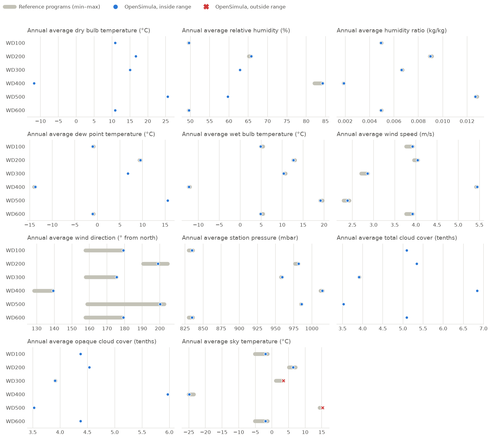

#### Annual average dry bulb temperature (°C)

| Case | OpenSimula | Min | Max | Programs | Result |
|---|--:|--:|--:|--:|---|
| WD100 | 10.875 | 10.876 | 10.879 | 9 | ✓ inside |
| WD200 | 16.653 | 16.653 | 16.654 | 9 | ✓ inside |
| WD300 | 15.048 | 15.048 | 15.049 | 9 | ✓ inside |
| WD400 | -11.817 | -11.817 | -11.816 | 9 | ✓ inside |
| WD500 | 25.551 | 25.551 | 25.553 | 9 | ✓ inside |
| WD600 | 10.875 | 10.876 | 10.879 | 9 | ✓ inside |

#### Annual average relative humidity (%)

| Case | OpenSimula | Min | Max | Programs | Result |
|---|--:|--:|--:|--:|---|
| WD100 | 49.619 | 49.582 | 49.618 | 9 | ✓ inside |
| WD200 | 65.736 | 65.145 | 65.736 | 9 | ✓ inside |
| WD300 | 62.828 | 62.826 | 62.851 | 9 | ✓ inside |
| WD400 | 84.194 | 82.149 | 84.194 | 9 | ✓ inside |
| WD500 | 59.732 | 59.725 | 59.732 | 9 | ✓ inside |
| WD600 | 49.619 | 49.582 | 49.618 | 9 | ✓ inside |

#### Annual average humidity ratio (kg/kg)

| Case | OpenSimula | Min | Max | Programs | Result |
|---|--:|--:|--:|--:|---|
| WD100 | 0.005 | 0.005 | 0.005 | 7 | ✓ inside |
| WD200 | 0.009 | 0.009 | 0.009 | 7 | ✓ inside |
| WD300 | 0.007 | 0.007 | 0.007 | 7 | ✓ inside |
| WD400 | 0.002 | 0.002 | 0.002 | 7 | ✓ inside |
| WD500 | 0.013 | 0.013 | 0.013 | 7 | ✓ inside |
| WD600 | 0.005 | 0.005 | 0.005 | 7 | ✓ inside |

#### Annual average dew point temperature (°C)

| Case | OpenSimula | Min | Max | Programs | Result |
|---|--:|--:|--:|--:|---|
| WD100 | -1.027 | -1.066 | -0.863 | 8 | ✓ inside |
| WD200 | 9.488 | 9.312 | 9.557 | 8 | ✓ inside |
| WD300 | 6.769 | 6.754 | 6.784 | 8 | ✓ inside |
| WD400 | -13.773 | -14.052 | -13.749 | 8 | ✓ inside |
| WD500 | 15.560 | 15.534 | 15.565 | 8 | ✓ inside |
| WD600 | -1.027 | -1.066 | -0.863 | 8 | ✓ inside |

#### Annual average wet bulb temperature (°C)

| Case | OpenSimula | Min | Max | Programs | Result |
|---|--:|--:|--:|--:|---|
| WD100 | 4.885 | 4.888 | 5.450 | 8 | ✓ inside |
| WD200 | 12.679 | 12.612 | 13.024 | 8 | ✓ inside |
| WD300 | 10.379 | 10.335 | 10.782 | 8 | ✓ inside |
| WD400 | -12.265 | -12.290 | -12.035 | 8 | ✓ inside |
| WD500 | 19.147 | 19.075 | 19.597 | 8 | ✓ inside |
| WD600 | 4.885 | 4.888 | 5.450 | 8 | ✓ inside |

#### Annual average wind speed (m/s)

| Case | OpenSimula | Min | Max | Programs | Result |
|---|--:|--:|--:|--:|---|
| WD100 | 3.917 | 3.768 | 3.927 | 9 | ✓ inside |
| WD200 | 4.038 | 3.956 | 4.047 | 9 | ✓ inside |
| WD300 | 2.858 | 2.709 | 2.867 | 9 | ✓ inside |
| WD400 | 5.444 | 5.414 | 5.446 | 9 | ✓ inside |
| WD500 | 2.381 | 2.290 | 2.430 | 9 | ✓ inside |
| WD600 | 3.917 | 3.768 | 3.927 | 9 | ✓ inside |

#### Annual average wind direction (° from north)

| Case | OpenSimula | Min | Max | Programs | Result |
|---|--:|--:|--:|--:|---|
| WD100 | 179.235 | 157.649 | 179.265 | 9 | ✓ inside |
| WD200 | 198.928 | 190.546 | 204.456 | 9 | ✓ inside |
| WD300 | 175.470 | 157.825 | 175.470 | 9 | ✓ inside |
| WD400 | 139.448 | 128.466 | 139.455 | 9 | ✓ inside |
| WD500 | 200.144 | 158.633 | 202.581 | 9 | ✓ inside |
| WD600 | 179.235 | 157.649 | 179.265 | 9 | ✓ inside |

#### Annual average station pressure (mbar)

| Case | OpenSimula | Min | Max | Programs | Result |
|---|--:|--:|--:|--:|---|
| WD100 | 834.601 | 830.110 | 835.940 | 9 | ✓ inside |
| WD200 | 981.731 | 976.786 | 981.737 | 9 | ✓ inside |
| WD300 | 959.062 | 957.582 | 959.079 | 9 | ✓ inside |
| WD400 | 1014.572 | 1012.040 | 1014.576 | 9 | ✓ inside |
| WD500 | 985.723 | 985.117 | 985.737 | 9 | ✓ inside |
| WD600 | 834.601 | 830.110 | 835.940 | 9 | ✓ inside |

#### Annual average total cloud cover (tenths)

| Case | OpenSimula | Min | Max | Programs | Result |
|---|--:|--:|--:|--:|---|
| WD100 | 5.089 | 5.089 | 5.089 | 8 | ✓ inside |
| WD200 | 5.344 | 5.344 | 5.344 | 8 | ✓ inside |
| WD300 | 3.908 | 3.907 | 3.913 | 8 | ✓ inside |
| WD400 | 6.842 | 6.841 | 6.842 | 8 | ✓ inside |
| WD500 | 3.523 | 3.523 | 3.524 | 8 | ✓ inside |
| WD600 | 5.089 | 5.089 | 5.089 | 8 | ✓ inside |

#### Annual average opaque cloud cover (tenths)

| Case | OpenSimula | Min | Max | Programs | Result |
|---|--:|--:|--:|--:|---|
| WD100 | 4.374 | 4.374 | 4.375 | 6 | ✓ inside |
| WD200 | 4.534 | 4.533 | 4.534 | 6 | ✓ inside |
| WD300 | 3.908 | 3.908 | 3.913 | 6 | ✓ inside |
| WD400 | 5.968 | 5.966 | 5.968 | 6 | ✓ inside |
| WD500 | 3.523 | 3.523 | 3.524 | 6 | ✓ inside |
| WD600 | 4.374 | 4.374 | 4.375 | 6 | ✓ inside |

#### Annual average sky temperature (°C)

| Case | OpenSimula | Min | Max | Programs | Result |
|---|--:|--:|--:|--:|---|
| WD100 | -1.985 | -5.150 | -1.310 | 8 | ✓ inside |
| WD200 | 6.361 | 5.116 | 7.087 | 8 | ✓ inside |
| WD300 | 3.431 | 1.117 | 3.422 | 8 | ✗ +0.01 °C above max |
| WD400 | -24.913 | -25.035 | -23.511 | 8 | ✓ inside |
| WD500 | 15.183 | 14.297 | 15.163 | 8 | ✗ +0.02 °C above max |
| WD600 | -1.985 | -5.150 | -1.310 | 8 | ✓ inside |

### Total solar radiation

| Output | Values | Inside range | Outside range |
|---|--:|--:|--:|
| Annual average total radiation, Horizontal (W/m²) | 6 | 6 | 0 |
| Annual average total radiation, South 90 (W/m²) | 6 | 5 | 1 |
| Annual average total radiation, East 90 (W/m²) | 6 | 6 | 0 |
| Annual average total radiation, North 90 (W/m²) | 6 | 6 | 0 |
| Annual average total radiation, West 90 (W/m²) | 6 | 6 | 0 |
| Annual average total radiation, 45° east of south 90 (W/m²) | 6 | 6 | 0 |
| Annual average total radiation, 45° west of south 90 (W/m²) | 6 | 6 | 0 |
| Annual average total radiation, East 30 (W/m²) | 6 | 6 | 0 |
| Annual average total radiation, South 30 (W/m²) | 6 | 6 | 0 |
| Annual average total radiation, West 30 (W/m²) | 6 | 6 | 0 |

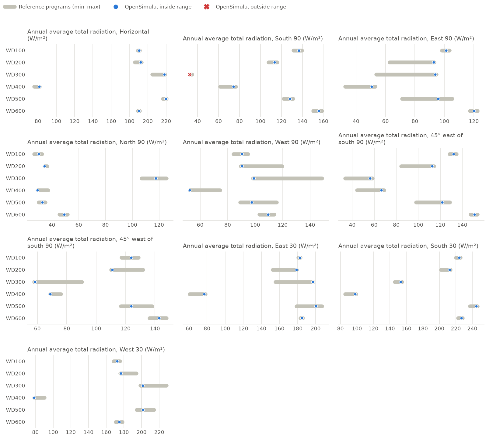

#### Annual average total radiation, Horizontal (W/m²)

| Case | OpenSimula | Min | Max | Programs | Result |
|---|--:|--:|--:|--:|---|
| WD100 | 190.441 | 189.107 | 191.061 | 9 | ✓ inside |
| WD200 | 192.220 | 185.921 | 193.085 | 9 | ✓ inside |
| WD300 | 217.968 | 204.895 | 218.775 | 9 | ✓ inside |
| WD400 | 81.248 | 75.595 | 81.590 | 9 | ✓ inside |
| WD500 | 219.890 | 216.286 | 220.329 | 9 | ✓ inside |
| WD600 | 190.441 | 189.108 | 191.061 | 9 | ✓ inside |

#### Annual average total radiation, South 90 (W/m²)

| Case | OpenSimula | Min | Max | Programs | Result |
|---|--:|--:|--:|--:|---|
| WD100 | 136.494 | 131.378 | 139.572 | 8 | ✓ inside |
| WD200 | 113.417 | 107.565 | 116.041 | 8 | ✓ inside |
| WD300 | 32.263 | 32.303 | 34.770 | 8 | ✗ -0.1 % below min |
| WD400 | 74.122 | 61.450 | 76.589 | 8 | ✓ inside |
| WD500 | 128.130 | 122.227 | 131.088 | 8 | ✓ inside |
| WD600 | 155.561 | 150.358 | 158.641 | 8 | ✓ inside |

#### Annual average total radiation, East 90 (W/m²)

| Case | OpenSimula | Min | Max | Programs | Result |
|---|--:|--:|--:|--:|---|
| WD100 | 101.140 | 98.269 | 103.569 | 8 | ✓ inside |
| WD200 | 92.838 | 62.845 | 93.159 | 8 | ✓ inside |
| WD300 | 93.797 | 53.736 | 94.568 | 8 | ✓ inside |
| WD400 | 50.624 | 32.499 | 53.011 | 8 | ✓ inside |
| WD500 | 95.944 | 71.286 | 105.438 | 8 | ✓ inside |
| WD600 | 120.206 | 117.249 | 122.478 | 8 | ✓ inside |

#### Annual average total radiation, North 90 (W/m²)

| Case | OpenSimula | Min | Max | Programs | Result |
|---|--:|--:|--:|--:|---|
| WD100 | 30.128 | 26.577 | 32.703 | 8 | ✓ inside |
| WD200 | 34.442 | 34.330 | 36.403 | 8 | ✓ inside |
| WD300 | 117.625 | 107.036 | 125.510 | 8 | ✓ inside |
| WD400 | 29.158 | 29.112 | 37.122 | 8 | ✓ inside |
| WD500 | 32.828 | 30.077 | 35.129 | 8 | ✓ inside |
| WD600 | 49.195 | 45.557 | 51.782 | 8 | ✓ inside |

#### Annual average total radiation, West 90 (W/m²)

| Case | OpenSimula | Min | Max | Programs | Result |
|---|--:|--:|--:|--:|---|
| WD100 | 90.401 | 84.121 | 94.846 | 8 | ✓ inside |
| WD200 | 90.491 | 89.549 | 119.586 | 8 | ✓ inside |
| WD300 | 98.992 | 98.397 | 148.576 | 8 | ✓ inside |
| WD400 | 52.405 | 52.223 | 74.461 | 8 | ✓ inside |
| WD500 | 97.521 | 88.988 | 115.691 | 8 | ✓ inside |
| WD600 | 109.467 | 103.102 | 113.927 | 8 | ✓ inside |

#### Annual average total radiation, 45° east of south 90 (W/m²)

| Case | OpenSimula | Min | Max | Programs | Result |
|---|--:|--:|--:|--:|---|
| WD100 | 131.957 | 128.340 | 134.788 | 8 | ✓ inside |
| WD200 | 112.687 | 84.489 | 114.212 | 8 | ✓ inside |
| WD300 | 56.316 | 33.411 | 58.379 | 8 | ✓ inside |
| WD400 | 66.356 | 44.388 | 68.780 | 8 | ✓ inside |
| WD500 | 121.756 | 97.853 | 128.706 | 8 | ✓ inside |
| WD600 | 151.024 | 147.320 | 153.737 | 8 | ✓ inside |

#### Annual average total radiation, 45° west of south 90 (W/m²)

| Case | OpenSimula | Min | Max | Programs | Result |
|---|--:|--:|--:|--:|---|
| WD100 | 123.732 | 117.248 | 128.717 | 8 | ✓ inside |
| WD200 | 110.911 | 110.103 | 131.824 | 8 | ✓ inside |
| WD300 | 58.331 | 57.666 | 90.291 | 8 | ✓ inside |
| WD400 | 68.640 | 68.675 | 75.954 | 8 | ✓ inside |
| WD500 | 123.850 | 116.692 | 138.026 | 8 | ✓ inside |
| WD600 | 142.799 | 136.228 | 147.792 | 8 | ✓ inside |

#### Annual average total radiation, East 30 (W/m²)

| Case | OpenSimula | Min | Max | Programs | Result |
|---|--:|--:|--:|--:|---|
| WD100 | 182.300 | 180.640 | 183.128 | 8 | ✓ inside |
| WD200 | 178.922 | 152.525 | 179.082 | 8 | ✓ inside |
| WD300 | 196.751 | 155.616 | 197.370 | 8 | ✓ inside |
| WD400 | 77.007 | 60.565 | 78.038 | 8 | ✓ inside |
| WD500 | 200.302 | 178.918 | 206.937 | 8 | ✓ inside |
| WD600 | 184.854 | 183.183 | 185.688 | 8 | ✓ inside |

#### Annual average total radiation, South 30 (W/m²)

| Case | OpenSimula | Min | Max | Programs | Result |
|---|--:|--:|--:|--:|---|
| WD100 | 224.119 | 220.135 | 225.679 | 8 | ✓ inside |
| WD200 | 212.267 | 201.884 | 213.347 | 8 | ✓ inside |
| WD300 | 152.918 | 145.795 | 154.718 | 8 | ✓ inside |
| WD400 | 97.796 | 85.517 | 98.797 | 8 | ✓ inside |
| WD500 | 244.856 | 237.099 | 246.191 | 8 | ✓ inside |
| WD600 | 226.674 | 222.678 | 228.238 | 8 | ✓ inside |

#### Annual average total radiation, West 30 (W/m²)

| Case | OpenSimula | Min | Max | Programs | Result |
|---|--:|--:|--:|--:|---|
| WD100 | 172.442 | 168.162 | 175.570 | 8 | ✓ inside |
| WD200 | 176.691 | 175.722 | 194.021 | 8 | ✓ inside |
| WD300 | 201.362 | 198.699 | 228.087 | 8 | ✓ inside |
| WD400 | 78.618 | 78.340 | 90.153 | 8 | ✓ inside |
| WD500 | 201.636 | 194.401 | 213.917 | 8 | ✓ inside |
| WD600 | 174.996 | 170.705 | 178.126 | 8 | ✓ inside |

### Beam solar radiation

| Output | Values | Inside range | Outside range |
|---|--:|--:|--:|
| Annual average beam radiation, Horizontal (W/m²) | 6 | 6 | 0 |
| Annual average beam radiation, South 90 (W/m²) | 6 | 6 | 0 |
| Annual average beam radiation, East 90 (W/m²) | 6 | 5 | 1 |
| Annual average beam radiation, North 90 (W/m²) | 6 | 5 | 1 |
| Annual average beam radiation, West 90 (W/m²) | 6 | 6 | 0 |
| Annual average beam radiation, 45° east of south 90 (W/m²) | 6 | 6 | 0 |
| Annual average beam radiation, 45° west of south 90 (W/m²) | 6 | 6 | 0 |
| Annual average beam radiation, East 30 (W/m²) | 6 | 6 | 0 |
| Annual average beam radiation, South 30 (W/m²) | 6 | 6 | 0 |
| Annual average beam radiation, West 30 (W/m²) | 6 | 6 | 0 |

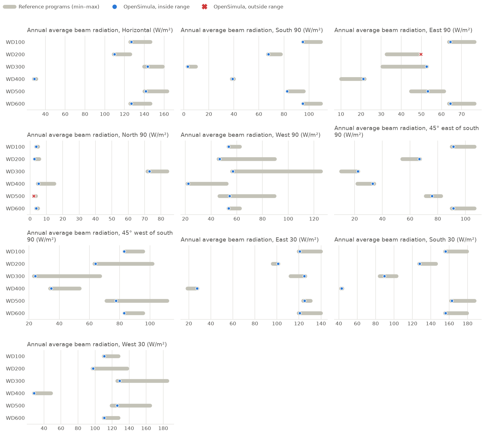

#### Annual average beam radiation, Horizontal (W/m²)

| Case | OpenSimula | Min | Max | Programs | Result |
|---|--:|--:|--:|--:|---|
| WD100 | 126.988 | 125.668 | 146.145 | 8 | ✓ inside |
| WD200 | 109.963 | 108.783 | 125.531 | 8 | ✓ inside |
| WD300 | 143.374 | 139.671 | 158.468 | 8 | ✓ inside |
| WD400 | 28.621 | 28.146 | 30.735 | 8 | ✓ inside |
| WD500 | 141.580 | 139.892 | 163.225 | 8 | ✓ inside |
| WD600 | 126.988 | 125.668 | 146.145 | 8 | ✓ inside |

#### Annual average beam radiation, South 90 (W/m²)

| Case | OpenSimula | Min | Max | Programs | Result |
|---|--:|--:|--:|--:|---|
| WD100 | 95.150 | 94.942 | 109.548 | 8 | ✓ inside |
| WD200 | 67.617 | 67.050 | 77.370 | 8 | ✓ inside |
| WD300 | 2.999 | 2.832 | 9.566 | 8 | ✓ inside |
| WD400 | 38.906 | 38.230 | 40.017 | 8 | ✓ inside |
| WD500 | 82.627 | 82.442 | 95.696 | 8 | ✓ inside |
| WD600 | 95.150 | 94.942 | 109.548 | 8 | ✓ inside |

#### Annual average beam radiation, East 90 (W/m²)

| Case | OpenSimula | Min | Max | Programs | Result |
|---|--:|--:|--:|--:|---|
| WD100 | 64.370 | 63.651 | 76.440 | 8 | ✓ inside |
| WD200 | 49.794 | 32.650 | 49.371 | 8 | ✗ +0.9 % above max |
| WD300 | 52.640 | 30.523 | 52.786 | 8 | ✓ inside |
| WD400 | 21.181 | 10.069 | 21.705 | 8 | ✓ inside |
| WD500 | 53.229 | 44.755 | 61.269 | 8 | ✓ inside |
| WD600 | 64.370 | 63.651 | 76.440 | 8 | ✓ inside |

#### Annual average beam radiation, North 90 (W/m²)

| Case | OpenSimula | Min | Max | Programs | Result |
|---|--:|--:|--:|--:|---|
| WD100 | 3.786 | 3.619 | 4.748 | 8 | ✓ inside |
| WD200 | 2.620 | 2.556 | 5.592 | 8 | ✓ inside |
| WD300 | 72.841 | 71.567 | 83.823 | 8 | ✓ inside |
| WD400 | 5.275 | 4.657 | 14.692 | 8 | ✓ inside |
| WD500 | 2.230 | 2.272 | 3.547 | 8 | ✗ -1.9 % below min |
| WD600 | 3.786 | 3.619 | 4.748 | 8 | ✓ inside |

#### Annual average beam radiation, West 90 (W/m²)

| Case | OpenSimula | Min | Max | Programs | Result |
|---|--:|--:|--:|--:|---|
| WD100 | 53.693 | 53.450 | 62.292 | 8 | ✓ inside |
| WD200 | 46.580 | 45.769 | 89.391 | 8 | ✓ inside |
| WD300 | 57.014 | 56.262 | 125.363 | 8 | ✓ inside |
| WD400 | 22.352 | 21.616 | 52.031 | 8 | ✓ inside |
| WD500 | 54.292 | 46.510 | 89.160 | 8 | ✓ inside |
| WD600 | 53.693 | 53.450 | 62.292 | 8 | ✓ inside |

#### Annual average beam radiation, 45° east of south 90 (W/m²)

| Case | OpenSimula | Min | Max | Programs | Result |
|---|--:|--:|--:|--:|---|
| WD100 | 91.215 | 89.995 | 106.511 | 8 | ✓ inside |
| WD200 | 66.745 | 54.294 | 67.014 | 8 | ✓ inside |
| WD300 | 22.280 | 10.198 | 22.581 | 8 | ✓ inside |
| WD400 | 33.026 | 21.958 | 34.016 | 8 | ✓ inside |
| WD500 | 75.894 | 71.323 | 82.221 | 8 | ✓ inside |
| WD600 | 91.215 | 89.995 | 106.511 | 8 | ✓ inside |

#### Annual average beam radiation, 45° west of south 90 (W/m²)

| Case | OpenSimula | Min | Max | Programs | Result |
|---|--:|--:|--:|--:|---|
| WD100 | 82.983 | 82.936 | 95.418 | 8 | ✓ inside |
| WD200 | 63.940 | 63.197 | 101.629 | 8 | ✓ inside |
| WD300 | 24.044 | 23.114 | 67.078 | 8 | ✓ inside |
| WD400 | 34.676 | 33.941 | 53.524 | 8 | ✓ inside |
| WD500 | 77.473 | 71.080 | 111.496 | 8 | ✓ inside |
| WD600 | 82.983 | 82.936 | 95.418 | 8 | ✓ inside |

#### Annual average beam radiation, East 30 (W/m²)

| Case | OpenSimula | Min | Max | Programs | Result |
|---|--:|--:|--:|--:|---|
| WD100 | 120.607 | 119.631 | 139.906 | 8 | ✓ inside |
| WD200 | 100.904 | 96.181 | 101.167 | 8 | ✓ inside |
| WD300 | 124.927 | 112.299 | 125.501 | 8 | ✓ inside |
| WD400 | 27.392 | 18.710 | 27.833 | 8 | ✓ inside |
| WD500 | 124.957 | 123.834 | 130.534 | 8 | ✓ inside |
| WD600 | 120.607 | 119.631 | 139.906 | 8 | ✓ inside |

#### Annual average beam radiation, South 30 (W/m²)

| Case | OpenSimula | Min | Max | Programs | Result |
|---|--:|--:|--:|--:|---|
| WD100 | 156.079 | 155.335 | 179.401 | 8 | ✓ inside |
| WD200 | 127.966 | 127.053 | 145.539 | 8 | ✓ inside |
| WD300 | 89.477 | 84.181 | 102.479 | 8 | ✓ inside |
| WD400 | 42.936 | 42.398 | 43.662 | 8 | ✓ inside |
| WD500 | 162.942 | 161.842 | 187.592 | 8 | ✓ inside |
| WD600 | 156.079 | 155.335 | 179.401 | 8 | ✓ inside |

#### Annual average beam radiation, West 30 (W/m²)

| Case | OpenSimula | Min | Max | Programs | Result |
|---|--:|--:|--:|--:|---|
| WD100 | 110.781 | 110.235 | 127.428 | 8 | ✓ inside |
| WD200 | 97.830 | 96.845 | 137.676 | 8 | ✓ inside |
| WD300 | 128.811 | 125.847 | 184.770 | 8 | ✓ inside |
| WD400 | 28.477 | 27.986 | 48.297 | 8 | ✓ inside |
| WD500 | 125.828 | 119.167 | 164.410 | 8 | ✓ inside |
| WD600 | 110.781 | 110.235 | 127.428 | 8 | ✓ inside |

### Diffuse solar radiation

| Output | Values | Inside range | Outside range |
|---|--:|--:|--:|
| Annual average diffuse radiation, Horizontal (W/m²) | 6 | 6 | 0 |
| Annual average diffuse radiation, South 90 (W/m²) | 6 | 6 | 0 |
| Annual average diffuse radiation, East 90 (W/m²) | 6 | 6 | 0 |
| Annual average diffuse radiation, North 90 (W/m²) | 6 | 6 | 0 |
| Annual average diffuse radiation, West 90 (W/m²) | 6 | 6 | 0 |
| Annual average diffuse radiation, 45° east of south 90 (W/m²) | 6 | 6 | 0 |
| Annual average diffuse radiation, 45° west of south 90 (W/m²) | 6 | 6 | 0 |
| Annual average diffuse radiation, East 30 (W/m²) | 6 | 6 | 0 |
| Annual average diffuse radiation, South 30 (W/m²) | 6 | 6 | 0 |
| Annual average diffuse radiation, West 30 (W/m²) | 6 | 6 | 0 |

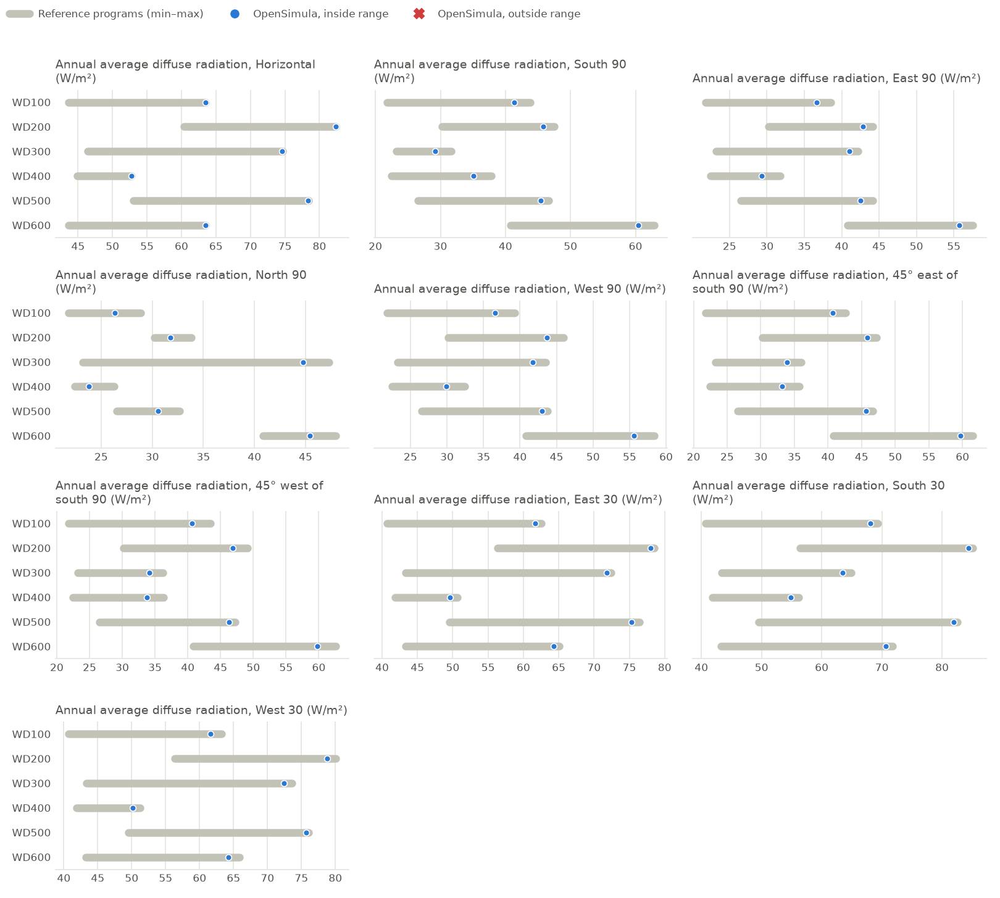

#### Annual average diffuse radiation, Horizontal (W/m²)

| Case | OpenSimula | Min | Max | Programs | Result |
|---|--:|--:|--:|--:|---|
| WD100 | 63.453 | 43.659 | 63.529 | 9 | ✓ inside |
| WD200 | 82.257 | 60.390 | 82.360 | 9 | ✓ inside |
| WD300 | 74.594 | 46.427 | 74.706 | 9 | ✓ inside |
| WD400 | 52.627 | 44.860 | 52.706 | 9 | ✓ inside |
| WD500 | 78.310 | 53.061 | 78.420 | 9 | ✓ inside |
| WD600 | 63.453 | 43.659 | 63.529 | 9 | ✓ inside |

#### Annual average diffuse radiation, South 90 (W/m²)

| Case | OpenSimula | Min | Max | Programs | Result |
|---|--:|--:|--:|--:|---|
| WD100 | 41.344 | 21.829 | 43.800 | 8 | ✓ inside |
| WD200 | 45.800 | 30.195 | 47.554 | 8 | ✓ inside |
| WD300 | 29.265 | 23.213 | 31.675 | 8 | ✓ inside |
| WD400 | 35.216 | 22.430 | 37.811 | 8 | ✓ inside |
| WD500 | 45.503 | 26.530 | 46.660 | 8 | ✓ inside |
| WD600 | 60.410 | 40.810 | 62.877 | 8 | ✓ inside |

#### Annual average diffuse radiation, East 90 (W/m²)

| Case | OpenSimula | Min | Max | Programs | Result |
|---|--:|--:|--:|--:|---|
| WD100 | 36.770 | 21.829 | 38.515 | 8 | ✓ inside |
| WD200 | 43.044 | 30.195 | 44.167 | 8 | ✓ inside |
| WD300 | 41.157 | 23.213 | 42.155 | 8 | ✓ inside |
| WD400 | 29.443 | 22.430 | 31.777 | 8 | ✓ inside |
| WD500 | 42.715 | 26.530 | 44.170 | 8 | ✓ inside |
| WD600 | 55.836 | 40.810 | 57.533 | 8 | ✓ inside |

#### Annual average diffuse radiation, North 90 (W/m²)

| Case | OpenSimula | Min | Max | Programs | Result |
|---|--:|--:|--:|--:|---|
| WD100 | 26.342 | 21.829 | 28.870 | 8 | ✓ inside |
| WD200 | 31.822 | 30.195 | 33.806 | 8 | ✓ inside |
| WD300 | 44.784 | 23.213 | 47.264 | 8 | ✓ inside |
| WD400 | 23.884 | 22.430 | 26.274 | 8 | ✓ inside |
| WD500 | 30.598 | 26.530 | 32.654 | 8 | ✓ inside |
| WD600 | 45.408 | 40.810 | 47.947 | 8 | ✓ inside |

#### Annual average diffuse radiation, West 90 (W/m²)

| Case | OpenSimula | Min | Max | Programs | Result |
|---|--:|--:|--:|--:|---|
| WD100 | 36.708 | 21.829 | 39.297 | 8 | ✓ inside |
| WD200 | 43.911 | 30.195 | 45.968 | 8 | ✓ inside |
| WD300 | 41.978 | 23.213 | 43.476 | 8 | ✓ inside |
| WD400 | 30.052 | 22.430 | 32.445 | 8 | ✓ inside |
| WD500 | 43.229 | 26.530 | 43.775 | 8 | ✓ inside |
| WD600 | 55.774 | 40.810 | 58.374 | 8 | ✓ inside |

#### Annual average diffuse radiation, 45° east of south 90 (W/m²)

| Case | OpenSimula | Min | Max | Programs | Result |
|---|--:|--:|--:|--:|---|
| WD100 | 40.742 | 21.829 | 42.606 | 8 | ✓ inside |
| WD200 | 45.942 | 30.195 | 47.198 | 8 | ✓ inside |
| WD300 | 34.036 | 23.213 | 36.042 | 8 | ✓ inside |
| WD400 | 33.330 | 22.430 | 35.736 | 8 | ✓ inside |
| WD500 | 45.862 | 26.530 | 46.632 | 8 | ✓ inside |
| WD600 | 59.808 | 40.810 | 61.525 | 8 | ✓ inside |

#### Annual average diffuse radiation, 45° west of south 90 (W/m²)

| Case | OpenSimula | Min | Max | Programs | Result |
|---|--:|--:|--:|--:|---|
| WD100 | 40.749 | 21.829 | 43.507 | 8 | ✓ inside |
| WD200 | 46.971 | 30.195 | 49.134 | 8 | ✓ inside |
| WD300 | 34.287 | 23.213 | 36.201 | 8 | ✓ inside |
| WD400 | 33.964 | 22.430 | 36.341 | 8 | ✓ inside |
| WD500 | 46.376 | 26.530 | 47.215 | 8 | ✓ inside |
| WD600 | 59.815 | 40.810 | 62.580 | 8 | ✓ inside |

#### Annual average diffuse radiation, East 30 (W/m²)

| Case | OpenSimula | Min | Max | Programs | Result |
|---|--:|--:|--:|--:|---|
| WD100 | 61.693 | 40.734 | 62.566 | 8 | ✓ inside |
| WD200 | 78.019 | 56.345 | 78.519 | 8 | ✓ inside |
| WD300 | 71.824 | 43.317 | 72.391 | 8 | ✓ inside |
| WD400 | 49.615 | 41.855 | 50.642 | 8 | ✓ inside |
| WD500 | 75.345 | 49.507 | 76.404 | 8 | ✓ inside |
| WD600 | 64.247 | 43.277 | 65.100 | 8 | ✓ inside |

#### Annual average diffuse radiation, South 30 (W/m²)

| Case | OpenSimula | Min | Max | Programs | Result |
|---|--:|--:|--:|--:|---|
| WD100 | 68.040 | 40.734 | 69.265 | 8 | ✓ inside |
| WD200 | 84.301 | 56.345 | 85.104 | 8 | ✓ inside |
| WD300 | 63.441 | 43.317 | 64.916 | 8 | ✓ inside |
| WD400 | 54.860 | 41.855 | 56.153 | 8 | ✓ inside |
| WD500 | 81.914 | 49.507 | 82.546 | 8 | ✓ inside |
| WD600 | 70.595 | 43.277 | 71.820 | 8 | ✓ inside |

#### Annual average diffuse radiation, West 30 (W/m²)

| Case | OpenSimula | Min | Max | Programs | Result |
|---|--:|--:|--:|--:|---|
| WD100 | 61.661 | 40.734 | 63.280 | 8 | ✓ inside |
| WD200 | 78.861 | 56.345 | 80.048 | 8 | ✓ inside |
| WD300 | 72.551 | 43.317 | 73.645 | 8 | ✓ inside |
| WD400 | 50.141 | 41.855 | 51.233 | 8 | ✓ inside |
| WD500 | 75.808 | 49.507 | 76.082 | 8 | ✓ inside |
| WD600 | 64.215 | 43.277 | 65.839 | 8 | ✓ inside |
